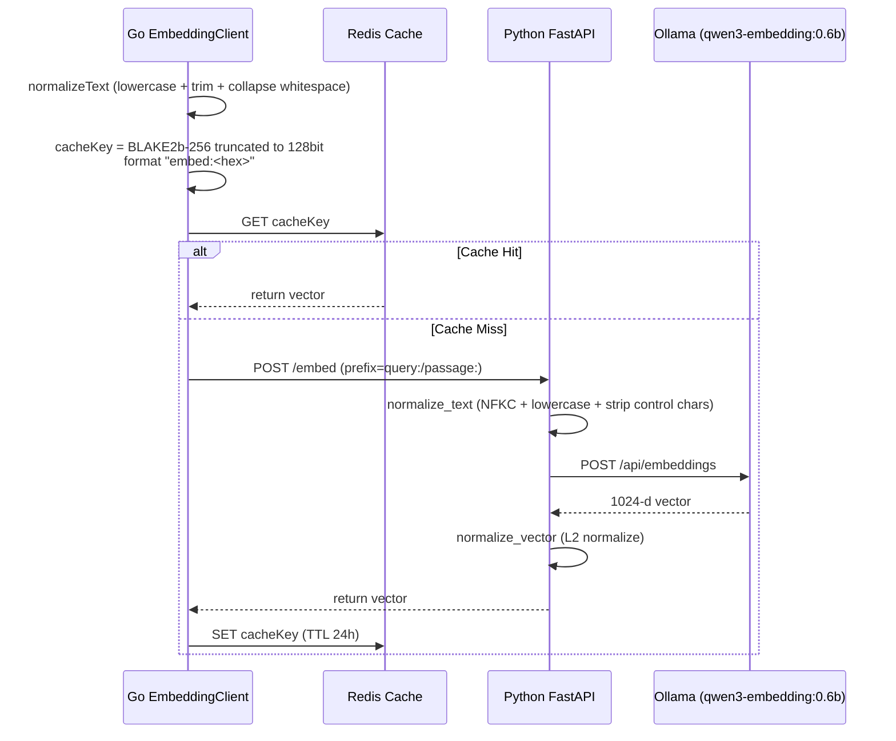
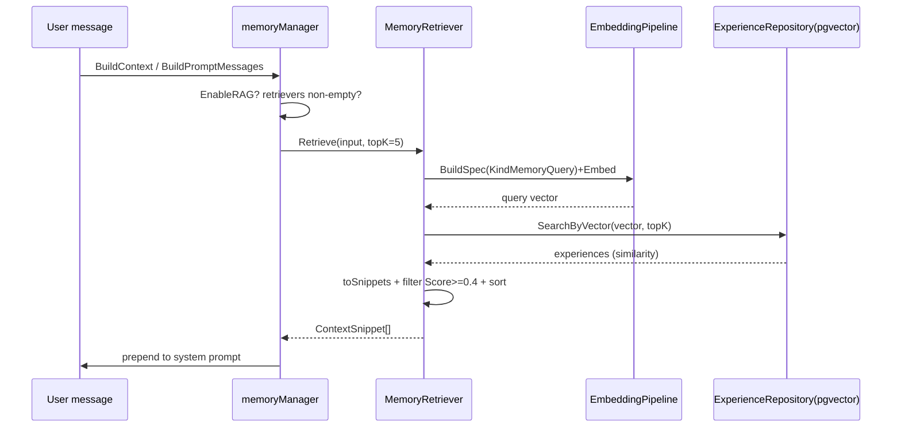

# ares Architecture Deep Dive (X): Retrieval System — Vector / Keyword / FTS in Practice, and Its Honest Limits (0.3.x)

> The agent says: "Based on your past experience, I suggest..." — but the suggestion is completely irrelevant.
> Even worse: the agent solved this exact problem before, but now it's starting from scratch.
> I realized back then: an agent's memory isn't about whether it has memory — it's about whether it can retrieve the right one.
> An agent without retrieval is a goldfish: 7-second memory, forever reinventing the wheel.

> Note: this article is based on real code (the hybrid scoring in `internal/knowledge/hybrid.go` and its `knowledge/store/postgres` `HybridSearch`, the vector/keyword repository layer under `internal/storage/postgres/repositories`, the RAG recall in `internal/runtime/memory/context/memory_retriever.go`, the experience ranking in `internal/runtime/memory/experience/ranking_service.go`, and FTS5/keyword search in `internal/runtime/protocol/skills`). Every symbol and every flow below is something I actually read in this codebase. Anything that is "configured but not actually wired" or that I'm not sure about is marked （待核实） — I won't oversell it.
>
> **Revised 2026-10-16**: this article's conclusion had to be corrected twice; §2 now states the settled facts, and the
> old line-by-line walkthrough of the "hybrid retrieval service" under `internal/storage/postgres/services` (§6) was
> **replaced wholesale** — that package was **never constructed in production** and has been deleted as
> zero-reference dead code (~8.4k lines, preserved in git history). Everything in the body that concerned that
> package was rewritten against the current code, rather than papered over with a "deprecated" banner.

---

## 1. First, Why Retrieval Determines Agent IQ

There's a brutal truth about building agents: **No matter how powerful the model, if you feed it the wrong context, the output is garbage.**

No matter how capable the model is, if I feed it wrong documents, irrelevant experience, or outdated knowledge, the output is something that sounds reasonable but is actually nonsense. That's worse than saying "I don't know" — because the user will trust it.

Retrieval has a plain goal: pull genuinely useful context into the LLM at the right time, from the right place, with the right weights. The hard part is defining and ordering what "relevant" means — semantically relevant, literally relevant, or "previously proven to solve this problem"? Different data calls for different answers. ares' approach is not "vector database for everything": it splits data by type and lets each use the retrieval it's good at. This article makes clear what is actually running and what isn't.

---

## 2. Off the Bat: What Retrieval Path Actually Runs at Runtime? (Settled After Two Corrections)

This conclusion has been corrected twice. Here is the settled, verifiable version:

- **Version 1 claimed**: "`RetrievalService` is written but never wired (`advancedRetrieval` is forever nil in the API layer); what runs is the pure-vector `SimpleRetrievalService`."
- **Version 2 claimed**: "Backwards — the one wired into production is `RetrievalService`, and `SimpleRetrievalService` has no callers."
- **Re-verified 2026-10-16: version 2 is wrong too, and both types have now been deleted.** Three findings, each reproducible:

  1. **`ProductionMemoryManager` lost that persistence/retrieval path long ago.** It is now a **config-only store** (`GetConfig` / `Lock` / `Unlock`, consumed by the evolution `MemoryPatchExecutor`), and its own file comment states that the former PostgreSQL-backed implementation (sessions / tasks / **RAG retrieval** / write buffer) **"had zero production constructors"** and was removed together with `postgres.WriteBuffer`. So version 2's "`production_manager.go` constructs it via `NewRetrievalService(...)`" **has no corresponding code** — that file contains no `New…(` call at all.
  2. **`SearchSimilarTasks` is not a `ProductionMemoryManager` method.** It lives on `memoryManager` in `manager_impl.go` and does its **own** vector search (`BuildMemoryQuerySpec` + the distillation pipeline's `Embed` + an experience-repo query) — **no `RetrievalService` anywhere in it**.
  3. **The only references to `internal/storage/postgres/services` left in the tree were the example** (`examples/_internal/11-knowledge-import`), and the package was **deleted wholesale on 2026-10-16** (zero-reference dead code, ~8.4k lines; it lives on in git history). `RetrievalService` was not even used by that example. The example itself now goes through the production path, `KnowledgeRepository.SearchByVector`.
  4. One half of version 1 was right and stays: **`api/retrieval/service.go` does not exist** (the `api/` packages were removed in 0.3.2 as deprecated forwarding layers). But "both services live under `internal/storage/postgres/services/`" is now stale — **that package no longer exists**.

### 2.1 The retrieval paths that actually run today (each one verified)

| Path | Entry | Data | Method | Status |
|------|-------|------|--------|--------|
| Knowledge hybrid search (AKG) | `knowledge/store/postgres`'s `HybridSearch` → `ScoreHybrid` in `internal/knowledge/hybrid.go` | AKG-distilled facts (`akf_objects`) | 0.7 vector + 0.3 lexical (weights are **relative**, renormalised over the available terms), sorted by `FinalScore`; recall window `ORDER BY updated_at DESC` | ✅ wired (via `KnowledgeRetriever`) |
| Knowledge-chunk vector recall | `KnowledgeRepository.SearchByVector` | `knowledge_chunks_1024` | pgvector cosine + `embedding_status='completed'` filter; index knobs applied inside a transaction (see §6.3) | ✅ wired (RAG / tool paths) |
| RAG experience recall | `MemoryRetriever.Retrieve` (via `manager_rag.go`'s `runRetrieval`) | distilled experiences | vector + `minScore` filter | ✅ wired when `EnableRAG=true` |
| Keyword, knowledge side | `KnowledgeRepository.SearchByKeyword` | `knowledge_chunks_1024.tsv` | PostgreSQL FTS: `ts_rank(tsv, plainto_tsquery('simple',$1))` | ⚠️ method present, **no callers right now** |
| Keyword, experience side | `ExperienceRepository.SearchByKeyword` | `experiences_1024` | ILIKE substring (not BM25) | ✅ wired (distillation path) |

> **Two capabilities that existed, never took effect, and went away with the dead code — recorded so they are not mistaken for regressions later**:
> ① the knowledge-chunk side's **BM25/tsvector wide lexical recall + fusion with the vector score** (the deleted
> package's `bm25Search*`). This is not "losing something that ran": the production entry point was never
> constructed. What still exists is the schema-level tsvector trigger / GIN index and `SearchByKeyword` — so
> restoring it is a wiring job, not a rebuild.
> ② `RankingService` (the additive multi-signal experience rerank, §7.1) **still exists but has no production
> caller** — its only caller was the deleted package's `applyExperienceRanking` (and re-verification shows it had
> no other caller even before the deletion).
>
> **Components still not constructed by any production path**: `RetrievalGuard` (§9) — its three protections are
> implemented, but nothing builds one.

---

## 3. The Embedding Pipeline: Text → 1024-D Vector

Whatever the retrieval path, the first step is turning text into a vector. ares is a three-layer chain: Go (`internal/storage/postgres/embedding`) → Python FastAPI (`services/embedding/app.py`) → Ollama (`qwen3-embedding:0.6b`).

Model & dimensions (`services/embedding/app.py`):
- `OLLAMA_MODEL = "qwen3-embedding:0.6b"` (overridable via env)
- `EMBEDDING_DIM = 1024`
- `MAX_LENGTH = 512` (truncated after prefixing)
- `CACHE_TTL = 86400` (24 hours)



Key points, all verified:

**1. Two-layer text normalization.** The Go side `EmbeddingClient.normalizeText` does lower + trim + collapses runs of whitespace to a single space; the Python side `normalize_text` first does `unicodedata.normalize('NFKC')`, then lowercase, strip, `re.sub(r'\s+',' ')`, and drops control chars. Why two layers? Because `strings.ToLower` (Go) and `str.lower()` (Python) differ on some Unicode characters, and dual-layer normalization cuts cache-miss explosions (`client.go` comment: "avoid cache miss explosion").

**2. The cache key.** Go's `getCacheKey` uses `blake2b.Sum256` truncated to the first 16 bytes (128 bits), prefixed `embed:`, built from `normalizedText|model|prefix`. Note: it is **not** a "BLAKE2b-128" algorithm — it is BLAKE2b-256 with the first 16 bytes kept. The Python side does not share this key scheme (it uses `sha256`), so the Go and Python caches are independent.

**3. Prefix.** Search queries use the `query:` prefix, document/experience storage uses `passage:` (`client.go`: `Embed` defaults to `query:`; `EmbedWithPrefix` passes explicitly). This is the common e5-style trick that keeps queries and passages in the same direction. （待核实: which exact prefix the `experiences_1024` write path uses is decided by the distillation chain; I did not trace every hop to the app side.)

**4. L2 normalization.** The Python side `normalize_vector` divides by `np.linalg.norm` to make the vector unit-length — the comment notes "Ollama does not guarantee returned vectors are unit vectors". This makes cosine distance meaningful downstream.

**5. Redis-first caching.** `EmbeddingClient.redis` is optional (nil means skip the cache and call the service directly). There is also an `EmbeddingCache`/`MemoryCache` (`cache.go`) with in-process memory fallback and a periodic cleanup goroutine, **but the production wiring uses `NewEmbeddingClient` talking to Redis directly** （待核实: I did not see `EmbeddingCache` injected in `production_manager`; it may or may not be attached in some boot).

---

## 4. Vector Retrieval (the one that actually runs): pgvector + IVFFlat Cosine

Vector retrieval does not query a standalone vector DB — it uses the **pgvector extension with tables in the same PostgreSQL**.

Tables (`migrate_storage.go`):
- `knowledge_chunks_1024` — knowledge chunks
- `experiences_1024` — distilled experiences (the `embedding` column is **nullable**, backfilled by an async worker)

Indexes are IVFFlat (`vector_cosine_ops`): `idx_knowledge_1024_embedding`, `idx_experiences_1024_embedding`. These are approximate, bucket-based (`lists`) cosine indexes.

The actual query (`repositories/experience_repository.go` `SearchByVector`):

```sql
SELECT id, tenant_id, type, input, output,
       1 - (embedding <=> $1::vector) as similarity
FROM experiences_1024
WHERE tenant_id = $2
  AND (decay_at IS NULL OR decay_at > NOW())
  AND embedding IS NOT NULL
ORDER BY embedding <=> $1::vector
LIMIT $3
```

- `embedding <=> $1::vector` is **cosine distance**, in [0,2]; `1 - distance` yields **similarity ∈ [-1,1]** (per the code comment). The default `Score` is just a passthrough of this similarity.
- Explicit `embedding IS NOT NULL`: the column is nullable and IVFFlat does not index NULL, so this filters out not-yet-backfilled rows before the scan.
- Expired `decay_at` rows never appear.
- **In RAG, each snippet's `Score` comes from distillation confidence** (`MemoryRetriever.toSnippets`: `scoreutil.ClampUnit(exp.Confidence)` clamped to [0,1]) — not the SQL similarity above. These are two different score semantics.

`knowledge_repository.go`'s `SearchByVector` likewise uses `1 - (embedding <=> $1::vector)`, and only searches rows with `embedding_status='completed'`.

---

## 5. Keyword Retrieval: PostgreSQL FTS, Not BM25

The old article hyped the keyword side as "BM25". **In the code there is no BM25.** On the knowledge side, keyword search is PostgreSQL full-text search using `ts_rank + plainto_tsquery('simple', ...)` (`knowledge_repository.go` `SearchByKeyword`), over the `tsv` column maintained by the `tsvector_update_knowledge_1024` trigger:

```sql
SELECT ..., ts_rank(tsv, plainto_tsquery('simple', $1)) as score
FROM knowledge_chunks_1024
WHERE tsv @@ plainto_tsquery('simple', $1)
  AND tenant_id = $2 AND embedding_status = 'completed'
ORDER BY ts_rank(...) DESC
LIMIT $3
```

On the experience side it is even simpler — `experiences_1024`'s `SearchByKeyword` uses **ILIKE substring matching** (with escaping), ordered by `score DESC, created_at DESC`. So experience keyword search is really "substring hit + sort by existing score", not BM25.

> Bottom line: **the keyword layer = PostgreSQL FTS (knowledge) + ILIKE substring (experience)**. Wherever the old text says BM25, that was stale comment language, not the current implementation. I'll phrase it as "keyword / full-text" from here on.

---

## 6. How Hybrid Retrieval Actually Scores in Production: Wide Recall → Weighted → Sorted

> **This section was replaced wholesale.** The old version walked line by line through `RetrievalService`'s
> `buildQueries` / `rerankResults` / `TimeDecay` / precision mode / query rewriting — an implementation that was
> **never constructed in production** and was deleted on 2026-10-16 along with the zero-reference package (it
> lives on in git history). What follows is the algorithm of the two searches that actually execute, each of
> which you can follow in the code.

### 6.1 Knowledge hybrid search (AKG / `akf_objects`)

`internal/knowledge/store/postgres`'s `HybridSearch` → `ScoreHybrid` in `internal/knowledge/hybrid.go`:

```
FinalScore = blend(Vector×0.7, Lexical×0.3, Recency×w)   // relative weights, renormalised over available terms
```

- **Recall width**: the SQL takes a candidate window with `ORDER BY updated_at DESC LIMIT k`
  (`k = max(TopK, FinalK, cap)`) — **recency is a window bias**, not a sort term.
- **Scoring**: vector term = cosine similarity; lexical term = **Jaccard over token sets**
  (**length-normalised**, and **CJK-aware via bigrams**, so Chinese text is no longer one giant token);
  freshness term = a tiered rule (`FreshnessScore`: <1d=1.0 / <7d=0.8 / <30d=0.5 / older=0.3, and a
  **zero timestamp scores the neutral 0.5 — not the oldest tier**).
- **Renormalised over available terms**: a candidate with no embedding is **not** damped toward zero; it is
  scored on what could be measured, so unembedded rows stay retrievable.
- **Recency weight defaults to 0** (`knowledge.recency_weight`): the window already orders by `updated_at`, so a
  recency term double-counts the same signal; whether the second helping pays off is a per-corpus measurement,
  so the default does not change ranking and the knob is the operator's.
- **Ordering**: filter by `MinScore` → sort by `FinalScore` descending → truncate to `FinalK`.
- **Diagnostics**: a vector-dimension mismatch (embedding model changed) logs one warning per call, and each
  result carries `VectorScore / LexicalScore / RecencyScore / FinalScore` so "why is this first?" is answerable.

### 6.2 Knowledge-chunk vector recall (`knowledge_chunks_1024` / `KnowledgeRepository.SearchByVector`)

- **Fail-closed on an empty vector**: it returns "embedding must not be empty" rather than letting pgvector
  reject a zero-dimension literal.
- **SQL**: `WHERE tenant_id=$2 AND embedding_status='completed' AND embedding IS NOT NULL`, ordered by
  `embedding <=> $1::vector` ascending (i.e. similarity descending), limited to `limit`.
- **Metadata carried out**: `metadata["similarity"]` (1 − distance) and `metadata["created_at"]` (for any
  downstream freshness/rerank use).
- **Failure paths**: query errors are wrapped and returned; an unparseable row is skipped with a per-row warning,
  and a final warning fires when "rows scanned ≠ rows returned" — a shrinking result set is something an
  operator should see, not something to swallow.

### 6.3 Per-query index knobs: `probes` / `ef_search` (one transaction path)

ivfflat reads `ivfflat.probes`, HNSW reads `hnsw.ef_search`, and **each ignores the other's value**, so they are
configured as a pair (`EmbeddingConfig.SearchProbes` / `SearchEFSearch`):

- Both go through `postgres.WithVectorSearchTuning`: a bare `SET LOCAL` is **silently ignored outside a
  transaction block** on a pooled handle, so the helper **opens the transaction the settings need** (it uses an
  existing `*sql.Tx` directly instead of nesting, and rolls back on failure). A handle it cannot cover is
  **reported with a warning** rather than pretended to be tuned — "configured but inert" is worse than absent,
  because the deployment believes it is tuned.
- **The index's shape** is reviewed too: `AdaptVectorIndexScale` checks whether an ivfflat index's `lists` still
  matches the table's size, and **rebuilds once** when the catalog's access method differs from the configured
  one (keeping the index name and partial predicate, with a warning; an empty expectation means "not judged",
  which is what the migration command passes).

---

## 7. Experience Recall & Ranking: RankingService and MemoryRetriever

For "find related memory", there are two code paths:

### 7.1 RankingService (`internal/runtime/memory/experience/ranking_service.go`)
`Rank` takes a batch of `*Experience` plus matching `baseScores` (semantic scores) and returns them sorted by FinalScore descending:

```
FinalScore = SemanticScore + UsageBoost + RecencyBoost + exp.Score
```

Note this is **additive**, unlike the retrieval service's multiplicative formula:
- `SemanticScore` = the similarity from vector search (default 0.5 when missing)
- `UsageBoost = min(log1p(UsageCount) × 0.05, 0.2)`
- `RecencyBoost = exp(−ageDays/30) × 0.05` (30-day half-life)
- `exp.Score` = the persisted reinforcement signal (bandit feedback, written by `RecordFailure` etc.)

Configured weights: `UsageWeight=0.05`, `RecencyWeight=0.05`, `RecencyDays=30` (`DefaultRankingWeights`, tunable via `Configure`).

> **Attribution corrected (2026-10-16)**: `RankingService` itself **still exists** (`ranking_service.go`: `Rank` /
> `Configure` / default weights, with tests), but **it has no production caller** — its only one was
> `applyExperienceRanking` in the deleted package (`retrieval_search.go`), which went away with it; re-verification
> shows it had no other caller even before the deletion either. Experience recall today runs through
> `MemoryRetriever` + the experience repository's `SearchByVector` (§7.2) and does **not** use this additive
> rerank. Wiring it back is possible — the signals and weights are intact — but that wiring is a piece of work in
> its own right, not a state to assume.

### 7.2 MemoryRetriever (RAG, `internal/runtime/memory/context/memory_retriever.go`)
This is the context-augmentation path: `Retrieve(input, topK)`:
1. Empty input short-circuits to empty
2. `topK<=0` → `DefaultTopK=5`
3. embed the query (via `EmbeddingPipeline`, `KindMemoryQuery`)
4. `expRepo.SearchByVector` (the experience repo's pgvector)
5. `toSnippets` builds `ContextSnippet`; `Score = ClampUnit(exp.Confidence)`
6. `filterByMinScore`: keep only **`Score >= minScore`**; `minScore<=0` → `DefaultMinScore=0.4`
7. `SortSnippetsByScore` descending, then truncate to topK

Embeds that fail do **not** silently fall back to keyword (code comment: `does not silently fall back to keyword search`) — it returns an error. That is the opposite trade-off to "if embedding dies, degrade to keyword-only" — a behaviour that used to live in the deleted retrieval service, and which no production path implements today.

`manager_rag.go`: `retrieveContextString` / `retrieveForPrompt` → `runRetrieval` (reads `EnableRAG`, `RAGTopK`, `RAGMinScore`, wakes the retrievers) → `memctx.RunRetrieval` (applies the canonical `DefaultTopK`/`DefaultMinScore` normalization). Retrieval is best-effort: on failure it only `log.Warn`s and never interrupts the chat loop.



---

## 8. Skills Retrieval: Discovery Keyword + FTS5 (Another "Find Something" Chain)

Retrieval isn't only vectors. Skill/capability discovery is a pure-text affair (see the Capability Fabric in article 28 of this series); here I align only the two real retrieval primitives (`internal/runtime/protocol/skills`):

**1. Keyword scoring (`discovery.go` `keywordSearch` + `matchScore`)**
- `splitTerms` lower-cases, whitespace-splits, strips punctuation, dedupes
- `matchScore` counts how many query terms hit an entry's ID/Name/Keywords/Capabilities/Description, +1 per hit
- Sort: score desc, then ID asc for determinism
- Only entries with score>0 are returned; `limit<=0` returns all

**2. FTS5 (`fts5.go` + `discovery.go` `SetFTS5`)**
- `FTS5Index` is an **in-memory SQLite FTS5** index (`sql.Open("sqlite", ":memory:")` with the modernc driver), with a `skills_fts` virtual table over id/name/description/keywords
- `Search(query, limit)` runs `WHERE skills_fts MATCH ? ORDER BY rank LIMIT ?`
- `Discovery.Search` prefers FTS5 when attached and query non-empty; **on FTS5 error or no match it falls back to `keywordSearch`** (`types.go` comment: FTS5 augments, not replaces)

**3. Experience priors `Experience.BestMatch` (`experience.go`)**
`Experience` remembers `{skill, task_pattern, success_rate}` priors (a Learning source — it only biases ranking, **never auto-executes skills**). `BestMatch(taskPattern)` returns the highest-success-rate match:
- short patterns (<4 tokens, e.g. the fallback `agent_top`) use **substring containment**, scoring 1.0 on hit
- long patterns are scored by **token-overlap ratio**; below `matchScoreThreshold=0.5` it's not a match (so two verbose descriptions sharing one incidental word don't spuriously match)
- `maxPatternLength=256` (runes) truncates patterns to keep `experience.json` compact

`ExperienceConfidenceSource` bridges these priors into a `taskfabric.ConfidenceSource` for the Kernel Scheduler (covered in detail in article 28).

---

## 9. Gating & Degradation

`RetrievalGuard` (`internal/storage/postgres/retrieval_guard.go`) implements three protections:

> **Correction (2026-10-16)**: the old version said this is constructed in `production_manager.go` as
> `NewRetrievalGuard(100, 5, 30s, 30s)` — **that file contains no `New…(` call at all** (it is a config-only
> store), and a repo-wide check finds **no other construction site**. So the three protections below are
> **implemented but have no production instance**: do not read this as "retrieval is rate-limited and
> breaker-protected". Making them effective means constructing the guard at a retrieval entry point — a piece of
> work in its own right, not a state to assume.

| Protection | Implementation | Behavior |
|------------|----------------|----------|
| Rate limit | `golang.org/x/time/rate`, `100 req/s` | `AllowRateLimit` returns `ErrRateLimitExceeded` when exceeded |
| Circuit breaker | `CircuitBreaker`, failure threshold 5, 30s to half-open | targets embedding; `CheckEmbeddingCircuitBreaker`; open → degrade to keyword-only |
| DB timeout | `WithDBTimeout` (30s) | queries past 30s are abandoned |

On the embedding side there is also a `FallbackClient` (`embedding/fallback.go`) with three `FallbackStrategy` values: `FallbackToCache` / `FallbackToKeyword` (returns `ErrEmbeddingFailed` to trigger keyword) / `FallbackToError`. （待核实: whether `FallbackClient` is actually mounted in some production path; production retrieval uses `NewEmbeddingClient` + `EmbeddingPipeline` directly, and I did not see the fallback injected — I lean toward "direct call, fail on error".)

---

## 10. Honest Reckoning: What Was Cut, What Remains

Comparing against the old article, the corrections land on three axes:

1. **"Advanced retrieval unwired / pure vector in production" — both versions were wrong; 2026-10-16 gives the third.** v1 claimed the advanced one was unwired and pure vector ran; v2 claimed the opposite (the advanced one was wired). **Verified: neither was ever constructed in production** — `RetrievalService` had zero references anywhere in the tree (not even the example used it), and `SimpleRetrievalService` was used only by the in-repo example (which now goes through the production path). The whole `internal/storage/postgres/services` package has been **deleted**. What runs is the table in §2.1.
2. **There is no `api/retrieval/service.go`**: ✓ still true (those `api/` packages were removed in 0.3.2). But "both services live under `internal/storage/postgres/services/`" is now **stale** — that package no longer exists.
3. **The keyword layer is not BM25**: knowledge is PostgreSQL `ts_rank` full-text; experience is ILIKE substring.

The old "four-domain split (Knowledge/Experience/Tools/TaskResults at 0.4/0.3/0.2/0.1) + pure-vector-DB comparison + 1024-D cosine 0.7–0.8 examples + recall@k / similarity thresholds" — **except the numbers with real sources that I kept** (sourceWeight 0.4/0.3/0.2/0.1, minScore 0.4, TopK 5/10, Jaccard 0.6, timeDecay 0.01/0.1, etc.) — **has no corresponding code and is dropped.** In particular: **there is no `recall@k` / normalized-embedding similarity threshold (like 0.7–0.8) population metric anywhere in the code**, so I give no pure-vector recall numbers and no "decays to 78% at 1 day / 18% at 7 days / 0.1 floor" table derived from assumption. The real artifact is `e^{-0.01·ageHours}` with a 0.1 floor.

**Does runtime vector retrieval exist? Yes.** It is not "keyword only": the **AKG hybrid search** (`HybridSearch` → `ScoreHybrid`), **knowledge-chunk vector recall** (`KnowledgeRepository.SearchByVector`) and **RAG experience recall** (`MemoryRetriever`) are all real, wired pgvector paths.

**Written but not wired — stated plainly** (none of these is "running"): `SimpleRetrievalService` / `RetrievalService` (**package deleted**), `RankingService` (§7.1, no production caller), `RetrievalGuard` (§9, no construction site), `FallbackClient` (待核实 whether it is mounted).

---

## 11. Summary

ares' retrieval system in one line: **a real hybrid search (vector + lexical, weighted and sorted) runs in production on the AKG side, knowledge-chunk vector recall runs through the repository, a separate RAG vector recall feeds experience into the LLM, and skill discovery runs on keyword + SQLite FTS5 — while the old "hybrid service" and the pure-vector service are both gone (neither was ever wired).**

Key design points (all with real code sources):

1. **Embedding pipeline** — Go→Python→Ollama, `qwen3-embedding:0.6b`, 1024-d, L2-normalized; Go BLAKE2b-256 truncated to 128-bit cache key, Redis 24h TTL
2. **Vector retrieval** — pgvector `<=>` cosine + IVFFlat, `1 − distance` → similarity ∈ [-1,1], tables `knowledge_chunks_1024` / `experiences_1024`
3. **Keyword retrieval** — actually PostgreSQL `ts_rank` (knowledge) + ILIKE substring (experience), not BM25
4. **Hybrid retrieval** — `knowledge/store/postgres`'s `HybridSearch` → `ScoreHybrid`: 0.7 vector + 0.3 lexical (relative weights, renormalised over the available terms), sorted by `FinalScore`; the recall window is `ORDER BY updated_at DESC`; a recency term exists but carries **weight 0 by default** (`knowledge.recency_weight`). Per-query index knobs (`probes` / `ef_search`) are applied inside a transaction, because a bare `SET LOCAL` would be silently ignored
5. **Experience ranking** — `RankingService` additive `Semantic + min(log1p·0.05,0.2) + e^{−days/30}·0.05 + rawScore`. **Currently unwired** (its only caller, `applyExperienceRanking`, lived in the deleted package); `ConflictResolver` is in the same position
6. **RAG recall** — `MemoryRetriever`, `DefaultTopK=5`, `DefaultMinScore=0.4`, no silent keyword fallback on embed failure
7. **Gating** — RateLimiter 100/s + circuit breaker + 30s DB timeout, implemented in `RetrievalGuard` but **not constructed by any production path** yet

Agent IQ ≈ the quality of its context. And ares' premise is plain: get retrieval running and running correctly before tuning the fancy stuff.

---

> Information is not power. Retrieval is. — this line now has real code behind it.

**Next post:** no definite next one (the series is spread by module; article 28 covers Skills/FTS5 in depth). If there's a module you'd like to go deep on, just say so.