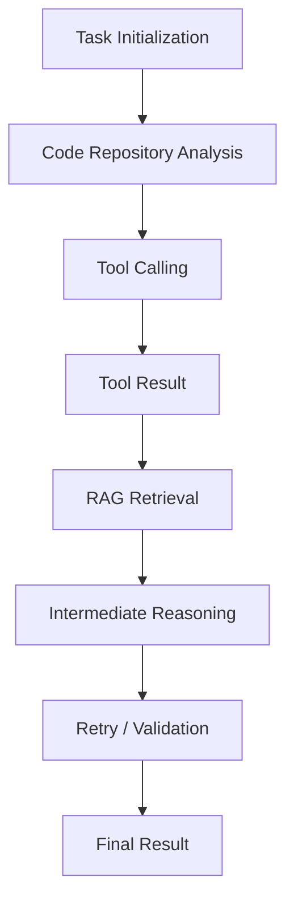
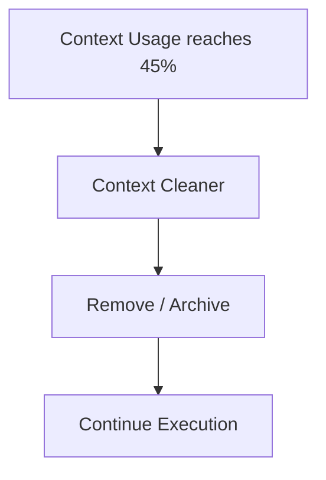
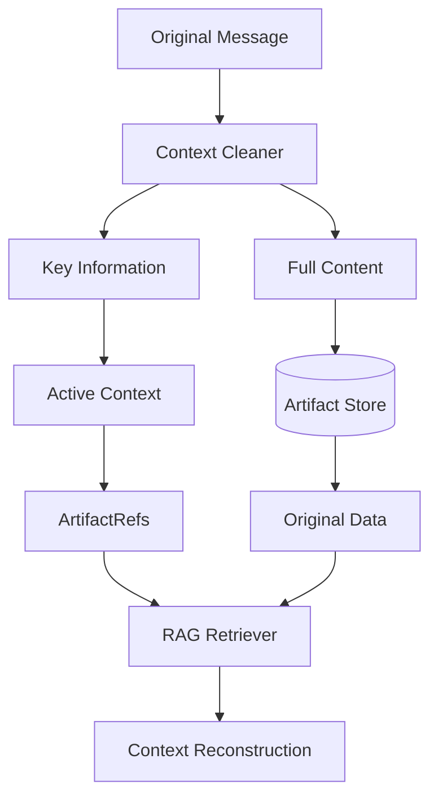
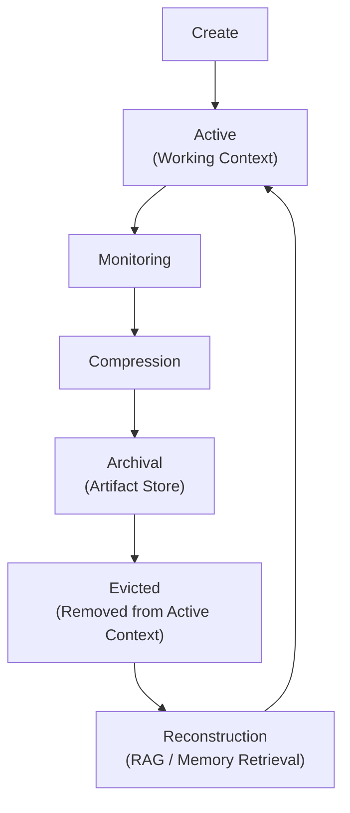
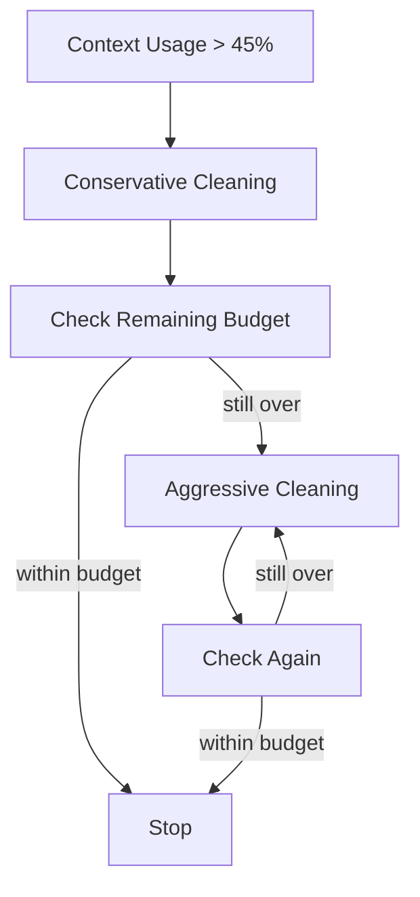

# ares Architecture Deep Dive (XXIX): Context Lifecycle Management — Why 45%, and Where Compressed Information Goes

> Context Window is Working Memory, not Long-term Memory.
>
> Don't maximize context utilization — maximize the effective density of information in the context.

---

## 01. One question: what should an Agent's context compression threshold actually be?

Context management is unavoidable in Agent system design.

As large language models have evolved, their context windows have grown continuously — from a few thousand tokens, to tens of thousands, to hundreds of thousands, and now to the million-token range.

At the same time, Agent applications have started adopting ever higher compression trigger thresholds. Ratios of 80%, 85%, 90% and beyond are not unusual[^1].

A consensus seems to have formed:

> A model's context window is large enough, so it should be used as fully as possible. Only when the context approaches the capacity limit does governance become necessary.

I have always had a different understanding of this question.

In a technical discussion, I was once asked what ARES's context compression threshold is.

My answer was: **45%**.

The other party immediately pushed back:

> "Model context windows are so long now — why trigger compression so early? Agent applications commonly compress at 80% or above."

I am aware that many Agent systems today use trigger strategies of 80–90% or higher.

But I think there may be a cognitive bias in this question:

**A larger Context Window does not mean an Agent should retain as much historical information as possible.**

How much information a model can accept, and how effectively it can use that information, are two different questions.

ARES chose 45% as its default context governance threshold (in code, `DefaultContextBudgetRatio = 0.45`) not because a model can only effectively process 45% of its context, and not to keep token usage artificially low.

It is an engineering trade-off based on the characteristics of long-running Agent runtimes.

In ARES, what I care about is not Context Utilization but Context Quality.

That is also the starting point for ARES Context Lifecycle Management.

[^1]: The 80%/85%/90% figures are not a uniform industry benchmark, but default or configurable values that appear in individual products' and frameworks' documentation, and their denominators differ (some measure against the model window, some against "window − output reserve", some trigger on message count or turn count). The concrete examples cited here are in §3.2 (Docker Agent's 90%, LangChain Deep Agents' configurable compression, Anthropic's token-threshold trigger). Before comparing them, confirm the denominator — otherwise "85%" and "85%" may not be the same thing.

---

## 02. Context Window is not the same as effective context

Before discussing specific thresholds, one concept needs to be settled:

**The Context Window is the model's capacity limit; it does not mean the model processes everything inside that window with equal efficiency.**

In an ordinary chat application, the context is usually made of user inputs and model replies.

An Agent is different.

While executing a task, an Agent continuously produces a large amount of process information:

- Tool calling requests and responses
- Intermediate reasoning results
- RAG retrieval content
- Task execution logs
- Failure and retry records
- Multi-agent collaboration messages
- DAG node execution results
- Contexts of historical tasks

This information may carry high value when produced, but as the task progresses, a substantial part of it gradually loses its current value.

Without governance, it keeps occupying the limited working context.

That raises several concerns.

### 2.1 Lost in the Middle: uneven information use in long contexts

A classic phenomenon in long-context research is Lost in the Middle.

Studies have found that in some long-context tasks, models use information at the beginning and the end of the context noticeably better than information in the middle.

This means that even if a model can accept 100K tokens, it does not follow that it uses those 100K tokens with equal efficiency.

Enlarging the context window solves the **capacity** problem.

But the problem of **effectively using** information in a long context does not disappear simply because the window grew.

For continuously running Agents, this deserves particular attention.

Because an Agent's context is not built once and finished — it grows as the task executes.

### 2.2 Context Pollution: process information contaminating the working context

A defining characteristic of an Agent is continuous interaction.

For example, a code-analysis Agent might go through:

Throughout this process, every tool call may produce new messages.

The problem is:

**Information produced by tool calls does not necessarily need to stay in the current context forever.**

For example:

- A tool returned a large amount of source code, but the current analysis is already finished.
- A retrieval returned dozens of documents, of which only two really matter.
- A failed retry produced a lot of debugging output, but the problem is already solved.
- An Agent already finished its task, and its process messages no longer matter to other tasks.

If this content remains in the context, it forms **Context Pollution**.

It is not necessarily useless information — but it should not permanently occupy the Working Context.

### 2.3 Context Quality is not Context Utilization

Two concepts need to be distinguished here:

- **Context Utilization** measures how much of the context window is used.
- **Context Quality** concerns whether the information currently in context is relevant to the task, whether it is complete, and whether it lets the model make correct judgements.

A simple example.

Suppose an Agent currently has a 100K-token context window.

| Option | Composition | Tokens |
|---|---|---|
| A | Historical tool calls, execution logs, intermediate reasoning + current task information | 85K |
| B | Current task goal, key facts, necessary constraints, relevant execution state (after governance) | 40K |

We cannot assert on token count alone that B is necessarily better than A.

But at least this much is clear:

**The utilization ratio of the context does not directly represent the validity of the context.**

For long-running Agents, I prefer to guarantee information density rather than fill the Context Window as much as possible.

---

## 03. Why do many Agent systems choose 80–90%?

Before discussing ARES's 45% strategy, it is worth understanding why high thresholds exist at all.

I do not think 80–90% is a wrong design.

On the contrary, it is reasonable in many scenarios.

### 3.1 Retaining as much raw context as possible

The greatest advantage of a high threshold is that it lets an Agent keep raw information for longer.

For some tasks, historical information genuinely has high value. For example:

- Complex code analysis
- Long-document research
- Multi-turn tool interaction
- Tasks that need to revisit early decisions
- Analysis tasks that depend on a large body of raw evidence

Compressing too early can cause information still needed later to be summarized away or removed from context.

Especially for compression strategies that rely on LLM-generated summaries, there is an inherent risk of information loss.

Delaying compression therefore lets the model retain more raw context.

### 3.2 Fewer compression operations

A high threshold means compression happens less often.

That reduces the frequency of context governance operations, and in some systems reduces the extra processing overhead.

Different Agent frameworks compress in different ways: some generate summaries with an LLM, some trim messages, some apply rule-based processing, and some combine external storage with retrieval.

So **not all compression strategies are the same mechanism**.

For example (these are practices described in each project's public documentation; implementations and budget definitions differ, and the percentages are not directly comparable):

- Docker Agent's documentation describes a default 90% proactive compression strategy.
- LangChain Deep Agents also provides a context compression mechanism driven by model configuration.
- Anthropic's context compression mechanism allows triggering on a token threshold.

**Rule-based cleaning and LLM summarization are not the same class of tool.** When comparing them, at least these dimensions should be separated:

| Dimension | Rule-based cleaning (ARES ContextCleaner) | LLM summarization |
|---|---|---|
| Extra model calls | None (local CPU) | One or more per compression |
| Cost predictability | Linear in message count, statically estimable | Depends on summary length and model price, highly variable |
| Latency | Milliseconds | Seconds, on the critical path |
| Determinism | Same input always yields same output; unit-testable | Sampling-dependent; same input may differ |
| Shape of information loss | **Enumerable**: which roles were truncated, which fields dropped | **Not enumerable**: the model decides what to drop |
| Causal protection | Explicitly guaranteed by rules (e.g. tool call / result pairing) | Depends on summary quality; not guaranteed |
| Failure mode | Wrong rule → reliably drops the wrong thing | Summary drift / hallucination → occasionally drops the wrong thing |
| Recoverability | Removed content has an explicit reference (ArtifactRef) | The original is usually gone from context; must be persisted separately |

They are not substitutes: rule-based cleaning suits **high-frequency, predictable** governance of process information, while LLM summarization suits **low-frequency, semantics-merging** compression of long documents.

### 3.3 A high threshold does not mean an outdated architecture (and the scope of this article)

I want to stress this point.

The high-threshold strategy has its own design goal:

> Extend the residency of raw context as far as possible, retain more information, and reduce the information loss caused by frequent governance.

ARES choosing 45% focuses on a different question:

> How can an Agent, while running for a long time, continuously maintain a relatively clean, relevant and usable working context?

The two approaches are not simply better or worse; they are engineering trade-offs under different architectural goals.

The real question is not whether 45% or 90% is the more correct number, but:

**How does your Agent Runtime want to manage context?**

**Scope** — 45% is *not* the better choice, and can even be harmful, in the following situations:

| Scenario | Why a high threshold fits better |
|---|---|
| One-shot long-document analysis (read once, few tool calls) | History *is* the evidence; compressing early destroys it, and there is no later injection pressure |
| Deployments without external storage (no Artifact Store, no persistence) | Removed content is genuinely gone; "recoverable" does not hold |
| Pipelines built mainly on LLM summarization | Every governance pass is a model call; high-frequency small-batch governance has a worse cost structure |
| Tasks requiring strict audit and reproducibility | Anything "removed" must be fully traceable, otherwise the task cannot be reproduced |
| Context window far larger than the task needs | The threshold barely matters; governance yields close to nothing |

Conversely, the benefits of 45% hold for **long-running, tool-heavy Agents with external storage** — which is exactly the shape ARES targets.

---

## 04. Why did ARES choose 45%?

ARES uses 45% as its default context governance threshold.

This design is not about achieving a lower token usage rate; it is about intervening earlier in the context lifecycle.

I considered four aspects.

### 4.1 Proactive governance instead of reactive cleanup

Suppose an Agent is executing a long-running task.

As tool calls, retrievals and intermediate results pile up, the context gradually grows.

If governance starts only at 80–90%, the Agent carries a large amount of historical process information for a much longer stretch of execution.

ARES wants to deal with content that has already lost its current value as early as possible.

To be clear:

**45% is not the theoretical threshold at which a model's attention degrades, and it does not mean that attention necessarily drops at 46%.**

It is an engineering default.

Earlier governance shortens how long low-value historical information resides in the working context.

From this angle:

> 45% represents when proactive governance intervenes, not where the model's capability boundary lies.

> **Where does 45% come from?** It is the result of a **capacity allocation**, not a number fitted to an attention curve. In code it is `DefaultContextBudgetRatio`, and the comment is blunt: it is the **share of the model window that a prompt may occupy** — because the prompt is not the only thing that has to fit. The answer needs room, and the skills block and RAG snippets are appended *after* this budget is applied; a budget set at the window's edge leaves the last-added block nowhere to go.
>
> So 45% bounds the **entire prompt** (history + system + tool definitions + retrieval injection); the remaining 55% serves the **completion** and **post-appended content**, not "history takes 45% and the other four blocks split 55%". It is also not a measurement of "where the model starts degrading". A deployment that has measured its own prompt sizes can override the derived value with `ContextTokenBudget` (explicit configuration wins).

### 4.2 Rule-based Compression: no extra LLM summarization

This is an important engineering characteristic of ARES's current implementation.

ARES's ContextCleaner performs differentiated context governance with local rules, rather than calling an additional LLM to generate a summary on every compression.

The basic idea: **messages of different roles and types deserve different treatment.**

| Message type | Treatment |
|---|---|
| Tool Result | Extract a gist, keep the digest reference |
| Assistant intent | Preserve as far as possible |
| Pure reasoning content | Truncate according to rules |
| History exceeding the token cap | Fall back to `trimToTokenCap` |

Core pieces:

- `ContextCleaner.Clean()`: role-differentiated rule-based compression.
- `trimToTokenCap()`: fallback trimming when the budget is still exceeded after cleaning.

**These three terms are three different things; conflating them derails the discussion:**

| Term | What it is | Where it lives | What is lost / kept |
|---|---|---|---|
| **gist** | A short text **extracted** from the original message by rules (first line, key fields, command and exit code) | Replaces the message content in place, still in context | Keeps "what was done", drops "the full output" |
| **digest** | A **summary reference** to the original content (source identity + content fingerprint), not the content itself | Inlined with the gist in the message | Consumes no content budget, but makes "the original still exists" referenceable |
| **ArtifactRef** (`Message.ArtifactRefs`) | A parseable reference to a record in the **Artifact Store**; together with shape and digest it forms the triplet that proves the ref really resolves | Attached to the message as a list of refs + the external raw data | Context keeps only the reference; the original is guaranteed by external storage, and dead refs are removed (`ErrInvalidArtifactRef`) |

In one line: **a gist is the compressed content, a digest is the fingerprint of where that content came from, and an ArtifactRef is where the original lives and how to fetch it.** The first two decide what the model **sees**; the third decides what the system **can still recover**.

This design has several properties.

**First, no additional LLM call.**

Compression is a local CPU operation; it requires no extra model inference request.

**Second, no extra reasoning budget.**

Unlike LLM summarization, a rule-based Cleaner does not hand the entire history back to the model for processing.

**Third, the process is easier to test and reproduce.**

The rules are explicit, and the transformation from input to output can be verified by unit tests.

Of course, rule-based compression does not mean zero information loss.

Rule-based extraction and truncation can also lose detail, so protection mechanisms are needed for key messages, causal relationships and execution state.

But it avoids the uncertainty and cost of extra LLM summarization calls.

### 4.3 Frequent, small-batch governance: shrinking the degradation window

This is, I think, the most important design consideration behind the 45% strategy.

We can compare two ways of governing.

**Option A: proactive governance at 45%** — clean low-value history as soon as the default threshold is reached.

**Option B: deferred governance at 80–90%** — retain more raw context and act only near the high-occupancy region.

The core difference is when governance intervenes.

ARES prefers to:

- Clean content that has lost its current value as early as possible.
- Reduce how long large amounts of process information reside.
- Avoid processing too much history in one pass.
- Protect the causal relationship between tool calls and tool results as far as possible.

Note that **frequent small-batch governance does not inherently mean less information loss**.

If the Cleaner's rules are poor, compressing at 45% can also repeatedly drop important information.

What matters is the governance strategy and the information-protection mechanism, not the compression frequency alone.

Prompt Cache is another factor worth considering.

If context governance changes the cache prefix, the cache hit rate may suffer.

A future direction is therefore to separate a stable prefix from the mutable working context, minimising changes to the stable prefix.

But whether 45% actually yields a higher cache hit rate depends on the caching mechanism of each model provider and must be verified experimentally — a smaller compression amplitude is not sufficient evidence.

### 4.4 Headroom: leaving space for subsequent execution

The context window does not only serve historical messages.

While executing, an Agent also needs budget for other content:

- System instructions
- The current task goal
- Tool definitions
- RAG retrieval results
- Subsequent tool calls
- Model output

So it is not enough to look at how many tokens the current history occupies; the token consumption that later execution may produce has to be considered as well.

The 45% default budget leaves more room for that later content.

But the framing needs to be precise (the code is the definition):

> ARES's 45% is the **budget for the entire prompt** (`DefaultContextBudgetRatio`: the share of the model window a prompt may occupy), not "history occupies 45%".
>
> The remaining 55% covers two things that happen *after* the budget is applied: the model's completion, and post-appended content such as the skills block and RAG snippets. Setting the budget at the window's edge leaves the last-added block nowhere to go — which is exactly why 45% rather than 50%+.

This also means the threshold and the output limit are coupled: the larger the output budget, the smaller the prompt budget should be. A deployment that has measured its own prompt sizes can pin this with `ContextTokenBudget`, overriding the ratio-derived value.

---

## 05. Context Lifecycle Management: compression is not the end

If ARES merely deleted messages at 45%, there would be little special about the design.

What matters is:

**After information leaves the context, where should it go?**

I believe an Agent's context management must solve not only the token-overflow problem but also the lifecycle of information.

That is why I prefer to call this part of ARES:

> Context Lifecycle Management

The idea behind it:

> **The Context Window is Working Memory, not Long-term Memory.**

### 5.1 Working Memory: serving the current task

Working Memory is the working context an Agent uses while executing its current task.

It should preferentially retain:

- The current task goal
- Task constraints
- Verified key facts
- Current execution state
- Unresolved questions
- Dependency information needed by subsequent execution

This information directly affects the Agent's current decisions and execution.

It therefore deserves higher retention priority.

Completed tool calls, repeated logs and historical reasoning that has lost its current value should not occupy Working Memory indefinitely.

### 5.2 Long-term Memory: preserving historical value

Long-term memory holds information that does not need to reside in the current context but may still be valuable later.

For example:

- Historical tool execution results
- Research material
- Experience from past tasks
- Important decisions
- Code analysis results
- External knowledge documents

This content can live in external stores such as the Knowledge Store or the Artifact Store.

When the Agent later needs related information, it retrieves it according to the task.

Working Memory and Long-term Memory thus separate their responsibilities.

### 5.3 ArtifactRefs: the bridge between the working context and external storage

ArtifactRefs are a crucial connection point in this design.

They answer:

> When a piece of historical content no longer needs to stay in the context in full, how is access to the original still preserved?

The basic process:

In other words:

**Compression does not mean the original content is destroyed.**

Externally stored content can still be located through ArtifactRefs.

When the Agent later needs related information, it can recover it on demand through Memory Search or a RAG Retriever.

One distinction deserves emphasis:

> **Recoverability is not the same as automatic lossless recovery.**

ArtifactRefs guarantee that the original content still has an explicit storage reference, but RAG retrieval does not guarantee that everything relevant will be found every time.

Critical execution state therefore must not depend solely on vector retrieval. For example:

- Current task constraints
- Unfinished DAG nodes
- Key decisions
- Task dependencies
- Checkpoints
- Execution results

This information should be persisted through structured mechanisms.

That is also why an Agent Runtime needs to separate task-state management from context management.

**Context can be cleaned; task state must not be lost because the context was cleaned.**

### 5.4 The complete Context Lifecycle

From a lifecycle perspective, ARES's design can be abstracted as:

Here, Evicted only means the content has left the current working context; it does not mean the original is permanently deleted.

The whole process is therefore managing where information **resides**, not simply deleting history.

That is also the important difference between Context Lifecycle Management and traditional context trimming.

> **Two different kinds of "eviction" must be distinguished — they happen at different levels and are handled by different code:**
>
> | Level | Mechanism | Trigger | Meaning |
> |---|---|---|---|
> | **Message level** (what the diagram above shows) | `trimToTokenCap()` decrements from the **head** of the message list (oldest first) until the total is within the cap | Whenever the budget is still exceeded after cleaning (fallback) | A single message leaves the active context; if the original was artifacted, it can still be fetched via its ArtifactRef |
> | **Session level** (not in this diagram) | `SessionRegistry.SweepExpired()` releases whole sessions by idle TTL (`DefaultSessionIdleTTL = 30min`), plus explicit `ReleaseSession`; the memory store additionally has a capacity bound (`max_sessions`) | Session idle timeout / task end / capacity pressure | The whole session graph and its context are reclaimed — not the same event as "one message was trimmed" |
>
> In other words: **`trimToTokenCap` is not LRU — it ignores access frequency and looks only at order and size**; session-level reclaim is what happens by time (and storage capacity). Conflating the two invites the belief that "an evicted message comes back automatically", whereas message-level trimming is irreversible — what can come back is the **artifacted original**, not the message itself.

---

## 06. Future work: from a fixed threshold to adaptive context governance

ARES currently uses 45% as the default trigger threshold.

That does not mean 45% is optimal for every model, every task and every scenario.

Context requirements differ greatly between tasks. For example:

- Code analysis tasks may need to retain a large amount of source code and call relationships.
- Ordinary document-retrieval tasks can clean tool output more aggressively.
- Multi-agent collaboration tasks must protect task state and inter-node dependencies in particular.

Context governance in ARES can therefore evolve from a fixed threshold towards task-aware governance.

I am currently focused on three directions.

### 6.1 Hysteresis: avoiding repeated triggering near the threshold

**The current implementation is a single drop-to-cap**: `trimToTokenCap()` trims to the budget limit in one pass, with **no** "progressive degradation + stopping condition" loop.

Although ContextCleaner already offers `Default`, `Conservative` and `Aggressive` modes, **progressive governance (Conservative first, Aggressive if insufficient) and the stopping condition are not implemented** — the modes are currently a **choice**, not a **cascade**.

The diagram below is the **target shape**, not the current behaviour:

Deal with low-value information first.

If the target budget is still exceeded, increase the intensity of governance step by step.

This avoids starting in Aggressive mode and cleaning away too much valuable information.

Note that **this is a future direction, not a capability that is fully implemented today**.

### 6.2 Task-aware Context Management

Different tasks have different context requirements.

| Task type | Information to protect first |
|---|---|
| Code Analysis | Source code, call relationships, key evidence |
| Research | Raw material, sources, key conclusions |
| Planning | Goals, constraints, decisions, dependencies |
| Tool Execution | Tool call / result causality |
| Multi-Agent Collaboration | Task state, node results, handover information |

In future, the Cleaner's strategy can be adjusted dynamically by task type and current execution phase.

That is more sensible than having every Agent share one set of cleaning rules.

### 6.3 Context Quality Evaluation

Most context management approaches today focus on token usage.

But I believe what is really worth studying is how to measure context quality.

A future evaluation suite could include:

| Metric | What it evaluates |
|---|---|
| Key Constraint Retention | Share of critical task constraints retained |
| Causal Integrity | Completeness of tool-call causality |
| Recovery Success Rate | Success rate of recovering historical information |
| Task Completion Rate | Task completion before/after compression |
| Token Consumption | Actual token consumption |
| Cache Hit Rate | Prompt cache hit rate |

Task Completion Rate above all.

If a governance mechanism substantially reduces token usage but lowers the task completion rate, the optimisation has no practical meaning.

Ultimately, experiments across different workloads should compare thresholds such as 45%, 60% and 80%.

Moving context governance from experience-driven to data-driven.

---

## 07. Conclusion: manage the context, don't fill it

A large context window solves **how much information a model can hold**.

It does not solve **which information an Agent should keep**.

For a long-running Agent, historical information does not carry lasting value by default.

Tool calls, intermediate reasoning, execution logs and historical retrieval results have different value at different stages of a task.

ARES choosing 45% as its default context governance threshold is not because a model can only effectively use 45% of its context, and not because 80% or 90% strategies are wrong.

It is an architectural trade-off.

We would rather have an Agent continuously maintain a high-density, low-noise, recoverable working context than extend the residency of raw history as long as possible.

In terms of design:

- **Context Monitoring** senses the state of the context.
- **Context Compression** governs low-value information.
- **Artifact Store** preserves recoverable raw content.
- **Context Reconstruction** restores historical information on demand.

Together they form Context Lifecycle Management.

> The Context Window is Working Memory, not Long-term Memory.

Compression is not deletion, and historical information should not lose its value simply because it left the current context.

What matters is not how large the context is, but how much genuinely useful information the Agent can obtain at this moment.

**Don't maximize context utilization — maximize context relevance.**
