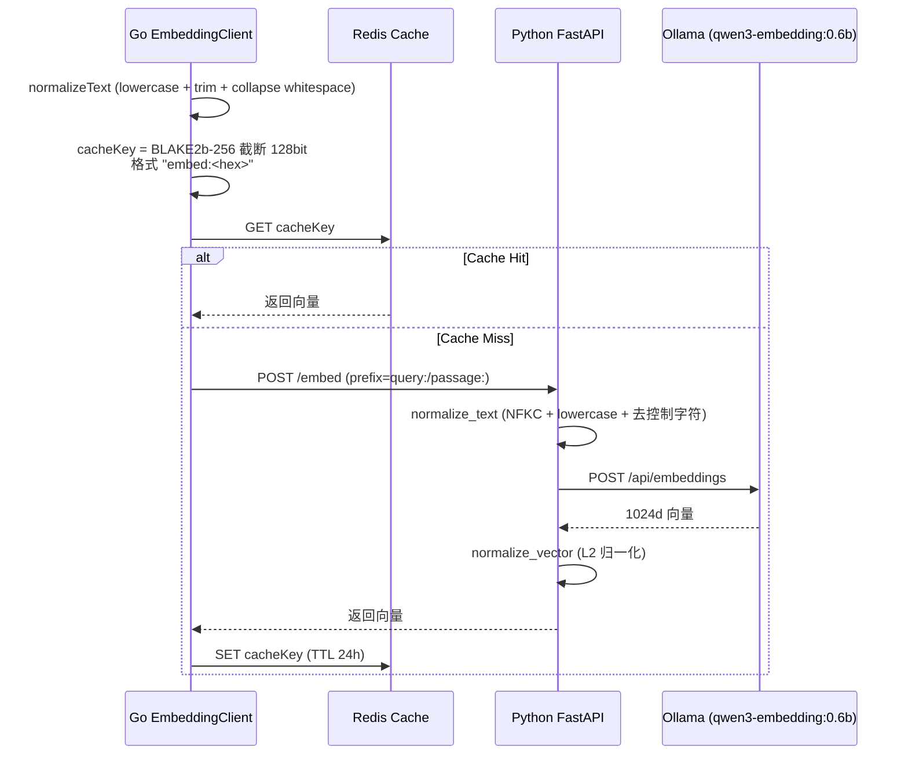
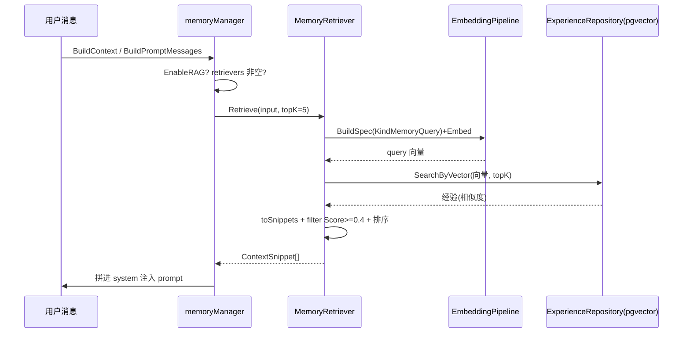

# ares 架构深度解析（十）：检索系统——向量 / 关键词 / FTS 的实战与诚实边界（0.3.x）

> Agent 说："根据您过去的经验，我建议……"——但建议的东西根本不相关。
> 比这更惨的是：Agent 明明之前解决过一模一样的问题，这次又从头开始想方案。
> 我当时就在想：Agent 的记忆不是"有没有"的问题，是"能不能找到对的"的问题。
> 一个没有检索能力的 Agent，就是一个金鱼——7 秒记忆，永远在发明轮子。

> 说明：本文基于实际代码（重点阅读 `internal/knowledge/hybrid.go` 的混合打分与 `internal/knowledge/store/postgres` 的 `HybridSearch`、`internal/storage/postgres/repositories` 的向量/关键词仓库层、`internal/runtime/memory/context/memory_retriever.go` 的 RAG 召回、`internal/runtime/memory/experience/ranking_service.go` 的经验排序，以及 `internal/runtime/protocol/skills` 的 FTS5/关键词检索）。每个符号、每条流程都是我在这份代码里实际读到的。凡是"配置了但实际没接线"或"我拿不准"的部分，我会标（待核实），不替它吹。
>
> **2026-10-16 修订**：本文的结论被更正过两次，本版把最终核准的事实写进正文（§二），并**整体替换**了旧版对
> `internal/storage/postgres/services` 那条"混合检索服务"的逐行拆解（§六）——那个包**生产从未构造过**，
> 已作为零引用死代码删除（约 8.4k 行，代码在 git 历史）。**正文里凡是与该包相关的描述都按当前代码重写，
> 而不是加个"已废弃"横幅糊过去。**

---

## 一、先说为什么检索决定 Agent 的智商

写 Agent 有个很残酷的事实：**模型再强，喂的上下文不对就是废物。**

模型再能打，如果我喂进去的是错误的文档、不相关的经验、过时的知识……那输出就是看起来很有道理但实际上是胡说八道的东西。这比直接说"我不知道"更坑——因为用户会相信。

检索的目的很朴素：在正确的时间、从正确的地方、用正确的权重，把真正有用的上下文捞出来喂给 LLM。难题在于，**"相关的"该怎么定义、怎么排序**——是语义相关、字面相关，还是"过去验证过能解决这个问题"？不同数据，答案不同。ares 的做法不是一个向量库一把梭，而是**按数据类型分流，各自用擅长的检索方式**。本文就讲清楚：代码里到底跑了哪些检索，没跑哪些。

---

## 二、先揭个榜：运行时到底跑哪条检索路径？（两次更正后的定论）

这个结论被更正过两次，这里把最终核准的事实一次写清：

- **第一版说**："`RetrievalService` 写好了但一直没接线（`advancedRetrieval` 在 API 层恒为 nil），在跑的是纯向量的 `SimpleRetrievalService`。"
- **第二版说**："反了——真正被接进生产的是 `RetrievalService`，`SimpleRetrievalService` 没有调用方。"
- **2026-10-16 复核：第二版同样是错的，而且两个类都已删除。** 三条实测（都可逐条复现）：

  1. **`ProductionMemoryManager` 早就不再有那条持久化/检索路径了**。它现在是**纯配置存储**（只有 `GetConfig` / `Lock` / `Unlock`，给 evolution 的 `MemoryPatchExecutor` 用），文件自身的注释写明：原来的 PostgreSQL 持久化实现（sessions / tasks / **RAG retrieval** / write buffer）**"had zero production constructors"**，已随 `postgres.WriteBuffer` 一并移除。所以第二版那句"`production_manager.go` 里 `NewRetrievalService(...)` 构造了它"**没有任何对应代码**——那个文件里连一个 `New…(` 调用都没有。
  2. **`SearchSimilarTasks` 不是 `ProductionMemoryManager` 的方法**，它是 `manager_impl.go` 里 `memoryManager` 的方法，而且**自己做向量检索**（`BuildMemoryQuerySpec` + 蒸馏 pipeline 的 `Embed` + 经验仓查询），**不经过任何 `RetrievalService`**。
  3. **全仓对 `internal/storage/postgres/services` 的引用只剩示例**（`examples/_internal/11-knowledge-import`），该包已于 **2026-10-16 整包删除**（零引用死代码，约 8.4k 行，代码留在 git 历史；其中 `RetrievalService` 连示例都没用过）。示例本身也已改走生产路径 `KnowledgeRepository.SearchByVector`。
  4. 顺带纠正第一版的另一半：**`api/retrieval/service.go` 确实不存在**，而且 `api/` 下那几个包（embedding / experience / knowledge / discovery）**已于 0.3.2 删除**（它们原是 internal/ 对应包的 deprecated 转发层，无消费者）。但"两条检索服务都住在 `internal/storage/postgres/services/`"这句现在也过期了——**那个包已经不存在**。

### 2.1 今天真正在跑的检索路径（逐条核实过）

| 路径 | 入口 | 数据 | 方式 | 状态 |
|------|------|------|------|------|
| 知识混合检索（AKG） | `knowledge/store/postgres` 的 `HybridSearch` → `internal/knowledge/hybrid.go` 的 `ScoreHybrid` | AKG 蒸馏事实（`akf_objects`） | 向量 0.7 + 词面 0.3（权重**相对**，缺项按可用项归一），按 `FinalScore` 排序；召回窗口 `ORDER BY updated_at DESC` | ✅ 已接（经 `KnowledgeRetriever`） |
| 知识块向量召回 | `KnowledgeRepository.SearchByVector` | `knowledge_chunks_1024` | pgvector 余弦 + `embedding_status='completed'` 过滤；索引旋钮在事务内应用（见 §6.3） | ✅ 已接（RAG / 工具路径） |
| RAG 经验召回 | `MemoryRetriever.Retrieve`（经 `manager_rag.go` 的 `runRetrieval`） | 蒸馏 experiences | 向量 + `minScore` 过滤 | ✅ 已接（`EnableRAG=true` 时） |
| 关键词·知识侧 | `KnowledgeRepository.SearchByKeyword` | `knowledge_chunks_1024.tsv` | PostgreSQL FTS：`ts_rank(tsv, plainto_tsquery('simple',$1))` | ⚠️ 方法在，**当前无调用方** |
| 关键词·经验侧 | `ExperienceRepository.SearchByKeyword` | `experiences_1024` | ILIKE 子串匹配（**不是 BM25**） | ✅ 已接（蒸馏路径） |

> **两条"曾在、但从未生效、现已随死代码删除"的能力，明确记录以免将来被当成回归**：
> ① `knowledge_chunks_1024` 侧的 **BM25/tsvector 宽词面召回 + 与向量融合**（被删包里的 `bm25Search*`）。
> 它不等价于"丢了在跑的能力"——那条路径的生产入口从未被构造过；而且 **schema 层的 tsvector trigger / GIN 索引
> 与 `SearchByKeyword` 都还在**，要恢复只需接线，不必重做。
> ② `RankingService`（经验的多信号加性重排，§7.1）**仍然存在**，但**已无生产调用方**——它唯一的调用方是
> 已删包里的 `applyExperienceRanking`（复核确认：删除之前它也没有别的调用方）。
>
> **仍未被任何生产路径构造的组件**：`RetrievalGuard`（§九），三层保护写好了但没有构造点。

---

## 三、Embedding 管线：文本 → 1024 维向量

不管哪条检索，第一步都是先把文本变成向量。ares 是 Go（`internal/storage/postgres/embedding`）→ Python FastAPI（`services/embedding/app.py`）→ Ollama（`qwen3-embedding:0.6b`）三层。

模型与维度（`services/embedding/app.py`）：
- `OLLAMA_MODEL = "qwen3-embedding:0.6b"`（可用环境变量覆盖）
- `EMBEDDING_DIM = 1024`
- `MAX_LENGTH = 512`（超出前缀后直接截断）
- `CACHE_TTL = 86400`（24 小时）



关键点都是真的：

**1. 双层文本标准化。** Go 端 `EmbeddingClient.normalizeText` 做 lower + trim + 把连续空白收成一个空格；Python 端 `normalize_text` 先做 `unicodedata.normalize('NFKC')`，再做 lowercase、strip、`re.sub(r'\s+',' ')`、去控制字符。为什么两层？因为 Go 的 `strings.ToLower` 和 Python 的 `str.lower()` 在部分 Unicode 字符上行为不同，双层兜底减少 cache miss 爆炸（`client.go` 注释原话："avoid cache miss explosion"）。

**2. Cache key。** Go 端 `getCacheKey` 用 `blake2b.Sum256`（截断到前 16 字节 = 128bit），前缀 `embed:`，key 由 `normalizedText|model|prefix` 拼出。注意：不是"BLAKE2b-128"这个哈希算法，而是 **BLAKE2b-256 取前 16 字节**。Python 端不共享这个 key 算法（它用 `sha256`），所以 Go/Python 两侧缓存是各自的。

**3. 前缀（prefix）。** 检索 query 用 `query:` 前缀，文档/经验存储侧用 `passage:` 前缀（`client.go` `Embed` 默认 `query:`；`EmbedWithPrefix` 显式传）。这是 e5 系模型的惯用做法，让 query 和 passage 落在不同区段、同向匹配。（待核实：`Experiences 1024` 表写入时具体用哪个前缀由蒸馏链路决定，我未逐行追到 App 侧透传。）

**4. L2 归一化。** Python 端 `normalize_vector` 用 `np.linalg.norm` 归一为单位向量——注释点明"Ollama 不保证返回单位向量"，归一化让后面的余弦距离（`cosine_distance`）有意义。

**5. 缓存是 Redis 为主。** `EmbeddingClient.redis` 可空（nil 则跳过缓存直接调服务）。另有 `EmbeddingCache`/`MemoryCache`（`cache.go`）做进程内内存兜底 + 定时清理 goroutine，但**生产接线用的是 `NewEmbeddingClient` 直连 Redis 那套**（待核实：`EmbeddingCache` 是否在某个 boot 里被挂上，我未在 production_manager 看到注入）。

---

## 四、向量检索（真实跑起来的那条）：pgvector + IVFFlat 余弦

向量检索不是"搜一个独立向量库"，而是 **pgvector 插件 + 同一 PostgreSQL 里的表**。两千维度以下直接 `<=>` 余弦距离算子。

表（`migrate_storage.go`）：
- `knowledge_chunks_1024` — 知识分块
- `experiences_1024` — 蒸馏经验（`embedding` 列**可空**，异步 worker 回填）

索引是 IVFFlat（`vector_cosine_ops`）：`idx_knowledge_1024_embedding`、`idx_experiences_1024_embedding`。这是近似索引，靠 `lists` 分桶 + 余弦。

真正的查询（`repositories/experience_repository.go` `SearchByVector`）：

```sql
SELECT id, tenant_id, type, input, output,
       1 - (embedding <=> $1::vector) as similarity
FROM experiences_1024
WHERE tenant_id = $2
  AND (decay_at IS NULL OR decay_at > NOW())
  AND embedding IS NOT NULL
ORDER BY embedding <=> $1::vector
LIMIT $3
```

- `embedding <=> $1::vector` 是**余弦距离**，取值范围 [0,2]；`1 - 距离` 转成 **similarity ∈ [-1,1]**（代码注释原话）。默认 `Score` 只是这个相似度的透传。
- 显式 `embedding IS NOT NULL`：因为列可空、IVFFlat 不索引 NULL，这里把没回填向量的行挡在扫描外。
- `decay_at` 过期行不进结果。
- **RAG 里每条的 `Score` 来自蒸馏 confidence**（`MemoryRetriever.toSnippets`：`scoreutil.ClampUnit(exp.Confidence)` 夹到 [0,1]），不是上面 SQL 的 similarity——注意这是两条不同的分数语义。

`knowledge_repository.go` 的 `SearchByVector` 同样用 `1 - (embedding <=> $1::vector)`，只查 `embedding_status='completed'` 的行。

---

## 五、关键词检索：PostgreSQL FTS，不是 BM25

老文把关键词那边夸成 "BM25"。**实际上代码里没有 BM25**：知识侧的关键词搜索是 PostgreSQL 全文检索 `ts_rank + plainto_tsquery('simple', ...)`（`knowledge_repository.go` `SearchByKeyword`），靠 `tsvector_update_knowledge_1024` 触发器维护的 `tsv` 列：

```sql
SELECT ..., ts_rank(tsv, plainto_tsquery('simple', $1)) as score
FROM knowledge_chunks_1024
WHERE tsv @@ plainto_tsquery('simple', $1)
  AND tenant_id = $2 AND embedding_status = 'completed'
ORDER BY ts_rank(...) DESC
LIMIT $3
```

经验侧更朴素——`experiences_1024` 的 `SearchByKeyword` 直接用 **ILIKE 子串匹配**（含转义），按 `score DESC, created_at DESC` 排。所以经验的关键词检索其实是"子串命中 + 按既有 score 排序"，谈不上 BM25。

> 结论：**关键词这条 = PostgreSQL FTS（知识）+ ILIKE 子串（经验）**。文中凡写 BM25 的地方，都是历史注释里的旧话，不是当前实现。我后面一律表述为"关键词 / 全文检索"。

---

## 六、混合检索在生产到底怎么算：宽召回 → 加权 → 排序

> **本节已整体替换。** 旧版本节逐行拆解 `RetrievalService` 的 `buildQueries` / `rerankResults` /
> `TimeDecay` / 精确模式 / query 重写——那段实现**生产从未构造过**，且已于 2026-10-16 随零引用包删除
> （代码在 git 历史）。下面是**当前实际执行**的两条检索的算法，每条都可在代码里对照。

### 6.1 知识混合检索（AKG / `akf_objects`）

`internal/knowledge/store/postgres` 的 `HybridSearch` → `internal/knowledge/hybrid.go` 的 `ScoreHybrid`：

```
FinalScore = blend(Vector×0.7, Lexical×0.3, Recency×w)   // 权重是相对值，按"可用项"归一
```

- **召回宽度**：SQL 先按 `ORDER BY updated_at DESC LIMIT k`（`k = max(TopK, FinalK, cap)`）取候选窗口 ——
  **recency 是窗口偏置**，不是排序项。
- **加权**：向量项 = 余弦相似度；词面项 = **token 集的 Jaccard**（**长度归一化**，且**已做 CJK bigram**，
  中文不再是"整句一个 token"）；新鲜度项 = 分档规则（`FreshnessScore`：<1d=1.0 / <7d=0.8 / <30d=0.5 / 更旧=0.3，
  **零时间戳=中性 0.5，不是最旧**）。
- **可用项归一**：候选没有 embedding 时**不把它压向 0**，而是只用剩下的项打分（未嵌入的行仍可被检索）。
- **recency 权重默认 0**（`knowledge.recency_weight`）：窗口已按 `updated_at` 偏置，分数里再来一次是
  **同一信号计入两次**，是否净收益要按语料实测，所以默认不改排序、开关给运维。
- **排序**：过滤 `MinScore` → 按 `FinalScore` 降序 → 截到 `FinalK`。
- **诊断**：向量维度不匹配（换过 embedding 模型）会打一次 Warn；结果里带 `VectorScore / LexicalScore /
  RecencyScore / FinalScore` 四个分量，便于判断"为什么它排第一"。

### 6.2 知识块向量召回（`knowledge_chunks_1024` / `KnowledgeRepository.SearchByVector`）

- **空向量 fail-closed**：直接返回"embedding must not be empty"，不让 pgvector 去报一个零维字面量的错。
- **SQL**：`WHERE tenant_id=$2 AND embedding_status='completed' AND embedding IS NOT NULL`，
  按 `embedding <=> $1::vector` 升序（即相似度降序）取 `limit`。
- **带出的元数据**：`metadata["similarity"]`（1 − 距离）与 `metadata["created_at"]`（供下游做新鲜度/重排参考）。
- 失败路径：查询错误包装返回；行解析失败**逐行 Warn 并跳过**，最后若"扫到的行数 ≠ 返回的条数"再打一条
  Warn（结果集缩水是运维该看见的事，不该静默）。

### 6.3 查询期索引旋钮：`probes` / `ef_search`（同一条事务路径）

ivfflat 读 `ivfflat.probes`、HNSW 读 `hnsw.ef_search`，**各自忽略对方的那个**，所以两者成对配置
（`EmbeddingConfig.SearchProbes` / `SearchEFSearch`）：

- 走 `postgres.WithVectorSearchTuning`：**`SET LOCAL` 只在事务块内生效**（在池化连接上裸发会被 PostgreSQL
  静默忽略），所以该助手按句柄形态**开事务**（已是 `*sql.Tx` 就直接用；不嵌套开事务），失败回滚；
  句柄形态不支持时**响亮 Warn**而不是假装已生效——"配了但没生效"比"没配"更糟，因为部署以为调优过了。
- **索引的"形状"**同样有人管：`AdaptVectorIndexScale` 复核 ivfflat 的 `lists` 是否与表规模匹配，
  并在**配置的索引方法与目录里的方法不一致时一次性重建**（保留索引名与 partial 谓词，Warn + 记录；
  空期望=不评判，迁移命令就属于不评判）。

---

## 七、经验召回与排序：RankingService 与 MemoryRetriever

这节的"找相关记忆"，代码里有两条：

### 7.1 RankingService（`internal/runtime/memory/experience/ranking_service.go`）
`Rank` 输入一批 `*Experience` + 对应的 `baseScores`（语义分），输出按 FinalScore 降序：

```
FinalScore = SemanticScore + UsageBoost + RecencyBoost + exp.Score
```

注意它是**加法**，不是检索服务里那套乘法：
- `SemanticScore` = 向量搜索给的 similarity（缺失默认 0.5）
- `UsageBoost = min(log1p(UsageCount) × 0.05, 0.2)`
- `RecencyBoost = exp(−ageDays/30) × 0.05`（30 天半衰期）
- `exp.Score` = 持久化的强化信号（bandit 反馈，`RecordFailure` 等写入）

配置权重：`UsageWeight=0.05`、`RecencyWeight=0.05`、`RecencyDays=30`（`DefaultRankingWeights`，可 `Configure`。）

> **归属更正（2026-10-16）**：本节的 `RankingService` **本身仍在**（`ranking_service.go`：`Rank` / `Configure` / 默认权重都在，也有测试），但**它当前没有生产调用方** —— 唯一的调用方是已删包里的 `applyExperienceRanking`（`retrieval_search.go`），随包一起消失；复核显示**删除之前它也没有别的调用方**。今天经验召回走的是 `MemoryRetriever` + 经验仓 `SearchByVector`（§7.2），**不使用**这套加性重排。若要重新接线，`Rank` 的信号与权重都还可用，但**接线本身是一件独立的事**。

### 7.2 MemoryRetriever（RAG，`internal/runtime/memory/context/memory_retriever.go`）
这是给 LLM 增强上下文用的那条：`Retrieve(input, topK)`：
1. 空输入短路返回空
2. `topK<=0` → `DefaultTopK=5`
3. embed query（用 `EmbeddingPipeline`，`KindMemoryQuery`）
4. `expRepo.SearchByVector`（经验仓库的 pgvector）
5. `toSnippets` 组装 `ContextSnippet`，`Score = ClampUnit(exp.Confidence)`
6. `filterByMinScore`：**`Score >= minScore` 才留**，`minScore<=0` → `DefaultMinScore=0.4`
7. `SortSnippetsByScore` 降序后截 topK

嵌入失败**不静默降级**关键词（代码注释原话：`does not silently fall back to keyword search`），直接返回错误。这与"embedding 挂了就降级成只跑关键词"是相反的取舍（后者曾写在被删的检索服务里，如今生产没有那条路径）。

`manager_rag.go` 的 `retrieveContextString`/`retrieveForPrompt` → `runRetrieval`（读 `EnableRAG`、`RAGTopK`、`RAGMinScore`，唤醒 retrievers）→ `memctx.RunRetrieval`（统一应用 DefaultTopK/DefaultMinScore 归一）。检索结果是 best-effort：失败仅 `log.Warn`，不打断主循环。



---

## 八、Skills 检索：Discovery 关键词 + FTS5（另一条"找东西"的链）

检索不只有向量。技能/能力目录的发现是纯文本侧的（详见本系列 28 篇的 Capability Fabric），这里只对齐两条真实检索原语（`internal/runtime/protocol/skills`）：

**1. 关键词打分（`discovery.go` `keywordSearch` + `matchScore`）**
- `splitTerms` 小写 + 空白切分 + 去标点 + 去重
- `matchScore` 数 query 里有多少个 term 命中条目的 ID/Name/Keywords/Capabilities/Description，命中即 +1
- 排序：score 降序，同分按 ID 升序保证确定性
- 只返回 score>0 的；`limit<=0` 返回全部

**2. FTS5（`fts5.go` + `discovery.go` `SetFTS5`）**
- `FTS5Index` 是**内存 SQLite FTS5**（`sql.Open("sqlite", ":memory:")`，modernc 驱动），建 `skills_fts` 虚表覆盖 id/name/description/keywords
- `Search(query, limit)` 走 `WHERE skills_fts MATCH ? ORDER BY rank LIMIT ?`
- `Discovery.Search` 有 FTS5 且 query 非空时先走 FTS5；**FTS5 出错或没命中就回退到 `keywordSearch`**（`types.go` 注释：FTS5 只是 augment，不是 replace）

**3. 经验先验 `Experience.BestMatch`（`experience.go`）**
`Experience` 记忆 `{skill, task_pattern, success_rate}` 先验（Learning 源，只偏置排序、**永不自动执行**）。`BestMatch(taskPattern)` 返回 success_rate 最高的匹配：
- 短 pattern（<4 token，如兜底的 `agent_top`）走**子串包含**，命中得分 1.0
- 长 pattern 按**token 重叠比例**打分，低于 `matchScoreThreshold=0.5` 不算匹配（防止两个长描述只因一个共词就误配）
- `maxPatternLength=256`（rune）截断 pattern 防 `experience.json` 膨胀

`ExperienceConfidenceSource` 把这套先验桥接成 `taskfabric.ConfidenceSource` 喂给 Kernel Scheduler（28 篇详述）。

---

## 九、门控与降级

`RetrievalGuard`（`internal/storage/postgres/retrieval_guard.go`）给检索设计了三层保护：

> **更正（2026-10-16）**：旧版称 `production_manager.go` 用 `NewRetrievalGuard(100, 5, 30s, 30s)` 构造它 ——
> **该文件现在连一个 `New…(` 调用都没有**（它是纯配置存储），全仓复核也**没有别的构造点**。
> 所以下面这三层是**设计就绪、当前没有生产实例**：别把它读成"检索已被限流/熔断保护"。
> 要让它生效，需要在检索入口显式构造并接入（这是一件独立的事，不是"已修"。）

| 保护 | 实现 | 行为 |
|------|------|------|
| 速率限制 | `golang.org/x/time/rate`，`100 req/s` | `AllowRateLimit` 超限返回 `ErrRateLimitExceeded` |
| 熔断 | `CircuitBreaker`，失败阈值 5、open 30s 半开 | 专门盯着 embedding，`CheckEmbeddingCircuitBreaker`；熔断打开则检索降级为只跑关键词 |
| DB 超时 | `WithDBTimeout`（30s） | 查询超过 30s 直接放弃 |

Embedding 侧还有一个 `FallbackClient`（`embedding/fallback.go`）提供三种 `FallbackStrategy`：`FallbackToCache` / `FallbackToKeyword`（返回 `ErrEmbeddingFailed` 触发关键词）/ `FallbackToError`。（待核实：`FallbackClient` 是否被某个生产路径真正挂上；production 检索走的是 `NewEmbeddingClient` + `EmbeddingPipeline`，我没看到 fallback 注入，倾向认为默认直连 + 主文档失败即报错。）

---

## 十、诚实盘点：这篇的更正在哪三条线上

1. **"高级检索没接线 / 纯向量在跑"——两版都不对，2026-10-16 给出第三版**：第一版说"高级的没接、跑的是纯向量"，第二版说"反了，接的是高级那个"。**实测：两个都从未被生产构造**——`RetrievalService` 全仓零引用（连示例都没用），`SimpleRetrievalService` 只有仓内示例在用（该示例已改走生产路径）；整个 `internal/storage/postgres/services` 包已**删除**。今天在跑的是 §2.1 表里那几条。
2. **没有 `api/retrieval/service.go`**：✓ 仍成立（`api/` 下那几个包已于 0.3.2 删除）。但"两条服务都住在 `internal/storage/postgres/services/`"这句**已过期**——那个包不存在了。
3. **关键词那套不是 BM25**：✓ 仍成立（知识侧 = PostgreSQL `ts_rank` 全文检索，经验侧 = ILIKE 子串）。补充一个容易误解的点：被删的包里**确实有方法叫 `bm25Search*`**，但它的实现也是 tsvector——"名叫 BM25、实为 FTS"，随包删除。

数值上，本版只保留**当前代码里有出处**的：向量 0.7 / 词面 0.3（相对权重，按可用项归一）、`minScore 0.4`、
`TopK 5/10`、`FreshnessScore` 的分档（1.0/0.8/0.5/0.3，未知=0.5）、`recency_weight` 默认 0。
**旧版从被删实现里引来的数不再算"有出处的保留值"**（sourceWeight 0.4/0.3/0.2/0.1、Jaccard 0.6、
`timeDecay = e^{-0.01·ageHours}` 下限 0.1 —— 它们出自已删除的 `rerankResults` / `validateRewrites`，属历史）。
另外照旧：**代码里没有任何 `recall@k` / 归一化相似度阈值（0.7~0.8）这类实证指标**，所以本文不给纯向量
召回率、也不编"每天衰减到 78%"这种由假设推出来的数。

**运行时向量检索存在吗？存在。** 不是"只用关键词"：**AKG 混合检索**（`HybridSearch` → `ScoreHybrid`）、
**知识块向量召回**（`KnowledgeRepository.SearchByVector`）、**RAG 经验召回**（`MemoryRetriever`）三条都是
pgvector 上真实、已接线的路径。

**当前"写了但没接线"的，如实列出**（都不是"在跑"）：`SimpleRetrievalService` / `RetrievalService`
（**整包已删除**）、`RankingService`（§7.1，无生产调用方）、`RetrievalGuard`（§九，无构造点）、
`FallbackClient`（待核实是否挂载）。

---

## 十一、总结

ares 的检索系统用一句话概括：**一条真实的混合检索管线（向量 + FTS + 关键词）直接跑在生产里，外加一条独立的 RAG 向量召回给 LLM 喂经验，技能目录走关键词 + SQLite FTS5；纯向量服务反而躺盒子里。**

关键设计点（全部有实码出处）：

1. **Embedding 管线** —— Go→Python→Ollama 三层，`qwen3-embedding:0.6b`、1024 维、L2 归一化；Go 侧 BLAKE2b-256 截 128bit 缓存 key，Redis 24h TTL
2. **向量检索** —— pgvector `<=>` 余弦 + IVFFlat 索引，`1-距离` 得 similarity ∈ [-1,1]，表 `knowledge_chunks_1024` / `experiences_1024`
3. **关键词检索** —— 实际是 PostgreSQL `ts_rank`（知识）+ ILIKE 子串（经验），不是 BM25
4. **混合检索** —— `RetrievalService.Search`，Query/源/子源权重 × 信号 × 时间衰减（`e^{-0.01h}`，下限 0.1），多路由去重 +0.3，精确模式（≤10 rune / 含 `=` 或数字夹运算符）
5. **经验排序** —— `RankingService` 加法公式 `Semantic + min(log1p·0.05,0.2) + e^{-days/30}·0.05 + rawScore`，ConflictResolver 合并冲突组
6. **RAG 召回** —— `MemoryRetriever`，`DefaultTopK=5`、`DefaultMinScore=0.4`，嵌入失败不降级
7. **门控** —— RateLimiter 100/s + 熔断 + 30s DB 超时

Agent 的智商 ≈ 喂给它的上下文质量。而 ares 的前提很朴素：先把检索跑起来、跑对，再说效果。

---

> 信息不是力量，检索才是。——这句话现在有真实的代码在后面撑着。

**下一篇预告：** 暂时没有明确下一篇（本系列已按模块铺开，28 篇已覆盖 Skills/FTS5 细节）。如果你有特别想深入的模块，随时告诉我。