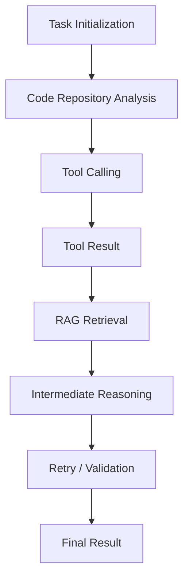
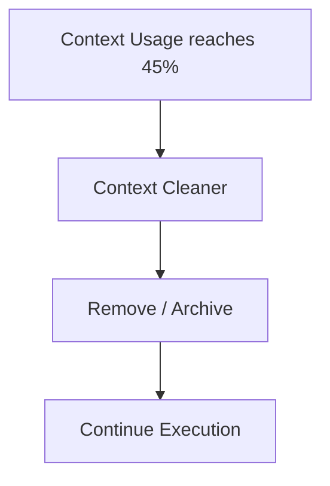
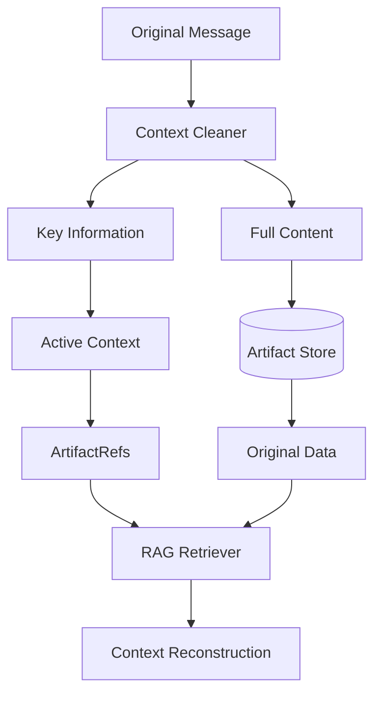
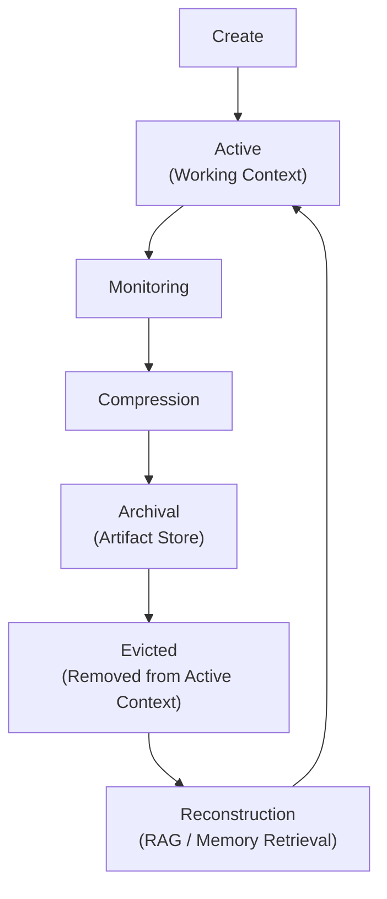
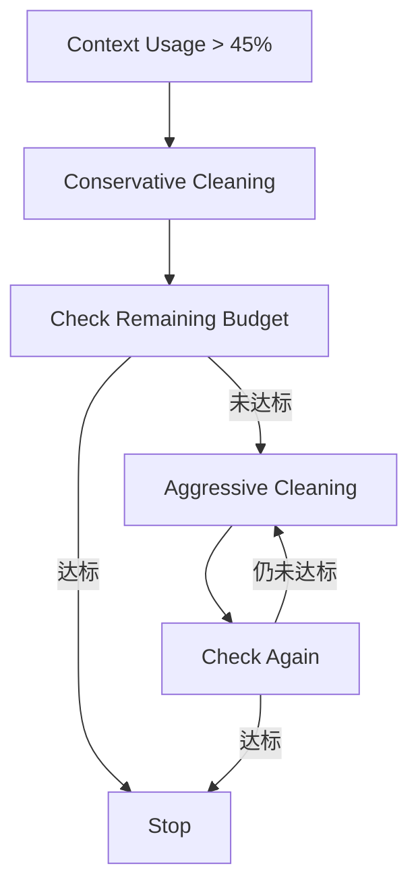

# ares 架构深度解析（二十九）：上下文生命周期管理 — 为什么是 45%，以及压缩之后信息去了哪里

> Context Window is Working Memory, not Long-term Memory.
>
> 不要最大化上下文利用率，而应该最大化上下文的信息有效密度。

---

## 01. 一个问题：Agent 的上下文压缩阈值到底应该设置多少？

在 Agent 系统设计中，上下文管理（Context Management）是一个绕不开的问题。

随着大语言模型的发展，模型的上下文窗口正在不断扩大。从早期的几千 Token，到几十 K、上百 K，再到今天的百万级。

与此同时，Agent 应用也开始采用越来越高的上下文压缩触发阈值。80%、85%、90%，甚至更高的比例并不罕见。

这似乎形成了一种共识：

> 模型上下文窗口足够大，就应该尽可能充分利用它。只有当上下文接近容量上限时，才需要开始治理。

但我对这个问题一直有不同的理解。

在一次技术交流中，我曾经被问到 ARES 的上下文压缩阈值是多少。

我的回答是：**45%**。

随后对方提出了质疑：

> 「现在模型上下文窗口已经这么长了，你为什么这么早就触发压缩？现在 Agent 应用的上下文压缩阈值普遍在 80% 以上。」

实际上，我知道目前很多 Agent 系统采用 80%～90% 甚至更高的触发策略。

但我认为，这个问题可能存在一个认知上的偏差：

**Context Window 越大，并不意味着 Agent 就应该尽可能多地保留历史信息。**

模型能够接收多少信息，与模型能否有效利用这些信息，是两个不同的问题。

ARES 选择 45% 作为默认上下文治理阈值（代码中为 `DefaultContextBudgetRatio = 0.45`），并不是因为模型只能有效处理 45% 的上下文，也不是为了刻意保持低 Token 使用率。

这是一次基于 Agent Runtime 长时间运行特征所做的工程取舍。

在 ARES 中，我更关注的不是 Context Utilization（上下文利用率），而是 Context Quality（上下文质量）。

这也是 ARES Context Lifecycle Management 的设计出发点。

---

## 02. Context Window 不等于有效上下文

在讨论具体阈值之前，需要先明确一个概念：

**Context Window 是模型的容量上限，不代表模型能够始终以相同效率处理窗口内的所有信息。**

对于普通的聊天应用，上下文通常由用户输入和模型回复构成。

但 Agent 不一样。

Agent 在执行任务时，会持续产生大量过程信息：

- Tool Calling 的请求与响应
- 中间推理结果
- RAG 检索内容
- 任务执行日志
- 失败重试记录
- 多 Agent 协作消息
- DAG 节点的执行结果
- 历史任务的上下文

这些信息在产生时可能具有较高价值，但随着任务推进，其中相当一部分会逐渐失去当前使用价值。

如果不进行治理，它们就会不断占据有限的工作上下文。

这会带来几个值得关注的问题。

### 2.1 Lost in the Middle：长上下文中的信息利用不均衡

长上下文研究中，一个经典现象是 Lost in the Middle。

研究发现，在部分长上下文任务中，模型对位于上下文开头和结尾的信息利用效果，可能明显优于位于中间位置的信息。

这意味着，即使模型能够接收 100K Token，也不代表它能够始终以相同效率利用这 100K Token。

上下文窗口扩大，解决的是**容量问题**。

但信息在长上下文中的**有效利用**问题，并不会因为窗口扩大而自动消失。

对于持续运行的 Agent，这个问题尤其值得关注。

因为 Agent 的上下文不是一次性构建完成的，而是随着任务执行不断增长。

### 2.2 Context Pollution：过程信息对工作上下文的污染

Agent 的一个典型特征是持续交互。

例如，一个代码分析 Agent 可能经历：

在这个过程中，每一次工具调用都可能产生新的消息。

问题在于：

**工具调用产生的信息，不一定需要永久保留在当前上下文中。**

例如：

- 某个工具返回了大量源代码，但当前分析已经完成。
- 某次检索返回了几十条文档，其中只有两条真正有价值。
- 某次失败重试产生了大量调试信息，但问题已经解决。
- 某个 Agent 已经完成任务，其过程性消息对其他任务不再重要。

如果这些内容一直留在上下文中，就会形成 **Context Pollution**。

它们并不一定是完全无用的信息，但不应该始终占据 Working Context。

### 2.3 Context Quality 不等于 Context Utilization

这里需要区分两个概念：

- **Context Utilization** 衡量上下文窗口被使用了多少。
- **Context Quality** 关注当前上下文中的信息是否与任务相关，是否完整，以及是否能够支持模型做出正确判断。

一个简单的例子。

假设 Agent 当前拥有 100K Token 的上下文窗口。

| 方案 | 构成 | Token |
|---|---|---|
| A | 历史工具调用、执行日志、中间推理 + 当前任务信息 | 85K |
| B | 当前任务目标、关键事实、必要约束、相关执行状态（经治理） | 40K |

我们不能仅凭 Token 数量就断言 B 一定比 A 好。

但至少可以明确：

**上下文的容量利用率，并不能直接代表上下文的有效性。**

对于长期运行的 Agent，我更倾向于优先保证信息有效密度，而不是尽可能填满 Context Window。

---

## 03. 为什么很多 Agent 系统选择 80%～90%？

在讨论 ARES 的 45% 策略之前，有必要先理解高阈值策略为什么存在。

我并不认为 80%～90% 是错误的设计。

相反，它在很多场景下具有合理性。

### 3.1 尽可能保留原始上下文

高阈值策略最大的优势，是允许 Agent 在更长时间内保留原始信息。

对于一些任务而言，历史信息确实具有很高的价值。例如：

- 复杂代码分析
- 长文档研究
- 多轮工具交互
- 需要回溯早期决策的任务
- 依赖大量原始证据的分析任务

如果过早压缩，可能导致一些后续仍然需要的信息被提前摘要或移出上下文。

尤其是依赖 LLM 生成摘要的压缩策略，本身也存在信息损失风险。

因此，延迟压缩可以让模型保留更多原始上下文。

### 3.2 减少压缩操作频率

高阈值意味着压缩发生得更少。

这可以减少上下文治理操作的频率，也可以降低某些系统中的额外处理开销。

不同 Agent 框架采用的压缩方式并不相同：有些系统通过 LLM 生成摘要，有些采用消息裁剪，有些采用规则化处理，还有些采用外部存储与检索相结合的方式。

因此，**不能把所有压缩策略视为同一种机制**。

**规则化清理与 LLM 摘要不是同一类工具**，对比时至少要分开看这几件事：

| 维度 | 规则化清理（ARES ContextCleaner） | LLM 摘要 |
|---|---|---|
| 额外模型调用 | 无（本地 CPU） | 每次压缩一轮（或多轮） |
| 成本可预测性 | 与消息数线性相关，可静态估算 | 取决于摘要长度与模型价格，波动大 |
| 延迟 | 毫秒级 | 秒级，且在关键路径上 |
| 行为确定性 | 同一输入必得同一输出，可单测 | 受采样影响，同一输入可能不同 |
| 信息损失形态 | **可枚举**：哪些角色被截断、哪些字段被丢弃 | **不可枚举**：模型自行决定丢什么 |
| 因果关系保护 | 由规则显式保证（如 Tool Call / Result 配对） | 依赖摘要质量，无法保证 |
| 失败模式 | 规则写错 → 稳定地丢错东西 | 摘要漂移 / 幻觉 → 偶发地丢错东西 |
| 可恢复性 | 外置内容有明确引用（ArtifactRef） | 原文通常已不在上下文，需另行持久化 |

两者不是替代关系：规则化清理适合**高频、可预测**的过程信息治理，LLM 摘要适合**低频、需要语义归并**的长文档压缩。

### 3.3 高阈值并不意味着架构落后（以及本文的适用边界）

我想特别强调这一点。

高阈值策略有自己的设计目标：

> 尽可能延长原始上下文的驻留时间，保留更多信息，减少频繁治理带来的信息损失。

而 ARES 选择 45%，关注的是另一个问题：

> 如何让 Agent 在长时间运行过程中，持续维持一个相对干净、相关且可用的工作上下文。

这两种方案并不是简单的优劣关系，而是不同架构目标下的工程取舍。

真正值得讨论的不是 45% 和 90% 哪个数字更正确，而是：

**你的 Agent Runtime 究竟希望如何管理上下文？**

**适用边界**——45% 这套策略在下面这些情况下**不是**更优选择，甚至是有害的：

| 场景 | 为什么高阈值更合适 |
|---|---|
| 单次长文档分析（一次性读入、极少工具调用） | 历史即证据，提前压缩等于丢证据；且没有后续注入压力 |
| 无法外置存储的部署（无 Artifact Store / 无持久化） | 移出的内容真的没了，「可恢复」不成立 |
| 以 LLM 摘要为主的压缩链路 | 每次治理都是一次模型调用，高频小量的成本结构反而更差 |
| 需要严格审计/复现的任务 | 任何"被移出"的内容都必须可完整回溯，否则无法复现 |
| 上下文窗口远大于任务实际需要 | 无所谓阈值，治理收益接近零 |

反过来说，45% 的收益在**长期运行、工具密集、可外置存储**的 Agent 上才成立——这也正是 ARES 的目标形态。

---

## 04. ARES 为什么选择 45%？

ARES 采用 45% 作为默认上下文治理触发阈值。

这个设计不是为了追求更低的 Token 使用率，而是为了更早介入上下文生命周期管理。

我主要考虑了四个方面。

### 4.1 主动治理，而不是被动清理

假设一个 Agent 正在执行一个持续时间较长的任务。

随着工具调用、检索和中间执行结果不断产生，上下文逐渐增长。

如果等到 80%～90% 才开始治理，就意味着 Agent 在更长的一段执行过程中，都可能携带大量历史过程信息。

ARES 希望尽早处理那些已经失去当前使用价值的内容。

这里需要明确：

**45% 不是模型注意力退化的理论临界点，也不是说上下文达到 46% 就一定会发生注意力下降。**

它是一个工程默认策略。

我希望通过更早的治理，缩短低价值历史信息在工作上下文中的驻留时间。

从这个角度来看：

> 45% 代表的是主动治理的介入时机，而不是模型能力的边界。

> **45% 是怎么来的？** 它是一个**容量分配**的结果，不是从注意力曲线拟合出来的数。代码里它是 `DefaultContextBudgetRatio`，注释写得很直白：**prompt 可以占模型窗口的比例**——因为 prompt 不是唯一要塞进窗口的东西：答案需要空间，而 skills block 与 RAG 片段是在这个预算**生效之后**才追加的，预算若贴着窗口上限，最后追加的块就无处安放。
>
> 所以 45% 约束的是**整个 prompt（历史 + system + tool definitions + 检索注入）**，剩下 55% 服务于**补全输出**与**后追加内容**，而不是"历史拿 45%、其余四块瓜分 55%"。它也不是"模型从多少开始退化"的测量值；部署若自己测过 prompt 规模，可用 `ContextTokenBudget` 显式覆盖这个推导值（显式配置优先）。

### 4.2 Rule-based Compression：不依赖额外 LLM 摘要

这是 ARES 当前实现中一个比较重要的工程特点。

ARES 的 ContextCleaner 采用本地规则进行差异化上下文治理，而不是在每次压缩时额外调用一个 LLM 生成摘要。

其基本思路是：**不同角色、不同类型的消息，应该采用不同的处理策略。**

| 消息类型 | 处理策略 |
|---|---|
| Tool Result | 提取 gist，保留 digest 引用 |
| Assistant 意图 | 尽可能保留 |
| 纯推理内容 | 根据规则截断 |
| 超出 Token Cap 的历史内容 | 通过 `trimToTokenCap` 进行兜底裁剪 |

核心实现包括：

- `ContextCleaner.Clean()`：负责角色差异化规则压缩。
- `trimToTokenCap()`：在清理后仍然超出预算时进行兜底裁剪。

**三个名词在这里是三个不同的东西，混用会让讨论失焦：**

| 名词 | 是什么 | 存在哪里 | 丢什么 / 保什么 |
|---|---|---|---|
| **gist** | 由规则从原始消息中**抽取**出的短文本（如首行摘要、关键字段、命令与退出码） | 就地替换原消息内容，仍在上下文中 | 保留"做了什么"，丢弃"完整输出" |
| **digest** | 指向原始内容的**摘要引用**（含来源标识、内容指纹），不是内容本身 | 与 gist 一同内联在消息里 | 不占内容预算，但让"原文还在"这件事可被引用 |
| **ArtifactRef**（`Message.ArtifactRefs`） | 指向 **Artifact Store 中一条记录**的可解析引用；与 shape、digest 一起构成"这条 ref 确实指得回原文"的三元组 | 上下文中作为引用列表挂在消息上 + 外部的原始数据 | 上下文只留引用；原文由外部存储保证，ref 失效时会被清掉（`ErrInvalidArtifactRef`） |

一句话区分：**gist 是"压缩后的内容"，digest 是"这段内容源自哪里的指纹"，ArtifactRef 是"原文存在何处、如何取回"。** 前两者决定模型**看到什么**，第三个决定系统**还能取回什么**。

这种设计有几个特点。

**第一，不需要额外调用 LLM。**

压缩本身是本地 CPU 操作，不需要额外的模型推理请求。

**第二，不额外消耗模型推理预算。**

与 LLM 摘要不同，规则化 Cleaner 不需要将整个历史上下文再次交给模型处理。

**第三，处理过程更容易测试和复现。**

规则明确，输入与输出之间的转换过程可以通过单元测试验证。

当然，Rule-based Compression 并不意味着完全没有信息损失。

规则提取和截断同样可能丢失细节，因此需要对关键消息、因果关系和执行状态设置保护机制。

但它避免了额外 LLM 摘要调用所带来的不确定性和成本。

### 4.3 高频小量治理：缩短上下文退化窗口

这是我认为 45% 策略最重要的设计考虑。

我们可以对比两种治理方式。

**方案 A：45% 主动治理**——当上下文达到默认治理阈值时，提前清理低价值历史信息。

**方案 B：80%～90% 延迟治理**——允许 Agent 保留更多原始上下文，直到接近高占用区间再进行处理。

两者最核心的区别是治理介入的时机。

ARES 更倾向于：

- 尽早清理已经失去当前价值的历史内容。
- 减少大量过程信息长期驻留。
- 避免一次性处理过多历史消息。
- 尽可能保护 Tool Call 与 Tool Result 之间的因果关系。

需要注意，**高频小量治理并不天然意味着信息损失更小**。

如果 Cleaner 的规则不合理，即使 45% 就开始压缩，也可能反复丢失重要信息。

因此，真正重要的是治理策略与信息保护机制，而不是单纯提高压缩频率。

另外，Prompt Cache 也是一个值得考虑的因素。

如果上下文治理会改变缓存前缀，那么缓存命中率可能受到影响。

因此，未来可以考虑稳定前缀与可变工作上下文分离，尽可能减少对稳定前缀的修改。

但 45% 是否能带来更高的缓存命中率，需要结合具体模型供应商的缓存机制进行实验验证，不能仅凭压缩幅度小就下结论。

### 4.4 Headroom：为后续执行保留空间

上下文窗口并不只服务于历史消息。

Agent 在执行过程中，还需要为其他内容预留预算：

- System Instructions
- 当前任务目标
- Tool Definitions
- RAG 检索结果
- 后续工具调用
- 模型输出

因此，不能只关注当前历史消息占用了多少 Token，还需要考虑后续执行可能产生的 Token 消耗。

45% 的默认预算，为后续内容保留了更大的空间。

但这里需要把口径说准（代码即口径）：

> ARES 的 45% 是**整个 prompt 的预算**（`DefaultContextBudgetRatio`：prompt 可占模型窗口的比例），不是"历史消息占 45%"。
>
> 剩下的 55% 用于两件在预算**生效之后**才会发生的事情：模型的补全输出，以及 skills block / RAG 片段这类后追加内容。若把预算设到窗口边缘，最后追加的块就没有落脚处——这正是取 45% 而不是 50%+ 的原因。

这也意味着"阈值"和"输出长度上限"是耦合的：输出预算越大，prompt 预算应越小。部署若测量过自身 prompt 规模，可以用 `ContextTokenBudget` 显式指定，覆盖这个比值推导。

---

## 05. Context Lifecycle Management：压缩不是终点

如果 ARES 只是简单地在 45% 触发消息删除，那么这套设计并没有太多特别之处。

真正重要的是：

**上下文中的信息被移出之后，应该去哪里？**

我认为，Agent 的上下文管理不能只解决 Token 超限问题，还应该解决信息的生命周期问题。

这也是为什么我更愿意将 ARES 的这部分能力称为：

> Context Lifecycle Management

它背后的核心理念是：

> **Context Window 是 Working Memory，而不是 Long-term Memory。**

### 5.1 Working Memory：服务当前任务

Working Memory 是 Agent 当前执行任务时使用的工作上下文。

它应该优先保留：

- 当前任务目标
- 任务约束
- 已验证的关键事实
- 当前执行状态
- 尚未解决的问题
- 后续执行需要的依赖信息

这些信息直接影响 Agent 当前的决策和执行。

因此，它们应该拥有更高的保留优先级。

而已经完成的工具调用、重复日志和失去当前价值的历史推理，不应该无限期占据 Working Memory。

### 5.2 Long-term Memory：保存历史价值

长期记忆负责保存那些不需要始终驻留在当前上下文，但未来仍然可能有价值的信息。

例如：

- 历史工具执行结果
- 研究资料
- 历史任务经验
- 重要决策
- 代码分析结果
- 外部知识文档

这些内容可以保存在 Knowledge Store、Artifact Store 等外部存储中。

当 Agent 后续需要相关信息时，再根据任务进行检索。

这样，Working Memory 和 Long-term Memory 就形成了职责分离。

### 5.3 ArtifactRefs：工作上下文与外部存储之间的桥梁

ARES 中的 ArtifactRefs 是这套设计中非常重要的一个连接点。

它解决的是：

> 当一段历史内容不再需要完整保留在当前上下文时，如何仍然保留对原始内容的访问能力？

基本过程：

也就是说：

**压缩并不意味着原始内容被彻底删除。**

被外置的内容仍然可以通过 ArtifactRefs 找到对应的原始数据。

当 Agent 后续需要相关信息时，可以通过 Memory Search 或 RAG Retriever 按需恢复。

这里有一个需要特别强调的区别：

> **可恢复性不等于自动无损恢复。**

ArtifactRefs 可以保证原始内容仍然有明确的存储引用，但 RAG 检索并不保证每次都能找回所有相关信息。

因此，对于关键执行状态，不能完全依赖向量检索。例如：

- 当前任务约束
- 未完成 DAG 节点
- 关键决策
- 任务依赖关系
- Checkpoint
- 执行结果

这些信息应该通过结构化持久化机制保存。

这也是为什么 Agent Runtime 需要将任务状态管理与上下文管理分离。

**上下文可以被清理，但任务状态不能因为上下文清理而丢失。**

### 5.4 完整的 Context Lifecycle

从生命周期角度来看，ARES 的设计可以抽象为：

这里的 Evicted 只意味着内容离开当前工作上下文，并不意味着原始信息被永久删除。

因此，整个过程实际上是在管理信息的**驻留位置**，而不是简单地删除历史。

这也是 Context Lifecycle Management 与传统 Context Trimming 的重要区别。

> **需要区分两种「驱逐」，它们发生在不同层级、由不同代码负责**：
>
> | 层级 | 机制 | 触发时机 | 语义 |
> |---|---|---|---|
> | **消息级**（上图所指） | `trimToTokenCap()` 从消息列表**头部（最旧）**开始逐条扣减，直到总 Token ≤ cap | 每次清理后仍超预算时（兜底） | 单条消息离开活动上下文；原文若已 Artifact 化，仍可由 ArtifactRef 取回 |
> | **会话级**（不在此图内） | `SessionRegistry.SweepExpired()` 按空闲 TTL（`DefaultSessionIdleTTL = 30min`）释放整个会话，另有显式 `ReleaseSession`；记忆存储侧另有容量上限（`max_sessions`） | 会话空闲超时 / 任务结束 / 容量压力 | 整个会话图与其上下文被回收，与"某条消息被裁掉"不是一回事 |
>
> 换句话说：**`trimToTokenCap` 不是 LRU，它不看访问频率，只看顺序和体积**；会话级回收才是按时间（以及存储容量）进行的。把两者混为一谈，会让人误以为"消息被驱逐后还能自动回来"，而实际上消息级裁减是不可逆的——能回来的是**被 Artifact 化的原文**，不是这条消息本身。

---

## 06. 未来演进：从固定阈值到自适应上下文治理

目前 ARES 使用 45% 作为默认触发阈值。

但这并不意味着 45% 是所有模型、所有任务和所有场景下的最优值。

不同任务的上下文需求存在很大差异。例如：

- 代码分析任务可能需要保留大量源代码和调用关系。
- 普通资料检索任务则可以更积极地清理工具输出。
- 多 Agent 协作任务需要特别保护任务状态和节点间的依赖关系。

因此，未来 ARES 的上下文治理可以从固定阈值逐渐演进为任务感知型治理。

我目前比较关注三个方向。

### 6.1 Hysteresis：避免阈值附近反复触发

**当前实现是单次 drop-to-cap**：`trimToTokenCap()` 一次性裁剪到预算上限，**没有**"渐进降级 + 停止条件"的闭环。

虽然 ContextCleaner 已经有 `Default`、`Conservative`、`Aggressive` 三种模式，但**递进式治理（先 Conservative，不够再 Aggressive）与停止条件尚未实现**——模式目前是**选择**，不是**级联**。

下图是**目标形态**，不是当前行为：

先处理低价值信息。

如果仍然超出目标预算，再逐步提高治理力度。

这样可以避免一开始就采用 Aggressive 模式，导致过多有价值的信息被清理。

需要注意，**这属于后续演进方向，而不是当前已经完整实现的能力**。

### 6.2 Task-aware Context Management：任务感知型上下文管理

不同任务对上下文的要求不同。

| 任务类型 | 优先保护的信息 |
|---|---|
| Code Analysis | 源代码、调用关系、关键证据 |
| Research | 原始资料、来源、关键结论 |
| Planning | 目标、约束、决策、依赖 |
| Tool Execution | Tool Call / Result 因果关系 |
| Multi-Agent Collaboration | 任务状态、节点结果、交接信息 |

未来可以根据任务类型和当前执行阶段，动态调整 Cleaner 的处理策略。

这比所有 Agent 共用同一套清理规则更加合理。

### 6.3 Context Quality Evaluation：上下文质量评估

目前很多上下文管理方案主要关注 Token Usage。

但我认为，真正值得研究的是如何衡量上下文质量。

未来可以建立一套评估指标：

| 指标 | 评估目标 |
|---|---|
| Key Constraint Retention | 关键任务约束保留率 |
| Causal Integrity | 工具调用因果完整性 |
| Recovery Success Rate | 历史信息恢复成功率 |
| Task Completion Rate | 压缩前后任务完成率 |
| Token Consumption | 实际 Token 消耗 |
| Cache Hit Rate | Prompt Cache 命中率 |

尤其是 Task Completion Rate。

如果一套上下文治理机制能够显著降低 Token 使用量，却导致任务完成率下降，那么这种优化就没有实际意义。

最终，我们需要通过不同任务负载下的实验，比较 45%、60%、80% 等不同阈值的表现。

让上下文治理从经验驱动逐步走向数据驱动。

---

## 07. 总结：应该管理上下文，而不是填满上下文

大上下文窗口解决的是**模型能够容纳多少信息**的问题。

但它并没有解决 **Agent 应该保留哪些信息** 的问题。

对于一个长期运行的 Agent 而言，历史信息并不天然具有持续价值。

Tool Calling、中间推理、执行日志和历史检索结果，在不同任务阶段具有不同的信息价值。

ARES 选择 45% 作为默认上下文治理阈值，并不是因为模型只能有效利用 45% 的上下文，也不是认为 80% 或 90% 的策略是错的。

这是一次架构取舍。

我们更希望 Agent 在执行过程中持续维护一个高密度、低噪声、可恢复的工作上下文，而不是尽可能延长原始历史的驻留时间。

从设计理念上看：

- **Context Monitoring** 负责感知上下文状态。
- **Context Compression** 负责治理低价值信息。
- **Artifact Store** 负责保存可恢复的原始内容。
- **Context Reconstruction** 负责按需恢复历史信息。

它们共同构成 Context Lifecycle Management。

> Context Window 是 Working Memory，不是 Long-term Memory。

压缩不是删除，历史信息也不应该因为离开当前上下文而失去价值。

真正重要的不是上下文有多大，而是 Agent 在当前时刻能够获得多少真正有用的信息。

**Don't maximize context utilization — maximize context relevance.**
