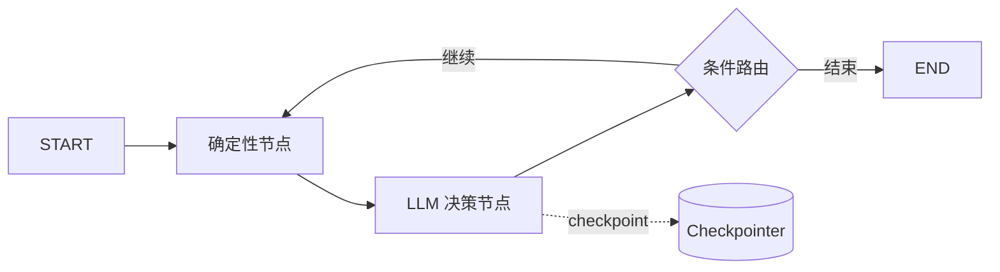
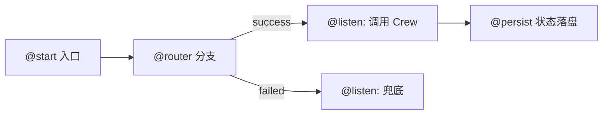
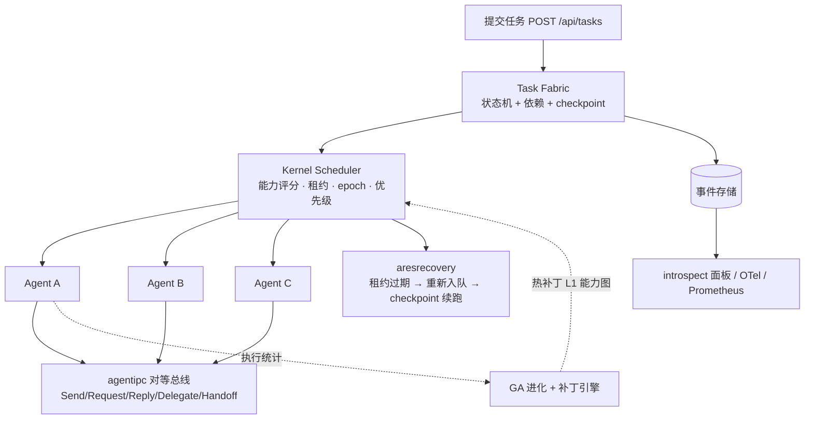

# LangChain / CrewAI / AgentScope / ARES(goagent) 框架对比

> 核对日期：2026-10-19
> 核对方式：官方文档 + GitHub 仓库 + PyPI 发布记录 + 本仓库源码/README/测试
> 对比对象：LangChain（含 LangGraph）、CrewAI、AgentScope、ARES（本仓库，模块名 `github.com/Timwood0x10/ares`，旧称 goagent）

---

## 0. 先读这一页

### 0.1 一句话结论

| 框架 | 一句话定位 | 最适合 |
|---|---|---|
| **LangChain / LangGraph** | 生态最大、集成最多的 Python Agent 平台；LangGraph 提供底层状态图与持久化执行 | 需要海量模型/向量库/文档加载器集成，或复杂有状态图编排 |
| **CrewAI** | 角色化团队（Crew）+ 事件驱动流程（Flow）的双层框架 | 业务自动化原型、角色分工明确的多 Agent 协作 |
| **AgentScope** | 阿里出品的生产向 Agent 框架 + Agent Service（FastAPI/Web UI/沙箱/A2A） | Python 技术栈下的多租户 Agent 服务、需要沙箱与现成控制台 |
| **ARES（goagent）** | Go 编写的 Agent 运行时：内核调度、持久任务、崩溃恢复、混沌与进化 | Go 团队、自托管、把"Agent 挂掉后任务还能续跑"当作硬需求 |

### 0.2 四个项目不在同一个抽象层

这是很多对比文章最大的误导来源：

- **LangChain** 是 Agent 开发框架（模型 + 工具 + middleware 的 harness），**LangGraph** 是它下面的编排运行时，**Deep Agents** 是再上层的开箱实现，**LangSmith** 是横切的观测/部署平台。
- **CrewAI** 把"团队协作"（Crew）和"确定性流程"（Flow）分成两层，官方明确建议生产应用**从 Flow 开始**，在需要自主性的步骤里调用 Crew。
- **AgentScope** 同时提供框架（Agent/ReAct/Toolkit/Memory）和 **Agent Service**（服务化后端 + Web UI + 多租户 + 定时任务），后者已经接近一个产品而不只是库。
- **ARES** 不把自己定位成"编排框架"，而是 **Agent Operating System**：Agent 是被内核调度的可丢弃执行体，Task 才是持久资产。它的对照物更接近"运行时/调度器"，而不是 LangChain 的 Chain。

因此下面的表格只做**能力有无与机制差异**的对比，不做"谁更强"的总排名。

### 0.3 版本与生态快照

| 维度 | LangChain / LangGraph | CrewAI | AgentScope | ARES（goagent） |
|---|---|---|---|---|
| 主要语言 | Python（另有 JS/TS 版） | Python（>=3.10,<3.14） | Python（>=3.11） | Go 1.26.1 |
| 最新版本 | LangChain **1.4.6** / LangGraph **1.2.16** | **1.15.28** | **2.0.10** | 仓库 `VERSION` **0.3.4**；GitHub 最新 Release **v0.3.3** |
| 最新发布 | 2026-10-14 / 2026-10-16 | 2026-10-14 | 2026-10-12 | 2026-10-12（v0.3.3） |
| GitHub Stars | 148.1k / 43.5k | 59.9k | 33.5k | **16** |
| License | MIT | MIT | Apache-2.0 | Apache-2.0 |
| 维护主体 | LangChain Inc. | CrewAI Inc. | 阿里巴巴 / agentscope-ai | 个人项目（1 名贡献者） |
| 商业产品 | LangSmith（观测/评估/部署） | CrewAI 企业平台 | 阿里云生态 / AgentScope Studio | 无 |

> 星数与版本为 2026-10-19 抓取快照，会持续变化。AgentScope 官网文档站的版本选择器仍显示 `v1.0 / v0.1.x`，但 PyPI 与 GitHub README 已是 **2.0.x**——查文档时要认版本线，这是它当前最容易踩的坑。

---

## 1. 架构与核心抽象

### 1.1 总表

| 维度 | LangChain / LangGraph | CrewAI | AgentScope | ARES |
|---|---|---|---|---|
| 核心抽象 | `create_agent`（model + harness）；LangGraph `StateGraph` | `Crew`（agents + tasks + process）+ `Flow` | `AgentBase`（reply/observe/print）+ `Msg` + `Toolkit` + `Pipeline` | Kernel Scheduler + Task Fabric + Agent Fabric + L1/L2 DAG |
| 执行模型 | 节点/边组成的图，Pregel 式超步 | 顺序或层级流程；Flow 为事件驱动 | 消息驱动；Agent 循环 + Pipeline | 任务状态机 + 量子（reason→tool→observe→checkpoint→yield） |
| 编排形态 | 显式图，可混编确定性代码与 LLM 决策 | Flow 定骨架，Crew 做自主协作 | Conversation / Routing / Handoffs / 并发 / Pipeline | 内核按能力派发，运行时动态生长 L2 图 |
| 状态归属 | Checkpointer（thread 级） | Flow state（可持久化） | 对象的 `state_dict`（可嵌套） | Task checkpoint envelope（跨 agent 存活） |
| 设计哲学 | 原语优先、按需组合 | 角色隐喻、低门槛 | 面向生产、可观察可干预 | Agents decide. The Kernel enforces. |

### 1.2 LangChain / LangGraph

LangChain 1.x 把 Agent 重新定义为 **Model + Harness**：

- `create_agent(model=..., tools=[...], system_prompt=..., middleware=[...])` 是最小 harness；
- **middleware** 是能力扩展点，官方内置 `HumanInTheLoopMiddleware`、`SummarizationMiddleware`、`ToolRetryMiddleware`、`ModelFallbackMiddleware`、`ModelCallLimitMiddleware`、`PIIMiddleware` 等；
- Agent 本体编译成一张 **LangGraph** 图，因此自动继承持久化、断点续跑与 HITL；
- 再往上是 **Deep Agents**（上下文压缩、虚拟文件系统、子 Agent 派生）。

LangGraph 的抽象很克制：`StateGraph` + 节点函数 + 边/条件边 + `compile()` + `invoke()`。它受 Pregel / Apache Beam 启发，公共接口参考 NetworkX，可脱离 LangChain 单独使用。

**优势**：同一张图里混编确定性逻辑与 Agent 决策；checkpoint 支持中断、回放、时间旅行；生态集成数量在所有框架里断层第一。
**代价**：抽象层多，出错时调用栈深；LangChain 历史上有破坏性变更，1.x 收敛后好转，但旧教程仍大量混杂 0.1/0.2 写法。

### 1.3 CrewAI

CrewAI 的架构是 **Flow 作骨架、Crew 作智能单元**：

- **Crew** = `agents` + `tasks` + `process`（`sequential` 默认 / `hierarchical`）。
- **Agent** 由 `role` / `goal` / `backstory` 三要素塑形，配 `llm`、`tools`。
- **Flow** 用 `@start` / `@listen` / `@router` / `@persist` 组织事件驱动流程，支持 `or_` / `and_` 汇合、条件分支、循环、状态持久化（默认 SQLite）。
- `@human_feedback`（>=1.8.0）可在 Flow 中暂停收集人类反馈，并把自由文本归约为 `approved/rejected/needs_revision` 等标签。

**优势**：概念少、上手快；角色分工直观；Flow 让"确定性"回到开发者手里，弥补了纯 Crew 的不确定性。
**代价**：Crew 内部仍由 LLM 决策，行为不完全可预测；复杂拓扑（动态图、跨流程子图）不如 LangGraph 表达力强；Python 进程内执行，没有分布式调度器。

### 1.4 AgentScope

AgentScope 2.0 的抽象面非常小，但配套很重：

- **State**：对象初始化与状态管理解耦，`state_dict()` / `load_state_dict()` 可嵌套恢复 agent / memory / toolkit。
- **Msg**：一份数据结构同时承担 Agent 通信、UI 展示、记忆存储、LLM 适配四种角色。
- **Tool**：任何 callable（函数、偏函数、实例方法、`__call__` 对象）都能当工具，不设注册协议；同步/异步、流式/非流式任意组合。
- **Agent**：`reply` / `observe` / `print` / `handle_interrupt`；ReAct Agent 暴露 `_reasoning` / `_acting` 作为模板方法。
- **Pipeline / Workflow**：Conversation、Routing、Handoffs、Concurrent Agents、Multi-Agent Debate。
- **Agent Service**：FastAPI 后端 + 预制 Web UI，支持多租户/多会话、Agent Team（leader-worker）、IM 渠道（飞书/Discord）、RAG、MCP & Skill Hub、持久化、定时任务、SOP、**A2A 协议**、实时语音 Agent。

AgentScope 2.0 还明确把**沙箱**（本地/Docker/E2B/Daytona/K8s）、**权限与 HITL**、**长期记忆**（ReMe/Mem0）、**上下文压缩**、**统一事件总线**列为核心构建块——这说明它的目标不是"demo 框架"，而是可部署的 Agent 服务。

**优势**：服务化程度最高；中文文档与阿里生态加成；A2A/沙箱/多租户/控制台开箱可用。
**代价**：2.0 相对 1.0 是结构性重写，社区教程与博客大量停留在 0.1.x；国际社区仍小于 LangChain/CrewAI；强绑定 Python 技术栈。

### 1.5 ARES（goagent）

ARES 的架构与上面三个都不同，它把 Agent 当成**可丢弃的进程**，把 Task 当成**持久意图**：

几个关键机制（均在本仓库有对应代码与测试）：

| 机制 | 位置 | 作用 |
|---|---|---|
| 任务状态机 | `internal/fabric/task` | READY → LEASED → RUNNING → DONE/FAILED；lease + epoch 防脑裂 |
| 内核调度 | `internal/kernel` | drain 循环、能力/负载/置信度评分、租约心跳、优先级抢占 |
| Agent 生命周期 | `internal/fabric/agent` | Spawn/Kill/Suspend/Recover，agent 可被替换 |
| 崩溃恢复 | `internal/aresrecovery` | 租约过期 → 重新入队 → 替代 agent → checkpoint 续跑；PG 模式支持跨重启回折 |
| 对等 IPC | `internal/agentipc` | Send/Request/Reply/Delegate/Handoff/Subscribe + 有界死信存储 |
| 图引擎 | `internal/fabric/task/workflow/engine` | 单一 `MutableDAG` 类型，L1 能力图约束 L2 执行图 |
| 观测 | `internal/introspect`、`internal/runtime/observability` | 只读面板 + OTel trace + Prometheus 指标 + Flight Recorder 录制/回放 |
| 混沌 | `internal/runtime/arena` | Kill/Partition/Pause/Slow/ToolTimeout/CorruptMemory/DisconnectMCP/LLMFailure |
| 进化 | `internal/runtime/ares_evolution`、`internal/runtime/evolution` | GA 种群进化 + Genome/Diff/Patch 热补丁 |

**优势**：Go 静态编译、低内存、goroutine 并发；任务寿命长于 Agent；恢复、混沌、观测是核心路径而非插件；对等 IPC 不是"编排器伪装的协作"。
**代价**：生态极小（16 stars、1 名贡献者），没有文档加载器、没有开箱 RAG 管线、LLM 只支持 OpenAI/OpenRouter/Anthropic/Ollama 四家；概念密度高（L1/L2、租约、epoch、量子），学习曲线在四个里最陡。

---

## 2. 编排能力对比

| 能力 | LangGraph | CrewAI | AgentScope | ARES |
|---|---|---|---|---|
| 显式 DAG | 原生 `StateGraph` | 非显式；Flow 是事件图 | Pipeline / 并发/路由组合 | L2 执行图 + Task 依赖 |
| 条件分支 | `add_conditional_edges` | `@router` | Routing / handoffs | 内核按能力与任务类型派发 |
| 循环 | 原生支持（有环图） | Flow 可通过 router/listen 回环 | ReAct 内循环 + 工作流循环 | ReAct 量子循环 + `PlanLoop` 多轮重规划 |
| 并行 | 同超步节点并行 | 多个 `@start`、`async_execution` | Concurrent Agents / 并发 Pipeline | drain 并发量子（goroutine） |
| 子图/嵌套 | 节点可为子图 | Flow 内调用 Crew | Pipeline 可组合 | 单一图类型，L1/L2 分层；无通用子图嵌套 |
| 运行时改图 | 不支持（图在编译期固定） | 不支持 | 不支持 | **支持**：运行时生长 L2 节点 + GA 对 L1 打热补丁 |
| 断点续跑 | Checkpointer | Crew checkpoint / Flow `@persist` | `state_dict` 恢复 | lease + epoch + checkpoint + 事件溯源 |
| 人机介入 | `HumanInTheLoopMiddleware` / `interrupt()` | `@human_feedback` | 权限 + HITL + `handle_interrupt` | 引擎中有 HITL 实现，但 **SDK 显式拒绝**（见 5.2） |
| 动态规划 | 需自建 | `planning=True` 追加计划到 task | Plan 特性 | 内置 planner + PlanLoop |
| 分布式 | LangSmith Deployment | 无（进程内） | Agent Service 多实例；A2A 跨服务 | 默认单进程内存 fabric；PG 事件存储可跨重启，**不是分布式调度器** |

**要点**：

- 论**图表达力**，LangGraph 仍然最强：有环、条件边、子图、checkpoint 回放是完整的一套。
- 论**确定性与自主性的分层**，CrewAI 的 Flow + Crew 设计最容易被业务团队理解。
- 论**服务化与协议**，AgentScope 最完整（A2A、Web UI、IM、沙箱）。
- 论**运行时可变性**，只有 ARES 把"图在运行时长出来"当成一等能力，代价是调试心智负担高。

---

## 3. 多 Agent 协作

| 模式 | LangGraph | CrewAI | AgentScope | ARES |
|---|---|---|---|---|
| 监督/编排 | 手写 supervisor 图 | hierarchical + manager agent | Agent Team（leader-worker） | 无中心编排器，内核派发 |
| 角色分工 | 自定义 | `role/goal/backstory` 一等公民 | Agent 配置 + 系统提示 | 能力（capability）注册，不绑定人格 |
| 任务分配 | 图路由 | manager 委派 / 顺序执行 | Pipeline 派发、handoff | 能力评分 + 负载 + 置信度 + 优先级 |
| 对等通信 | 共享状态 | 任务输出链式传递 | 消息路由 / 广播 | agentipc 真实消息总线 |
| 结果聚合 | 状态合并 | CrewOutput 聚合 | Pipeline 汇聚 | 每个 Task 独立完成，调用方按任务查询 |
| 跨进程/跨框架 | 自建 API | 无原生协议 | **A2A** | 无 A2A/AG-UI；HTTP + MCP 为边界 |

需要特别说明 ARES 的两个限制（仓库 README 已自曝）：

1. **`ask_agent` 是 fire-and-forget**：目标 Agent 的回复只写日志，不回写给提问方。它能"派活"，但不是完整的请求-响应协作。
2. **默认 fabric 是内存态、单进程**：跨重启恢复依赖 Postgres 事件存储；多节点调度尚未实现。

因此"多 Agent 协作"这四个字在 ARES 里更偏**运行时协作原语**（IPC + 任务分派），而不是 CrewAI/AgentScope 那种"团队语义"。

---

## 4. 记忆、知识与上下文

| 维度 | LangChain / LangGraph | CrewAI | AgentScope | ARES |
|---|---|---|---|---|
| 短期记忆 | thread checkpoint / messages | Crew 运行上下文 | Memory + 会话状态 | Session 内存 + checkpoint |
| 长期记忆 | LangGraph Store（可接 Postgres 等） | 统一 `Memory` 类，默认 LanceDB | 长期记忆（ReMe/Mem0 集成） | Experience/Memory 仓储，PG + pgvector |
| 写入方式 | 开发者显式写 | LLM 推断 scope/categories/importance | Agent 自主 record/retrieve | **规则管线**：抽取→分类→评分→噪声/安全检查→冲突消解→嵌入 |
| 检索排序 | 自定义 | `0.5*语义 + 0.3*新近 + 0.2*重要性` | 语义检索 | 规则评分 + 向量相似度 |
| 去重/冲突 | 自定义 | 余弦 0.85 触发 LLM 裁决；批内 0.98 静默丢弃 | 由记忆后端决定 | 规则冲突检测（阈值可配） |
| 作用域 | namespace | 文件系统式 scope 树 + MemorySlice | 会话/租户 | tenantID 谓词 + knowledge namespace |
| 知识图谱 | 无内置（可接图库） | 无内置 | 无内置（有 RAG） | **AKG（BETA）**：规则抽取 + 混合检索，构建期不调用 LLM |
| 文档加载/RAG | 100+ loader，最完整 | 少量内置 + knowledge_sources | 内置 RAG 服务 | **无文档加载器/切分管线**；知识侧走 KnowledgeObject/AKG 构建，检索注入靠 `WithRAG` |

**四种记忆哲学的差异**：

- **LangGraph**：给你状态与存储原语，记什么、怎么记由你决定。灵活，但等于把记忆设计成本留给你。
- **CrewAI**：把记忆做成"LLM 自动整理的知识库"，scope 树自动生长，开箱即用；代价是写入路径依赖 LLM，成本与延迟更高，且行为不如规则管线可预测。
- **AgentScope**：记忆是可保存/恢复的有状态对象，长期记忆交给 ReMe/Mem0 等后端；工程化最规整。
- **ARES**：蒸馏是**规则驱动、不调 LLM**——快、便宜、可离线复现，但语义质量明显弱于 LLM 蒸馏。AKG 同理：这是它最激进的实验，也是完成度最低的子系统。

---

## 5. 可靠性与生产特性

### 5.1 能力表

| 机制 | LangGraph | CrewAI | AgentScope | ARES |
|---|---|---|---|---|
| 重试 | 需自建或用 middleware | `max_retry_limit` / `max_execution_time` | 有限内置 | 任务/工作流级重试（默认 3 次，指数退避） |
| 输出校验 | 结构化输出 + 自定义 | `output_pydantic` + Guardrails | 结构化输出 | Schema 校验器 |
| 多模型降级 | `ModelFallbackMiddleware` | 可配置多 LLM | 多 provider 配置 | FailoverClient（4 provider + 冷却） |
| 熔断 | 无内置 | 无内置 | 无内置 | LLM failover 冷却；PG 检索有专用熔断器 |
| 崩溃恢复 | Checkpoint 续跑 | 任务级 checkpoint | 状态恢复 | 租约过期→重入队→替代 Agent→checkpoint 续跑 |
| 死信 | 无 | 无 | 无 | agentipc `DeadLetterStore`（有界、只诊断、无自动重试） |
| 沙箱 | 无内置 | 无内置 | 本地/Docker/E2B/Daytona/K8s | 文件工具沙箱；进程内执行，无容器隔离 |
| 混沌工程 | 无 | 无 | 无 | `internal/runtime/arena` 故障注入 + 生存测试 |
| 观测 | LangSmith（商业） | 事件 + 日志 + 第三方 | Tracing / Studio | OTel + Prometheus + introspect 面板 + Flight Recorder |
| 部署 | LangSmith Deployment | 进程/容器 | 内置 Agent Service | `ares serve` 单二进制 |

### 5.2 ARES 的 HITL 必须单独说明

旧版对比文档容易写成"HITL 已实现"。准确说法是：

- `internal/fabric/task/workflow/engine/hitl.go` 与 `internal/fabric/task/fabric_lifecycle.go` 里确有 HITL 中断/审批实现；
- 但 **SDK 的 `WithHumanInput` 会显式返回 `ErrHumanInputUnsupported`**，因为 B3 收敛后所有执行都走共享 L2 会话内核，而该内核没有"每次工具调用前审批"的拦截点；
- 团队的选择是**响亮失败而不是静默丢门禁**（`sdk/human_input_unsupported_test.go` 锁定）。

这是正确的工程决策，但对选型意味着：**今天的 ARES 不能作为需要工具级人工审批的系统**。

### 5.3 生产成熟度的诚实排序

- **LangChain/LangGraph**：生产案例最多，但"能跑"与"跑得好"之间仍需要自建大量运维能力；LangSmith 是商业产品。
- **CrewAI**：原型到中小规模生产顺畅；大规模、强一致、复杂恢复不是它的强项。
- **AgentScope**：服务化能力最完整，2.0 是重构后的新版本，需按 2.0 文档评估而不是旧教程。
- **ARES**：README 自己写明"**尚不是加固过的 runtime**"；GA apply gate 与多目标入口未接线；AKG 是 BETA。适合技术验证与自托管实验，不适合把关键业务直接押上。

---

## 6. 工具、协议与互操作

| 维度 | LangChain | CrewAI | AgentScope | ARES |
|---|---|---|---|---|
| 内置工具 | 通过 integrations 海量接入 | 数十个内置 + 自定义 | Toolkit：shell/文件编辑/搜索等编码工具 | 24 个内置工具（文件/网络/文本/数学/PDF/知识/记忆等，部分为聚合工具） |
| MCP | 通过适配器接入 | 通过 `crewai-tools` / 自定义接入 | **核心支持**（MCP + Skill Hub） | **原生客户端**（`internal/mcpclient`，`sdk.WithMCP`） |
| Agent 间协议 | 自建 | 无 | **A2A** | 无 A2A/AG-UI；agentipc 为进程内总线 |
| 对外 API | LangServe / LangSmith Deployment | 自建 | FastAPI 服务（多租户/会话/定时任务） | REST（`/api/tasks`、`/api/graphs`、`/api/tools`、`/api/v1/introspect/*`） |
| CLI | `langchain` CLI（脚手架） | `crewai` CLI（create/run/replay/memory） | `agentscope` CLI / `main.py` | `ares`（serve/run/doctor/status/evolution/knowledge/arena/flight/bench） |
| 多模态 | 强（content blocks） | 取决于模型 | 支持多模态消息 + 实时语音 | LLM 客户端未见图像输入支持 |

**互操作建议**：如果要在四者之间搭桥，**MCP 是最现实的边界**——四个框架都能接 MCP；A2A 目前只有 AgentScope 原生支持。不要期待"ARES 的 Agent 直接加入 CrewAI 的 Crew"，那需要自建协议层。

---

## 7. 安全与多租户

| 维度 | LangChain | CrewAI | AgentScope | ARES |
|---|---|---|---|---|
| 鉴权 | 交给应用 | 企业安全配置 | Agent Service 内建 | JWT / API key / introspect token + 审计 |
| 工具级护栏 | middleware（PII、调用上限） | Guardrails | 权限 + HITL | ToolAllowlist + 文件沙箱 + SSRF 防护 |
| 租户隔离 | namespace 约定 | scope 约定 | 多租户服务 | 任务级 tenantID，内核强制覆盖 LLM 传入值 |
| 隔离边界 | 取决于实现 | 取决于实现 | 服务层 | **不端到端**：experience/蒸馏按列隔离；知识侧按 namespace，AKG 事实全落 `default` |
| 多租户前提 | — | — | 服务部署 | 必须由鉴权层绑定租户，不能信任请求体 |

ARES 的租户设计值得单独记一笔：它用 **context 传递 + 内核盖章**防止 LLM 在工具参数里伪造 `tenant_id`，这个思路比"在 prompt 里要求模型别乱填"强得多；但知识层隔离不完整，README 与 `SECURITY.md` 都明确承认这一点。

---

## 8. 性能与语言模型

这是最容易被夸大的维度，先给结论：

1. **没有可信的跨框架基准**。各家的 benchmark 测试的东西不同（吞吐、延迟、token 成本、并发会话数），不能直接比较。
2. **LLM 调用是 I/O 密集**，Python 的 GIL 对"多个 Agent 等模型返回"影响很小；真正的瓶颈通常是模型延迟、限流与上下文长度。
3. **Go 的优势在资源占用、启动速度、部署形态**（单二进制、无解释器、内存低），而不是"Agent 一定更快"。

| 维度 | LangChain/CrewAI/AgentScope | ARES |
|---|---|---|
| 部署产物 | Python 环境 + 依赖 | 单个静态二进制 |
| 并发模型 | asyncio / 线程 | goroutine |
| 冷启动 | 秒级（导入大量包） | 毫秒级 |
| 内存占用 | 较高 | 较低 |
| 生态换来的成本 | 依赖树深、供应链风险 | 依赖少，但什么都得自己写 |

ARES 仓库内的基准（Apple M3 Max，`-benchtime=500ms`）是**单机冒烟基线**，例如"100 任务调度排空 1.03ms""64 节点 L2 生长链 132ms"。这些数字只用于自身前后对照，**不能拿来和 Python 框架比**——测试负载与语义都不同。

---

## 9. 开发体验与学习曲线

| 维度 | LangChain | CrewAI | AgentScope | ARES |
|---|---|---|---|---|
| Hello World | ~8 行 | ~15 行或 CLI 脚手架 | ~15 行 | Go 模块 + `ares.yaml` + ~10 行 SDK |
| 上手难度 | 中高（层次多） | 低 | 中 | 高（AgentOS 概念密度大） |
| 配置方式 | 代码为主 | YAML/JSONC + 代码 | 代码 + 服务配置 | **YAML 单一入口** + SDK options |
| 文档质量 | 广但新旧混杂 | 清晰、新手友好 | 中文优先，2.0 文档线需确认 | 内部文档多、示例多，但外部资料几乎为零 |
| 调试体验 | LangSmith 很强（收费） | 日志/事件/`crewai replay` | Studio + tracing | introspect + Flight Recorder + OTel（全开源） |
| 扩展方式 | 自定义 tool/middleware/集成包 | 自定义 tool/Flow | Toolkit/MCP/Skill/中间件 | Tool/PluginBus/MCP/自定义 Cognition |

一个现实差异：**遇到问题时能不能搜到答案**。LangChain/CrewAI/AgentScope 有大量博客、课程、Stack Overflow 记录；ARES 基本只能读源码与仓库文档。这是选型时最容易被低估的成本。

---

## 10. 各自的优势与短板

### 10.1 LangChain / LangGraph

**优势**
- 集成生态断层第一：模型、向量库、文档加载器、工具、Tracing。
- LangGraph 的图模型 + checkpoint + HITL 是目前最完整的有状态编排方案。
- 1.x 的 `create_agent` + middleware 明显降低了"拼装成本"。
- 文档、课程、社区答案最多。

**短板**
- 抽象层多，性能问题与错误定位需要经验。
- 历史 API 变更频繁，网上大量过时示例。
- 关键生产能力（LangSmith 观测/部署）是商业产品。
- 默认不提供沙箱、混沌、任务级恢复这类"运行时"能力。

### 10.2 CrewAI

**优势**
- 概念最少，业务人员也能读懂 `role/goal/backstory`。
- Flow 把确定性编排补回来了，`@router`/`@persist`/checkpoint 够用。
- 统一 Memory 的 scope 树 + 复合评分设计相当实用。
- 社区活跃，模板与示例多。

**短板**
- Crew 内部行为由 LLM 决策，可重复性有限。
- 没有分布式调度、没有内核级恢复。
- 复杂拓扑表达力不如 LangGraph。
- 深度定制（自定义执行引擎、非标准协议）会很快撞到框架边界。

### 10.3 AgentScope

**优势**
- 服务化最完整：多租户、会话、Web UI、定时任务、IM、A2A、沙箱。
- 抽象小（reply/observe/print），但周边能力重，适合"直接部署"。
- 中文文档与阿里云/ModelScope 生态衔接好。
- 2.0 明确面向"更强自主性的模型"设计，HITL/权限/上下文压缩都是一等公民。

**短板**
- 2.0 与 1.x 生态割裂，教程滞后。
- 国际社区规模小于前两者。
- 框架 + 服务 + Studio 的概念面较宽，简单脚本场景显得重。
- 绑定 Python 技术栈。

### 10.4 ARES（goagent）

**优势**
- **任务寿命长于 Agent**：lease + epoch + checkpoint + 事件溯源，Agent 死了任务能续。
- **内核调度**：能力/负载/置信度/优先级，策略可热演化。
- **运行时可变图**：L2 随会话生长，L1 由 GA 打补丁（这是它与所有编排框架的根本差异）。
- **可观测与混沌是一等公民**：introspect、Flight Recorder、Arena 全部开源。
- **Go 单二进制**：部署简单、资源占用低。
- **对等 IPC**：不是"编排器假装多 Agent"。

**短板（按 README 自述与代码核实）**
- 生态极小：16 stars、1 名贡献者、24 个内置工具、无文档加载器、无开箱的切分/嵌入/RAG 管线。
- LLM 仅 4 家：OpenAI / OpenRouter / Anthropic / Ollama。
- **HITL 在生产路径不可用**（SDK 显式拒绝）。
- **多目标 GA 未接线**，apply gate 未安装；进化系统未经大规模验证。
- **默认单进程内存 fabric**，不是分布式调度器。
- **调度是协作式的**：只在 ReAct 轮边界让出，单个失控 LLM 调用靠超时兜底。
- **租户隔离不端到端**；AKG 是 BETA。
- 概念密度高，外部学习资料几乎为零。

---

## 11. 选型建议

### 11.1 按场景

| 场景 | 首选 | 理由 |
|---|---|---|
| 快速验证想法、需要任意模型/向量库/loader | **LangChain** | 集成最全，改一个 `model=` 就能换厂商 |
| 复杂有状态工作流、需要中断/回放/人工审批 | **LangGraph** | 图 + checkpointer + interrupts 最完整 |
| 角色分工明确的业务自动化（研究/写作/审核） | **CrewAI** | Crew 隐喻直观，Flow 保确定性 |
| 需要现成的多租户 Agent 服务、Web UI、沙箱、A2A | **AgentScope 2.0** | 服务层能力最全 |
| Go 团队、自托管、要求崩溃恢复与低资源占用 | **ARES** | 单二进制 + 内核调度 + 持久任务 |
| 需要混沌演练、运行时策略进化、全链路观测 | **ARES** | 这三点是它的核心设计目标 |
| 需要工具级人工审批 | **LangGraph / CrewAI / AgentScope** | ARES 当前不支持 |
| 需要成熟生态与可招聘的开发者 | **LangChain / CrewAI** | 人才与资料最多 |

### 11.2 反选清单（什么时候不要选）

- **不要为了"Go 更快"选 ARES**：如果你的瓶颈是模型延迟，语言不解决问题；如果瓶颈是并发连接数，Python asyncio 也够用。
- **不要为了"生态"选 LangChain 然后只用它的 Agent 循环**：那等于背了一整棵依赖树换 200 行代码；直接用模型 SDK + 自建循环可能更清晰。
- **不要把 CrewAI 的 Crew 当成确定性工作流**：需要可重复、可审计的步骤，请用 Flow（或 LangGraph）。
- **不要用 AgentScope 1.x 的教程评估 2.0**：两代 API 差异是结构性的。
- **不要把 ARES 当成"多节点分布式调度器"**：它默认是单进程；PG 只解决跨重启持久化，不解决水平扩展。

### 11.3 组合使用的现实路径

1. **MCP 作为工具层边界**：四个框架都能接 MCP，把内部系统封装成 MCP server，可显著降低迁移成本。
2. **A2A 作为跨框架 Agent 边界**：目前 AgentScope 原生支持；其他框架需要自建适配。
3. **不要让两个框架同时拥有"编排权"**：例如 LangGraph 编排 + ARES 执行，必须明确谁是唯一调度者，否则恢复语义会冲突。

---

## 12. 相对旧版对比文档的主要更正

仓库里原有 `docs/reference/framework-comparison-*.md`（含 tRPC-Agent-Go、ARES 五方对比）写作时间较早，本次核对发现以下事实已变化：

| 项目 | 旧文档说法 | 本次核实 |
|---|---|---|
| 对比范围 | 5 个框架（含 tRPC-Agent-Go、ARES） | 本文聚焦文件名约定的 4 个：LangChain、CrewAI、AgentScope、goagent |
| LangChain | v0.3.x、约 10 万 stars | LangChain **1.4.6**、LangGraph **1.2.16**、148.1k / 43.5k stars |
| LangChain 抽象 | Chain / AgentExecutor 为主 | `create_agent` = model + harness；middleware 成为一等扩展点；底层是 LangGraph |
| CrewAI | 约 4 万 stars；无 checkpoint、无 HITL | **1.15.28**、59.9k stars；有 Crew checkpoint、Flow `@persist`、`@human_feedback`、统一 Memory |
| AgentScope | 约 4 千 stars；v0.x；"缺少生产可靠性机制" | **2.0.10**、33.5k stars；Agent Service、A2A、沙箱、HITL、长期记忆、多租户 |
| ARES 版本 | dev 分支 v0.3.1 | 仓库 `VERSION` **0.3.4**；GitHub Release **v0.3.3**（2026-10-12） |
| ARES 贡献者 | 2 名 | **1 名**（Timwood0x10）；16 stars |
| ARES HITL | "已实现但未接入生产" | 更准确：**SDK 显式返回 `ErrHumanInputUnsupported`**，是主动拒绝而非静默缺失 |
| ARES 死信 | AHP DLQ 已实现未接入 | AHP 已退役；现存为 agentipc `DeadLetterStore`（有界、只诊断、无自动重试） |

---

## 13. 附录：事实核对表

| 事实 | 值 | 来源 |
|---|---|---|
| LangChain 最新版 | 1.4.6（2026-10-14） | PyPI `langchain` |
| LangGraph 最新版 | 1.2.16（2026-10-16） | PyPI `langgraph` |
| CrewAI 最新版 | 1.15.28（2026-10-14） | PyPI `crewai` |
| AgentScope 最新版 | 2.0.10（2026-10-12） | PyPI `agentscope` |
| LangChain / LangGraph stars | 148.1k / 43.5k | GitHub 仓库页（2026-10-19 快照） |
| CrewAI stars | 59.9k | GitHub 仓库页 |
| AgentScope stars | 33.5k | GitHub `agentscope-ai/agentscope` |
| ARES stars / 贡献者 | 16 / 1 | GitHub `Timwood0x10/ARES` |
| ARES 最新 Release | v0.3.3（2026-10-12） | GitHub Releases |
| ARES 仓库版本 | 0.3.4 | 本仓库 `VERSION` |
| ARES Go 版本 | 1.26.1 | 本仓库 `go.mod` |
| ARES 当前分支/提交 | `dev` / `0783e67`（2026-10-19） | `git log -1` |
| CrewAI 记忆默认存储 | LanceDB + OpenAI 3072 维嵌入 | CrewAI 官方 Memory 文档 |
| CrewAI 记忆评分权重 | 0.5 语义 + 0.3 新近 + 0.2 重要性 | CrewAI 官方 Memory 文档 |
| AgentScope 2.0 沙箱 | 本地/Docker/E2B/Daytona/K8s | AgentScope GitHub README |
| AgentScope 2.0 协议 | A2A、MCP、实时语音（WebRTC） | AgentScope GitHub README |
| ARES 内置工具 | 24 个工具名（部分为聚合工具） | `internal/tools/resources/builtin` |
| ARES LLM 提供商 | OpenAI / OpenRouter / Anthropic / Ollama | `sdk/options.go` |
| ARES HITL | SDK 拒绝（`ErrHumanInputUnsupported`） | `sdk/human_input_unsupported_test.go` |

### 核对边界

- 本文所有外部框架信息以 **2026-10-19** 能访问到的官方文档、PyPI、GitHub 为准；这四个项目都在快速迭代，版本与能力会继续变化。
- ARES 的能力描述以**本仓库当前 `dev` 分支代码**为准，与 GitHub Release v0.3.3 可能存在细节差异。
- 未做跨框架基准测试；文中不提供"性能排名"，只描述语言/运行时带来的结构性差异。
- 未把厂商博客、第三方测评当作事实来源；有争议的说法要么标注限制，要么不写。

---

## 14. 术语速查

| 术语 | 含义 |
|---|---|
| Harness | 模型循环之外的一切：提示、工具、middleware |
| Checkpoint | 执行状态的持久化快照，用于中断/恢复/回放 |
| Durable execution | 长时运行任务在故障后从中断点继续 |
| Lease / Epoch | 任务租约与代际号，防止旧 Agent 的过期结果覆盖新结果 |
| Quantum | ARES 的一次执行切片：reason → tool → observe → checkpoint → yield |
| L1 / L2 | ARES 的能力图（ToolClass，长期进化）与执行图（ToolInstance，每会话生长） |
| Fabric | ARES 的持久任务/Agent 管理层，任务独立于 Agent 存活 |
| AKG | ARES 的自适应知识图谱，构建期不调用 LLM（BETA） |
| A2A | Agent-to-Agent 协议，跨框架/跨服务 Agent 通信 |
| MCP | Model Context Protocol，工具与上下文的接入标准 |
