# ARES System Internals (v0.3.x)

> A reference walkthrough of how the ARES (goagent) v0.3.x AgentOS works,
> covering 15 core modules, each with a Mermaid diagram and source
> file / line references.
>
> The design thesis in one line: **treat an agent as a disposable process,
> a task as a durable intent; the kernel schedules, the LLM understands and
> decomposes, GA makes it sharper over time, and checkpoint + chaos make it
> safe to fail.**
>
> Note: the project self-labels as dev / small ecosystem / GA not yet
> validated at production scale (see `docs/reference/framework-comparison-*.md`).

---

> **Where this document fits.** It is the *runtime internals* reference:
> startup -> hot path -> L2/L1 graphs -> collaboration -> IPC -> recovery ->
> chaos -> evolution -> storage / knowledge / memory / MCP / SDK-CLI / security.
> Pair it with `README.md` (positioning + *Honest limits*) -> `ARCHITECTURE.md`
> (module map, data flow, the 23-step `POST /api/tasks` walkthrough) ->
> `docs/articles/*` (per-subsystem deep dives) -> `SECURITY.md` and
> `docs/operator/README.md` (operations).

## Contents

1. [Global Overview](#1-global-overview)
2. [Entry Point & Startup (serve / Bootstrap)](#2-entry-point--startupserve--bootstrap)
3. [Configuration Panel (config.yaml)](#3-configuration-panelconfigyaml)
4. [Hot Path: Single-Task Execution Loop](#4-hot-pathsingle-task-execution-loop)
5. [Quantization & Resource Budgets](#5-quantization--resource-budgets)
6. [Dynamic Graph: L2 Session Graph ↔ Tasks (planprojection)](#6-dynamic-graphl2-session-graph--tasksplanprojection)
7. [L1 Tool-Class Graph Constraining L2](#7-l1-tool-class-graph-constraining-l2)
8. [Agent Expansion (agentsyscall)](#8-agent-expansionagentsyscall)
9. [Collaboration: Decompose / Ask / Handoff](#9-collaborationdecompose--ask--handoff)
10. [IPC Message Bus (agentipc)](#10-ipc-message-busagentipc)
11. [Multi-Session Concurrency & Resource Isolation](#11-multi-session-concurrency--resource-isolation)
12. [Recovery (aresrecovery)](#12-recoveryaresrecovery)
13. [Chaos Engineering](#13-chaos-engineering)
14. [Evolution (GA cold path + Deployment Pipeline)](#14-evolutionga-cold-path--deployment-pipeline)
15. [Observability & Control Plane (introspect)](#15-observability--control-planeintrospect)
16. [Storage Layer: Postgres (schema / retention / migration / tenant guard)](#16-storage-layer-postgres)
17. [Knowledge Layer: AKG (build / retrieve / fallback)](#17-knowledge-layer-akg)
18. [Memory & Distillation (session store / thresholds / token cost / safety fencing)](#18-memory--distillation)
19. [MCP Integration & Tool Discovery (progressive disclosure)](#19-mcp-integration--tool-discovery)
20. [SDK / CLI Usage](#20-sdk--cli-usage)
21. [Security Model (SSRF / sandbox / tenant boundaries)](#21-security-model)
22. [Where ReAct Went: Dynamic DAG and the Think-Do-Evolve Layers](#22-where-react-went-dynamic-dag-and-the-think-do-evolve-layers)
23. [L1 / L2 Dual Graphs & Data Splitting (Postgres / pgvector)](#23-l1--l2-dual-graphs--data-splitting)
24. [Retrieval Denoising (Vector-Search Noise and How to Fight It)](#24-retrieval-denoising)
25. [Checkpoint & Recovery (fields + 7 steps + two modes)](#25-checkpoint--recovery)
26. [Context Management (sliding-window truncation + rule-based cleaning + RAG injection, NOT LLM summarization)](#26-context-management)
27. [LLM Failover + Tool Organization (`core.Registry`)](#27-llm-failover--tool-organization)
28. [Event-Driven Bus (who subscribes to what)](#28-event-driven-bus)
29. [HITL Approval Gate (0.3.3)](#29-hitl-approval-gate-033)
30. [Version Status: 0.3.4 / 0.3.5 (convergence)](#30-version-status-034--035convergence)

---

## 1. Global Overview

The system splits into a **hot path** (always running, completes work) and a
**cold path** (runs when idle, keeps getting better), plus an
**observability / control plane**.

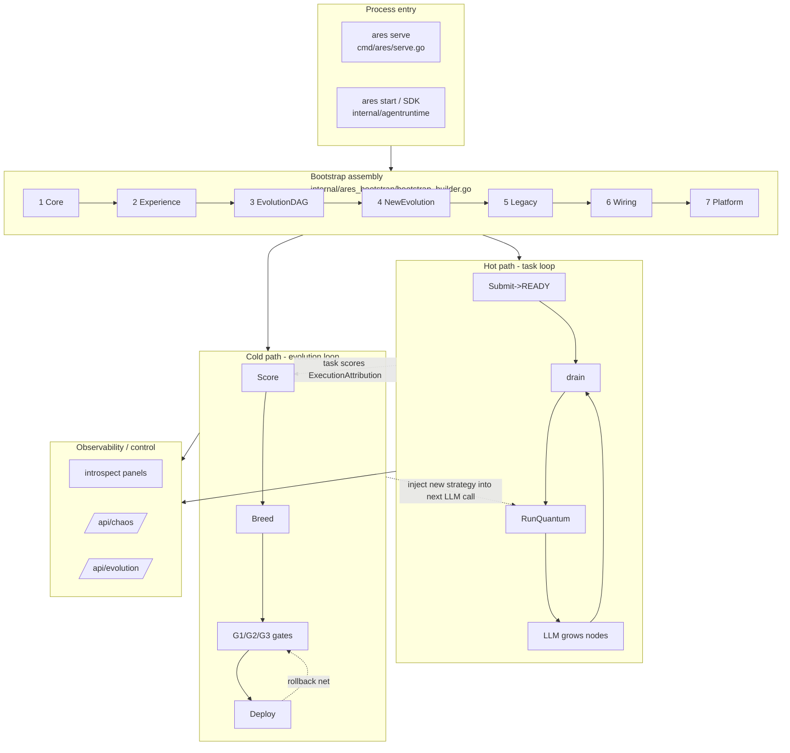

**Plain-English picture**: think of the whole system as an open kitchen.
Customers (users) place orders (submit tasks). A **shift sheet** (the task
fabric) keeps track of every dish's progress; the **cooks** (agents) are
swappable — if today's chef calls in sick, the sous-chef picks up the recipe
notes left on the shift sheet (checkpoint) and keeps cooking; the dish never
burns. Outside the kitchen there is a **judge panel** (the GA cold path) that,
when idle, flips through the cooks' "score cards" (the event ledger) and
propagates the recipes (prompts + params) that worked, culling the ones that
did not. The whole kitchen's state is visible on a **monitoring wall**
(introspect panels). The 30 sections below follow "hot before cold":
§2–§4 are "how a dish goes from order to plate", §5–§11 are "the kitchen
rules", §12–§15 are "when things break and how it gets better",
§16–§21 are "back of house (storage / knowledge / memory / tools / security)",
§22–§28 are "the frequent follow-up questions, each with a dedicated section".

**Four invariants (thread through the whole system):**

| Invariant | Meaning | Source |
|---|---|---|
| Agents never self-schedule | agents are scheduled, they never decide "who next" | `cmd/ares/kernel.go` (`kernelScheduler`; HTTP submission is the single entry) |
| Tasks outlive agents | agents are disposable; tasks are durable in the fabric | `internal/aresrecovery/recovery.go` |
| Kernel enforces provenance | origin/tenant/source come from context, never LLM args | `internal/agentsyscall/syscall.go` |
| Tasks are externally observable / schedulable | the task is a first-class citizen: "submit / check status / await result" all go through the same task interfaces; "what counts as done" is defined once | `cmd/ares/agent_routes_tasks.go`, `agent_routes_task_read.go`, `internal/agentruntime/await.go` (added in 0.3.2) |

**Plain-English picture (why the fourth one matters)**: the first two say
"agents are consumable, tasks are the asset" — but an "asset" is only valuable
if **the outside world can actually touch it**; not a black box you submit
into and forget. Since 0.3.2 the task is a **first-class external interface**:

- **Submit**: `POST /api/tasks {"query": "..."}`. Note the body **does not even
  name the capability** — it defaults to `server.default_capability`, so an
  external caller **does not need to know the internal task model** to place an
  order.
- **Check status**: `GET /api/tasks/{id}` returns the task view — on success
  the session's answer, on failure the failure reason
  (`agent_routes_task_read.go`).
- **Await**: `POST /api/tasks?wait=<dur>` blocks until the task reaches a
  terminal state; when the wait expires it **degrades to 202 with the current
  state** ("submission itself never fails because a wait expired"). A wait over
  300s is rejected with 400; a larger configured value is **clamped to the cap**
  (default 60s).
- **The rule is written once**: `TaskResolved` / `AwaitSessionResult`
  (`await.go:317/397`) replace the three hand-rolled poll loops ("serve read",
  "SDK submit", "evolution") — "what counts as resolved" (terminal state, plus
  the session answer where one exists) is **defined once** and shared by all
  three entry points.

In one line: the first two let a task **outlive the agent**; the fourth lets a
task **be submitted, queried, and awaited by the outside world** — "the task
is a first-class citizen" only closes the loop here.

---

## 2. Entry Point & Startup (serve / Bootstrap)

`runServe` in `ares serve` is the assembly hub, in four stages:
**load config → Bootstrap assembly → build peer kernel → start HTTP + loops**.

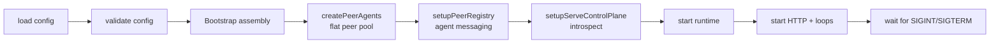

**Security fail-closed** (`cmd/ares/serve.go:292` `validateServeConfig`): a
wildcard bind (`0.0.0.0` / `::`) with no auth/JWT/`introspect.token` is
**refused at startup**, not logged-and-started. Default bind is
`127.0.0.1` (`serve.go:353` `defaultServeHost`).

**Bootstrap 7-step assembly order** (components have dependencies, built in order):

| Step | Function | Builds |
|---|---|---|
| ① | `assembleCore` `bootstrap_builder.go:68` | EventStore / Runtime / Memory / MCP / Skills |
| ② | `assembleExperience` `:162` | LLM (failover) / distillation / AKG loop / observability trio |
| ③ | `assembleEvolutionDAG` `:231` | evolution DAG / KnowledgeRuntime / evidence store |
| ④ | `assembleNewEvolution` `:322` | NewEvolution (Genome+Diff+`UngatedPatcher`) + FlightRecorder |
| ⑤ | `assembleLegacyEvolution` `:362` | legacy Evolution system (gated by `Evolution.Enabled`) |
| ⑥ | `wireEvolutionWiring` `:402` | RAG retrievers + DeploymentPipeline + minimal DAG registration |
| ⑦ | `wirePlatform` `:477` | GA evolution ticker + Discovery + SystemRuntime + expiry cleanup |

Every failed step runs `runCleanups()` (reverse order) so a failed bootstrap
never leaves live goroutines behind.

**Why seven ordered steps at all**: later components *inject* earlier ones
(step ④'s NewEvolution needs step ②'s LLM and step ③'s evidence store). It is
lego: baseplate first (Core's event store + runtime), then wheels (LLM,
memory, tools), then the engine (evolution), then the steering wheel
(scheduling, discovery, expiry loops). Wrong order = pieces do not fit.
`runCleanups()` means "if assembly breaks halfway, undo what is already
inserted, in reverse" — reverse, because later pieces depend on earlier ones.

One easily missed detail: `runServe` re-checks `ctx.Err()` **after**
Bootstrap (around `serve.go:107`) — if a SIGINT arrived *during* the
assembly, startup **aborts** rather than "finish then stop". Reason: the
next steps start HTTP and background loops; starting them on an already
canceled context just spawns a pile of immediately-erroring goroutines.
In plain terms: if the customer already said "stop", the kitchen does not
keep the fire lit.

---

## 3. Configuration Panel (config.yaml)

15 top-level sections (`internal/ares_config/config.go` `Config`):

```
server / tasks / llm / agents / tools / storage / memory /
knowledge / mcp / evolution / embedding / discovery / kernel /
security / introspect
```

**The three sections you actually touch:**

```yaml
agents:                                   # which agents + their capabilities
  peers:
    - id: coder
      capabilities: [code, refactor]      # the key for scheduling match
    - id: reviewer
      capabilities: [review, audit]

kernel:                                   # scheduling + wallet + lease
  max_concurrent: 4
  lease_ttl: 5m
  max_restarts: 5
  agent_budget:                           # *the agent wallet*
    tokens: 100000                        # lifetime token cap (0 = unlimited)
    tools: 50                             # lifetime tool-call cap (0 = unlimited)
    deadline: 30m                         # max wall-clock life ("" = unlimited)

evolution:                                # GA on/off / population / gates / rollback
```

| Block | Struct | Source |
|---|---|---|
| `kernel` | `KernelConfig` | `config.go:47` |
| `agent_budget` (the "agent wallet") | `AgentBudgetConfig` | `config.go:151` |
| `dag_execution` | `DAGExecutionConfig` | `config.go:143` |

**Per-agent limits (`agent_budget`, `AgentBudgetConfig` in
`internal/ares_config/config.go`)**: `tokens` / `tools` / `deadline`, all-zero =
unlimited — plus a `reserve_ratio` that is easy to miss. Token and tool budgets are
consumed **per quantum** through the scheduler's governance provider; the deadline is
armed at spawn.

**What actually happens when a limit is hit** (`Fabric.Admissibility` in
`internal/fabric/agent/governance.go`) — checked in a fixed precedence:

1. **deadline** first (an agent past its wall-clock life is dead weight, whatever budget
   it has left);
2. **hard exhaustion** (`used + 1 > budget`);
3. **reserve** (the remaining share dropped below `reserve_ratio`).

The fabric then refuses to admit the quantum, and the task the agent was holding goes
**back to READY for another agent to resume from its checkpoint**. The agent is not killed
and not parked "until a new card is issued" — the *work* moves, and the checkpoint is what
makes that move safe.

**Plain-English picture**: a **daily cash limit on a company card**, not a punishment. When
the card is maxed the purchases stop, but the project is not cancelled — someone else picks
it up with the receipt (checkpoint) in hand. `reserve_ratio` is the "keep enough for the
return trip" rule: stop taking *new* work before the card is empty, so finishing what you
already hold stays possible.

Two more real limits, at different layers — worth keeping apart in an interview:

| Limit | What it bounds | Where |
|---|---|---|
| `scoring.Budget` | **GA scorer calls per generation** (`MaxLLMCalls`), with `CacheHits` / `FallbackCount` exposed so a budget cut is visible rather than silent | `internal/runtime/ares_evolution/scoring/budget.go` |
| `retryBackoff` + `Fail` | **Retry attempts on one task**: requeue only when the failure is retryable **and** budget remains; delay is `base` doubling to `max`, and a waiting task is hidden from `ReadyTasks`/`ResumableTasks` and refused by `Acquire` | `internal/fabric/task/backoff.go`, `internal/fabric/task/fabric_lifecycle.go` |
| `ReclaimPolicy` (`IdleTTL` / `SuspendedTTL`) | **How long an idle or suspended agent keeps its slot** before the reclaim sweep releases it | `internal/fabric/agent/reclaim.go` |

None of these is a request timeout: they bound *spend*, *attempts* and *residency*
separately, and conflating them is how "budget" stops meaning anything in particular.

---

## 4. Hot Path: Single-Task Execution Loop

Full lifecycle of one task from submit to done.

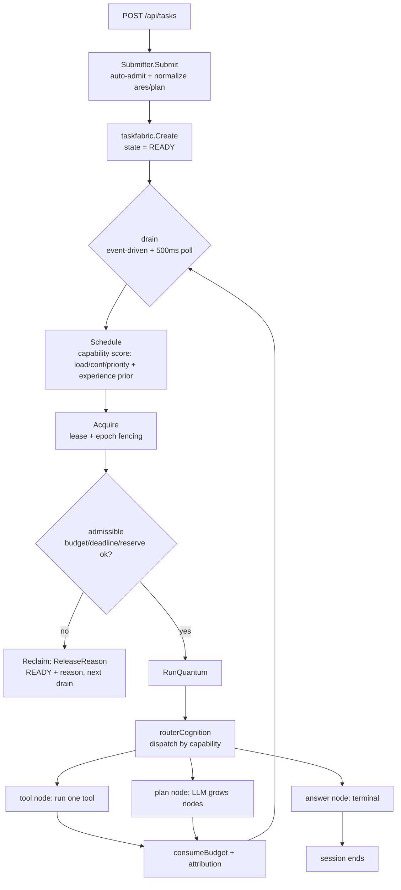

**Key source:**

| Stage | Function | File:line |
|---|---|---|
| Submit | `Submitter.Submit` | `internal/agentruntime/submit.go:151` |
| Queue drain | `Scheduler.drain` | `internal/kernel/scheduler_dispatch.go:43` |
| Select + acquire | Schedule/Acquire inside `drain` | `internal/kernel/scheduler_dispatch.go:43` |
| Execute | `Scheduler.execute` | `internal/kernel/scheduler_execute.go:70` |
| Quantum | `buildQuantumStep` | `internal/kernel/scheduler_quantum.go:65` |
| Dispatch | `routerCognition.ExecuteStep` | `internal/fabric/agent/l2graph.go:388` |

**`routerCognition` is the dispatcher**: one session agent declares its full
capability set; `ExecuteStep` picks the body by `task.AgentType`:

```
tool/<name>  -> toolCognition    (run a single tool)
ares/plan    -> plannerCognition (call LLM, grow tool/plan nodes; never run tools)
ares/answer  -> answerCognition   (terminal: pass-through / synthesized / gap body)
ares/root    -> rootCognition    (session admission, zero work)
```

**"Grow-as-you-go" decomposition**: each tool node becomes a new fabric task
back in the drain; the `answer` node completing = session ends.

**Plain-English walkthrough (one "fix this bug" order end to end)**:

1. You `POST /api/tasks {"desc": "make X compile"}`. The kernel opens a
   session; the session itself is a root task — "this order is accepted".
2. The scheduler's drain loop (event-driven + 500ms poll as backstop) picks
   it up and runs one **quantum** for the root task. The root step does no
   work; it is just "walking in the door".
3. The `ares/plan` quantum: the agent feeds "what I have on hand + the
   previous steps' results" to the LLM; the LLM replies "I need to run
   `grep 'TODO'` and then read `main.go`" — **so two tool nodes + a
   plan-2 node grow on the L2 graph** (see §6).
4. Those two tool nodes are compiled into fabric tasks; drain continues.
   agent-B runs grep, agent-C reads the file — **it may not be the same
   agent**. That is fine: the task carries its own checkpoint, so whoever
   picks it up can run it.
5. Tools finish, results are written into the fabric. The next plan quantum:
   the LLM looks at the results, says "enough, here is the answer…", and an
   `answer` node grows. answer completes → session ends.

The key point: **the LLM only decides "what the next step is" (grows
nodes); the actual doing (running tools) is scheduled out by the kernel**.
The two never block on each other. That is the "split 'do' into two node
kinds" from §22.

### 4.1 Failure semantics (0.3.3)

A failure is three decisions, not one event: **is it worth retrying**, **when**,
and **what happens to everything downstream**.

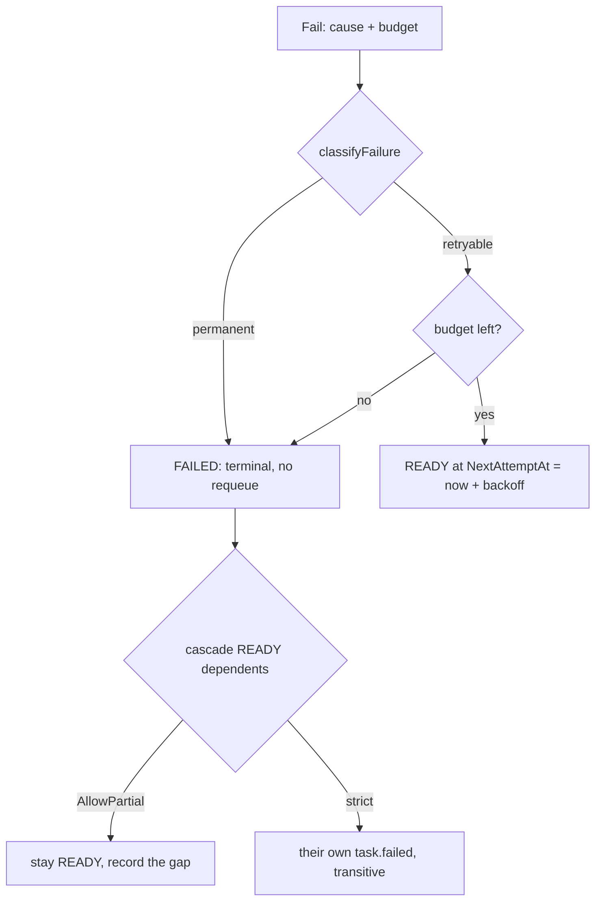

**How the "worth retrying?" judgment actually looks in source (`classifyFailure` in `failure.go`, read line by line)**:

```go
func classifyFailure(cause error) bool {
    if cause == nil { return true }            // no cause (operator kill / sweep) -> keep retrying
    var perm *permanentError
    if errors.As(cause, &perm) { return false } // 1 the producing layer marked "permanent" -> terminal
    var retry *retryableError
    if errors.As(cause, &retry) { return true } // 2 marked "retryable" -> retry
    if errors.Is(cause, ErrTaskDeadlineExceeded) { return false } // 3 past the absolute deadline -> terminal
    if isKnownPermanent(cause) { return false } // 4 hits the narrow "known permanent" list -> terminal
    return true                                 // 5 fall-through: everything else is retryable (= 0.3.2)
}
```

How to read it (this is the foundation of the system's "dare to fail"):
- **Order = precedence**: explicit markers (①②) always win — "the layer that
  produced the error knows it best, and it decides".
- **④ is a deliberately narrow list** (`permanentCauses`): only errors that
  "waiting cannot fix" count as permanent — e.g. `ErrNotFound` (the referenced
  tool/entity does not exist), `ErrInvalidArgument` (the request itself is
  malformed; retrying reproduces it exactly), `ErrDependencyCycle` (a cycle is a
  property of the graph, not a race to retry).
- **⑤ is the safety floor**: when unsure, **treat it as retryable**. Verbatim
  comment: "a misclassification costs a retry rather than a task". Better to
  believe it can be tried than to believe it should die.
- The verdict is recorded as the `retryable` bit on the `task.failed` event, so
  "why did it try again?" is answerable **from the log alone**, without reading
  code.

| Decision | Where | Rule |
|---|---|---|
| Retryable? | `classifyFailure` | `internal/fabric/task/failure.go:132` — explicit markers win (`MarkPermanent` / `MarkRetryable`: the producing layer knows best), a cause past the task's deadline is terminal, and **everything else is retryable**, exactly as in 0.3.2 (a bare `context.DeadlineExceeded` included). The verdict is recorded as `retryable` on the `task.failed` event, so "why did it try again" is answerable from the log alone. |
| When? | `Fail` | `internal/fabric/task/fabric_lifecycle.go:397` — requeue only when the cause is retryable **and** budget remains. `BackoffBase` is the first delay and doubles per attempt, capped by `BackoffMax` (`internal/fabric/task/backoff.go:19`); unset means an immediate requeue, which is 0.3.2's behaviour. A waiting task is hidden from `ReadyTasks`/`ResumableTasks` and refused by `Acquire`, and `NextAttemptAt` is persisted, so a restart cannot make it retry early. |
| Downstream? | `cascadeFailureLocked` | `internal/fabric/task/dag.go:178` — a terminal failure fails every transitive READY dependent, unless that dependent opted into `AllowPartial`: it stays READY with the failed predecessor recorded in `DegradedInputs`. That record is what unlocks it (`dependencySatisfied`, `internal/fabric/task/dag.go:138`): only recorded gaps count, so a second dependency that is still running keeps blocking. |

**A deadline is not a lease expiry.** An expired lease means the execution rights
lapsed: the task returns to READY and a replacement may resume it from its
checkpoint (§12). `Task.Deadline` is an absolute cut-off — `ExpireDeadlines`
(`internal/fabric/task/fabric_lifecycle.go:436`) takes it to terminal FAILED
through its own path (never requeued, even with budget left) and cascades, and
`Acquire` refuses a task whose deadline has already passed, so nothing can be
granted in the gap before the sweep runs.

**Partial input is declared, not inferred.** A degraded task carries
`degraded_inputs` (the missing predecessor ids) in its checkpoint payload and on
its `task.ready` event, so a reader can tell "not checked" from "checked, nothing
found". The reason is deliberately *not* copied: the failed task's `LastError` and
`task.failed` event stay the single source of truth, and the id is the stable key
to follow back.

### 4.2 Capability Scoring (how the best agent is picked)

`Schedule` does not "pick any agent"; it scores every candidate 0–1 and takes
the highest.

**Formula (`internal/fabric/task/scheduler.go:44`)**:

```
score = capability_overlap × (1 - load) × confidence × (1 + priority)
```

**What the source actually looks like (`ScoreBreakdown` in `scheduler.go`, read line by line)**:

```go
func ScoreBreakdown(taskCapability string, c Candidate) ScoreParts {
    overlap := CapabilityOverlap(taskCapability, c.Capabilities) // 1 overlap fraction; 0 = cannot do it
    load    := clamp01(c.Load)        // 2 busyness clamped to 0..1; the idle one scores higher
    conf    := clamp01(c.Confidence)  // 3 trust clamped to 0..1
    boost   := 1.0
    if c.Priority > 0 { boost = 1.0 + c.Priority } // 4 priority boost, deliberately NOT clamped
    parts := ScoreParts{...}
    if overlap > 0 {
        parts.Score = overlap * (1 - load) * conf * boost  // 5 all four factors multiplied
    }
    return parts
}
```

How to read it: ① is the **master switch** — when capability does not overlap
(`overlap=0`) the `if` is skipped and `Score` stays 0, so it is **never chosen**
(the "gate" lives right in the code, not as a post-hoc zero). ⑤ is a
*product*, so **any factor being 0 makes the total 0** (fully busy `load=1` →
`(1-load)=0` → total 0, it yields automatically). ④'s `boost` is
deliberately un-clamped because "a busy high-priority agent beats an idle
low-priority one" is an operator-intended strong signal; clamping it would
distort the intent.

| Factor | Range | Intent | Source |
|---|---|---|---|
| `capability_overlap` | [0,1] | **Gate**: can't do this capability → 0, never chosen (overlap *fraction*, not "any overlap counts") | `CapabilityOverlap` |
| `1 - load` | [0,1] | idle scores higher; `load=1` (fully busy) → 0, yield. This is what makes "parallel if possible" work | `LoadTracker` (`load_tracker.go`) |
| `confidence` | [0,1] | experience prior / measured: "has it succeeded at this before?" | `ConfidenceForMeasured` (`scheduler_execute.go:282`) |
| `1 + priority` | ≥1 | priority boost; at `priority=0` the boost is 1. A busy high-priority agent can outscore an idle low-priority one, so the boost is deliberately un-capped | `scheduler.go:75` |

**The three confidence tiers (most-asked, `scheduler_execute.go:176`)**:

```
for each candidate (agentID, task capability):
  ① has a MEASURED value (evolution feedback / GA override) → use it  ★ measured always wins
  ② is NEUTRAL (no history, no override) and a prior exists → zero it so the fabric fills the prior
  ③ no prior → the neutral value stands (historical default)
```

This is where GA lands on the hot path: `SetAgentConfidence` (`load_tracker.go:183`) lets the
evolution feedback loop **override an agent's per-capability confidence in real time**,
effective from the next drain — GA does not change code, it changes "how trustworthy this
agent is for this kind of task".

**Candidate pool and two non-obvious points (`buildCandidates`, `scheduler_execute.go:119`)**:

```
candidates = registered + unbound + capability-overlapping + idle executors
             ∪  live IDLE fabric agents
   → first pass the governance budget filter (:159, drop those over token/tool/deadline budget)
   → score each → take the highest
```

| Point | Why | Source |
|---|---|---|
| **Budget filter before schedule** | distinguishes "no agent matched" (`ErrNoCapableCandidate`, should alert) vs "matching agents are all over budget" (should wait for budget recovery) | `scheduler_execute.go:264` |
| **`TryBegin` admission gate** | the candidate snapshot is built *before* `Schedule`, so two concurrent goroutines can both read `load=0`; `TryBegin` uses the load counter as an atomic gate, preventing "two tasks both think they got the same idle agent" | `load_tracker.go:82` |

**Winner (`Pick`) and explainability (`ScheduleDecision`)**:

```
all candidates sorted by score descending (ties broken stably by capability-overlap, no flapping) → highest wins
each Schedule records one ScheduleDecision: every candidate + four-factor breakdown + winner + epoch
   stored in a DecisionRecorder (ring of 200, decision_recorder.go:26/58)
```

> The panel can show "TASK-184 ↓ agent-7f21 ↓ Acquire ↓ epoch=42" plus each candidate's
> `Overlap/Load/Confidence/PriorityBoost/Score` — **not a black box; it can say why this
> agent was chosen.**

| Location | Line |
|---|---|
| Score formula `Score`/`ScoreBreakdown` | `internal/fabric/task/scheduler.go:44/71` |
| Candidate scoring `scoreCandidates` | `internal/kernel/decision_recorder.go:107` |
| Budget filter + confidence resolution | `internal/kernel/scheduler_execute.go:264/192` |
| `LoadTracker` (Begin/End/TryBegin/SetAgentConfidence) | `internal/kernel/load_tracker.go` |
| Decision record `ScheduleDecision` | `internal/kernel/decision_recorder.go:42` |

### 4.3 State Codes & the "Why Not Chosen" Diagnosis (StopReason + Admissibility)

The table above covers "**who gets picked**" (the score formula). But an agent often "**should not be picked**" — why? Since 0.3.3 the system turns "why not chosen" from a silent skip into 8 **diagnosable codes**.

**`StopReason` (`internal/fabric/agent/stopreason.go`) — 8 reasons an agent is unschedulable / has left the fabric**:

| Code | Meaning | Terminal? | Emitted by |
|---|---|---|---|
| `unknown` | zero value / unattributed | — | legacy paths |
| `budget_reserved` | remaining budget < `MinRemainingRatio` (nearly spent, still a little but not safely) | no (reset on respawn) | `Admissibility` |
| `budget_exhausted` | one dimension fully spent (tokens/tools/deadline) | no (reset on respawn) | `Admissibility` |
| `deadline_exceeded` | wall-clock lifetime over | **yes** | `Admissibility` |
| `capability_unfit` | the scheduled winner has no live executor | no (task → READY) | `scheduler_execute.go:146/158` |
| `crashed` | killed (panic / operator / chaos) | **yes** (death snapshot can revive) | `Kill` (`lifecycle.go:453`) |
| `recovery_exhausted` | revival budget spent, no more revivals | **yes** | `RestartAgent` refuses |
| `retired` | graceful decommission | **yes** | `Retire` |

**Design intent (verbatim comment)**:

> "An agent out of budget is **NOT dead**: it stays IDLE, its cognition is intact,
> and the fabric simply stops handing it work. Recording WHY is what keeps that
> distinction visible instead of **collapsing every 'not serving' case into a
> silent skip**."

**Before: "out of budget" and "no executor" both looked like "not scheduled". Now 8
codes separate the reasons; the log can answer "why wasn't it chosen".**

**`Admissibility` (`governance.go:113`) — combines multiple reasons into one admission predicate**:

```
Admissibility(agentID) → (ok bool, reason StopReason, err error)
  precedence:
    1. deadline_exceeded  (hardest — once past it, unrecoverable)
    2. budget_exhausted   (fully spent)
    3. budget_reserved    (below MinRemainingRatio)
```

**What it fixes** (verbatim comment):

> "Before this existed the two gates [pre-schedule filter + post-acquire quantum
> gate] **each re-derived affordability**, and the reserve was expressible in
> neither — a budget-starved agent was **indistinguishable from a missing
> executor**."

Both the pre-schedule filter and the post-acquire gate now call `Admissibility`,
so **they cannot disagree** ("the two cannot disagree about who may run").

**Two new sentinel errors on the hot path (`scheduler_execute.go:205-217`)**:

| Sentinel | Meaning | Operator should… |
|---|---|---|
| `ErrNoCapableCandidate` | no agent matches the capability | **add agents** (capability pool too small) |
| `ErrNoAffordableCandidate` (new in 0.3.3) | capable agents exist but all are over budget/deadline/reserve | **raise budget** (not add agents) |

**Before: budget-too-small looked like "no capability" (the `07-hil` silent hang). Now the two are separate.**

**The `busy` bridge (R4, `agent.go:235/171`)**: resolves the "two state systems
say different things" problem between subAgent's `models.AgentStatus`
(execution state) and fabric's `AgentState` (lifecycle state).

```
subAgent executing → SetBusy(true) → fabric IsIdle() = StateIdle && !a.busy
  → when busy=true, IsIdle=false → scheduler will not pick it
```

**Effect**: the two state systems **align on "is it schedulable"**, no longer
relying on `maxConcurrentPerAgent=1` as a backstop. Comment verbatim
(`agent.go:81`): *"busy is the R4 bridge between subAgent execution state and
fabric (there is no RUNNING lifecycle state)."*

**`StopUnfit` immediate reclaim (`scheduler_execute.go:146/158`)**:

```
Before: winner was picked, its executor vanished → task stuck in lease until TTL expiry (minutes)
Now:    handleStaleWinner → immediate ReleaseReason(taskID, winner, epoch, "capability_unfit")
        → task back to READY (checkpoint preserved), next capable executor picks it up at once
```

| Location | Line |
|---|---|
| `StopReason` full definition (8 codes) | `internal/fabric/agent/stopreason.go:43-70` |
| `Admissibility` (single admission predicate) | `internal/fabric/agent/governance.go:113` |
| `reserveExhausted` | `internal/fabric/agent/governance.go` (just below `Admissibility`) |
| `busy` bridge (`SetBusy` / `IsIdle`) | `internal/fabric/agent/agent.go:235/171`, `fabric.go:205` |
| `StopUnfit` reclaim (`handleStaleWinner`) | `internal/kernel/scheduler_execute.go:144-170` |
| `filterBudgetAffordable` + `ErrNoAffordableCandidate` | `internal/kernel/scheduler_execute.go:254-217` |

---

### 4.4 Narrowing the Advertised Toolbelt & Planner-Injected Tools (new in 0.3.x)

The planner (`plannerCognition`) no longer advertises the whole registry to the
model: each quantum sees only the subset relevant to the task. Three filters,
fixed order and precedence (`advertisedToolSchemas`, `planner_cognition.go`):

| Layer | What | Match semantics |
|---|---|---|
| ① L1 policy (hard gate) | a ToolClass evolution disabled is **never advertised** | not waivable below |
| ② static filter `tool_tag_filter` (deployment-level config) | tool tags must ALL match | AND |
| ③ capability flags (per-task) | the task's capability tags | ANY (union) |

caps derivation order: explicit task-payload tags > model tagger (opt-in, config
`llm_tool_tagging`: one model call per quantum, falls back to keywords on
failure) > keyword table. The keyword table lives in a shared leaf package
`internal/tools/capability` (the router and the "table vs tools that actually
declare capabilities" drift guard share one copy, single source).

**Bias: prefer failing open, never over-narrow.** Unrecognized description → no
caps → advertise everything (only costs tokens); narrowing to the empty set →
**fail-open back to every enabled tool** (with a Warn), never an empty list — an
empty advertisement is indistinguishable from "the tool does not exist" and no
transcript would show the filter as the cause.

**Two "do-no-work" injected tools** (prompt-only, not in the registry,
planner-session specific):

- **`need_tools`** (narrowing escape hatch, `planner_need_tools.go`): the
  keyword table's error direction is "partial hit" (needs network+git but only
  matches network → the git tool is silently hidden). The model uses it to say
  "I need a capability I cannot see"; the argument is written to the task
  payload `tool_capabilities` and the **next** quantum's advertised surface
  widens (per-task; the planner is shared across sessions). Malformed JSON =
  no request, does not fail the quantum.
- **`record_rationale`** (`planner_rationale.go`): the model calls it to state
  **why** it is about to act. The driver is a measurement: on this deployment's
  provider, tool-call turns returned **5/5 empty Content** (recorded by the
  live integration test `rationale_availability_live_test.go`), so the old
  "store Content as the rationale" got nothing on exactly the turns where a
  reason matters, and "no reason" was indistinguishable from "the model chose
  not to explain". The rationale now rides in the tool argument (`rationaleFrom`
  falls back to it when Content is empty); it is advertised to the planner only
  (the rationale's sole consumer), not the global registry. A turn that called
  **only** `record_rationale` forces an answer, labelled `rationale_only`
  (not mislabelled L1-blocked; see §6 `answerCauseRationaleOnly`).

**Observability**: each advertisement is recorded via `ToolAdvertisementSink`
(caps, advertised count, total); the registered total is logged at boot
(**deliberately no cap** — what shape a cap should take is a product decision,
and a silent limit is worse than a loud number).

**MCP tools are OFF this path**: they register into the SDK's own registry and
report planner capabilities from their description
(`sdk/mcp_capabilities.go`), so kernel-side tag filter / caps narrowing does not
apply to them.

| Stage | Source |
|---|---|
| Three filters + fail-open | `internal/fabric/agent/planner_cognition.go` `advertisedToolSchemas` |
| Keyword table (single source + drift guard) | `internal/tools/capability/capability.go` |
| Model tagger (opt-in) | `internal/fabric/agent/planner_tagger.go` |
| `need_tools` escape hatch | `internal/fabric/agent/planner_need_tools.go` |
| `record_rationale` | `internal/fabric/agent/planner_rationale.go` |

---

## 5. Quantization & Resource Budgets

**Quantization's core is not "bookkeeping" — it is checkpoint-resume /
preemptibility / yield (robustness). Bookkeeping (tokens/tools) is just a
side-channel feeding GA fitness.**

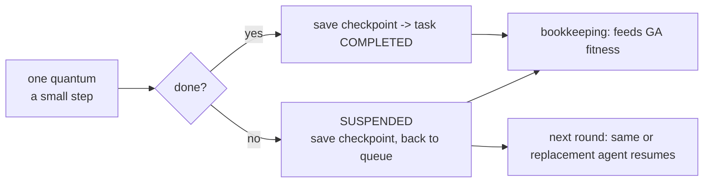

| Concept | Mechanism | Source |
|---|---|---|
| Admission gate (budget/deadline/reserve) | `admissible` → `agentfabric.Admissibility` | `internal/kernel/scheduler_governance.go` |
| Post bookkeeping | `consumeBudget` | `internal/kernel/scheduler_governance.go` |
| Reclaim (attributed release) | `fabric.ReleaseReason` → `task.released{reason}` | `internal/fabric/task/fabric_lifecycle.go` |
| One concurrent quantum per agent | `maxConcurrentPerAgent` | architectural invariant |
| Reject expired holder | epoch fencing | validated at drain |

**What one quantum actually does (`buildQuantumStep` in `scheduler_quantum.go`, read line by line)**:

The scheduler does not "run the whole LLM call to the end"; it wraps **one
small step** (a quantum) in a closure and hands it to `RunQuantum`. Three
things in that closure are worth reading:

```go
func (s *Scheduler) buildQuantumStep(ctx, executor, tk, meta, usage) taskfabric.QuantumStep {
    return func() (any, bool, error) {
        type stepResult struct{ out *sub.StepOutcome; err error }
        done := make(chan stepResult, 1)
        go func() {
            defer func() { if r := recover(); r != nil { done <- stepResult{err: ...} } } // 1 catch the panic
            stepCtx := userctx.With(tenantctx.With(ctx, ...), ...)                          // 2 tenant/user into ctx
            out, stepErr := executor.ExecuteStep(stepCtx, mt)                               // 3 actually run the step
            done <- stepResult{out: out, err: stepErr}
        }()
        var out *sub.StepOutcome; var stepErr error
        select {
        case res := <-done: out, stepErr = res.out, res.err                                 // 4 got the result
        case <-ctx.Done():
            return nil, false, fmt.Errorf("quantum aborted by scheduler shutdown")           // 5 shut down = may yield
        }
        ...
    }
}
```

Line by line:
- **① panic catch**: the executor runs in its own goroutine; `recover` turns a
  panic into a structured error, so **the whole process does not crash** — a
  broken step is just "this small step failed".
- **② tenant/user into ctx**: the task's own `tenant_id` / `user_id` are wrapped
  into the execution context, and every downstream tool call / knowledge lookup
  reads them from `ctx` **rather than a process global** — that is the physical
  implementation of "multi-tenant, each sees its own".
- **③ the real step**: `ExecuteStep` is the `routerCognition` dispatch from §4
  (run a tool / grow a plan node / emit an answer).
- **④ vs ⑤ is the key**: the `select` listens to "result arrived" and "the
  scheduler is shutting down" at the same time. On shutdown it **returns
  "not done" (`false`) immediately**, so the task goes back to SUSPENDED /
  READY with its checkpoint, and the next round (same or another agent)
  resumes it. **That is the code body of "a quantum is interruptible and can
  yield"**: not run-to-the-end, but "small step + can always back out".

**The agent wallet** = `kernel.agent_budget` (`config.go:151`): `tokens` /
`tools` / `deadline` / `reserve_ratio`; the first three are all-zero =
unlimited. A syscall-spawned agent carries this wallet from birth
(`SpawnAgent`'s `Governance: k.governance` in
`internal/agentsyscall/syscall.go`).

**The reserve threshold (`reserve_ratio`, 0.3.3)**: "stop taking work while
there is still headroom". With `reserve_ratio=0.4` and `tokens=500`, an agent
admits a new quantum only while ≥200 tokens remain; below that, the task it
holds is **reclaimed** at the quantum boundary (`ReleaseReason` → READY,
checkpoint preserved, `task.released` event carrying
`reason=budget_reserved`) so a fresher agent resumes it from the checkpoint.
Two invariants: admission has **one** implementation (`Admissibility`) shared
by the pre-schedule candidate filter and the post-acquire gate, so the two
gates cannot disagree; and this is **admission control, not preemption** — a
running quantum is never interrupted. Budget counters reset only on respawn,
so when every agent is drained the task parks in the "no admissible
candidate" wait state (`ErrNoAffordableCandidate` — a distinct sentinel and a
distinct log-throttle slot from `ErrNoCapableCandidate`, "nobody matches the
capability").

**Agent stop reasons (`agentfabric.StopReason`, 0.3.3)**: answers "why is this
agent not taking work / why is it gone". A budget-drained agent is NOT dead
(it stays IDLE with its cognition intact); only truly gone agents get the
terminal codes. Every code has a production producer:

| Code | Meaning | Producer |
|---|---|---|
| `budget_reserved` | remaining budget below the reserve (soft stop) | admission gate |
| `budget_exhausted` | a budget dimension fully spent (hard stop) | admission gate |
| `deadline_exceeded` | wall-clock deadline passed | admission gate |
| `capability_unfit` | scheduled winner has no live executor body | `handleStaleWinner` |
| `crashed` | killed (panic / operator / chaos) | `Kill` |
| `recovery_exhausted` | restart budget spent, revival refused | recovery loop |
| `retired` | graceful decommission | `Retire` |

They land in two places: the task's `task.released{reason}` event, and the
agent's `agent.killed`/`agent.retired` events plus its death snapshot
(`AgentSnapshot.StopReason`). Note `task.released` is not must-persist: the
event stream carries the record and the introspect panel can subscribe to it,
but restore does not fold it back into task state.

**Token budget semantics (0.3.1+)**: `WithMaxTokens` is **enforced**, not a
no-op — it bridges into the same governance budget (`sdk/sdk.go:441`), and the
admission gate refuses a quantum for an agent whose `tokenUsed` has reached
`TokenBudget`, so an over-budget task yields instead of burning tokens. Two
caveats before quoting it as a hard cap: the value is the **L2 peer's lifetime
total** (the first positive `WithMaxTokens`/`WithAgentGovernance` wins; a later
agent's value does not tighten it), and enforcement is **cooperative** — it
stops at a quantum boundary, never mid-LLM-call (`sdk/options.go:703-717`).

**Permanent failures (0.3.3)**: `taskfabric.MarkPermanent` finally has a
production caller — `markPermanentStepCause`
(`internal/kernel/scheduler_quantum.go`) classifies
`errors.ErrInvalidArgument` (empty prompt / empty message list / over-length
prompt, as stamped by the LLM client) as "retrying reproduces it exactly", so
the task goes terminal **FAILED on the first attempt** instead of burning the
retry budget on attempts that cannot succeed. Every other, unclassified cause
keeps the 0.3.2 retryable behaviour.

---

## 6. Dynamic Graph: L2 Session Graph ↔ Tasks (planprojection)

Two "graphs" are the most confusing part:

| Graph | What | Character |
|---|---|---|
| **L2 session graph** (`L2Graph` / `MutableDAG`) | a session's execution plan; nodes = tool instances / plan / answer | in-memory, live, LLM keeps growing nodes |
| **Task fabric** | the tasks actually scheduled + executed | durable (event-sourced) |

"Dynamic" = **as the L2 graph grows a node, it is immediately compiled into a
task**.

**Plain-English picture**: imagine the L2 graph as a **live flowchart pinned
to the wall**; the planner (LLM) is the "design department" that draws one
box at a time as it thinks; the task fabric is the "work-order system" that
auto-prints a work order to the dispatcher for each box drawn. So "the graph"
and "the tasks" are **two faces of the same thing**: the graph is structure
for humans (and the LLM), the task is the state machine for machines
(the scheduler) to run.

Why the indirection of "immediate incremental compilation" instead of just
having the LLM think the whole plan up front and then run it? Because **a
session is alive**: the LLM may change its mind, or may be interrupted
mid-growth (yield / hand-off). Full compilation is like "putting the whole
dish in the pot at once" — you cannot change spoons halfway; incremental
compilation is "box by box", and a RUNNING work order may not be rebuilt as a
whole batch (reordering would lose state). That is where the "must be
incremental" comment comes from.

Why the "missed-event full reconcile" (Reconcile) at all? Graph events travel
over an in-memory hub whose subscription channel is bounded, so when it fills
it **drops events** (counted by the drop counter). Losing one or two is fine;
lose too many and the graph and the work orders fall out of sync — so
periodically, using two signals ("graph version + cumulative dropped count"),
it does a **full stock-take** (Reconcile: scan the whole graph, add what is
missing, remove what is extra).

**"Node ID = task ID" in plain terms**: when the planner wants to read the
previous grep's result, it does not dig through logs — it takes the node ID
(e.g. `tool-7`) straight to the fabric and looks up `task-7`'s envelope,
like "the work-order number *is* the shelf number", one hop to the data.

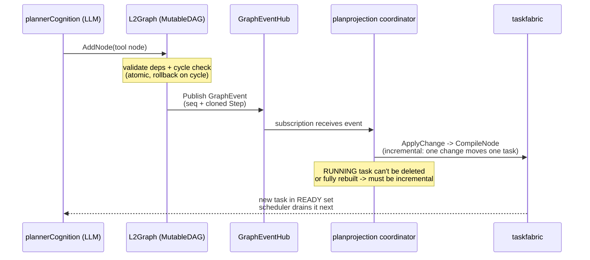

**Missed-event fallback**: `SubscribeGraphEvents` uses a **drop-counter + DAG-
version two-signal** scheme (F-21) to trigger a full `Reconcile`.

| Mechanism | Function | Source |
|---|---|---|
| Add node (cycle check + rollback) | `MutableDAG.AddNode` | `internal/fabric/task/workflow/engine/mutable_dag.go:77` |
| Atomic node replace | `ReplaceNode` | `mutable_dag.go:784` |
| Subscribe to graph events | `Subscribe` / `SubscribeWithID` | `mutable_dag.go:593` / `:593` |
| Node->task mapping | `ProjectStep` | `internal/fabric/planprojection/projection.go:58` |
| Incremental compile | `ApplyChange` | `internal/fabric/planprojection/coordinator.go:314` |
| Full reconcile | `Reconcile` | `coordinator.go:384` |
| Event subscription loop | `SubscribeGraphEvents` | `coordinator.go:695` |
| Grow tool node | `L2Graph.AddToolNode` | `internal/fabric/agent/l2graph.go:282` |

**Node ID = task ID**: the planner reads a predecessor's output by using the
node ID to look up the task's fabric envelope (the "join key").

---

## 7. L1 Tool-Class Graph Constraining L2

**L1 ≠ L2.** L1 is the "tool capability catalog + constraints" (`enabled` /
`budget` / `prior`) and is **not compiled into tasks**; L2 is the "session's
actual execution plan".

**Plain-English picture**: L1 is the **company policy manual** ("which tools
you may use, how many times each, which to prefer"); L2 is **this order's
actual work orders** ("this order used grep 3 times"). The policy manual is
one copy company-wide and long-stable — GA evolution edits *the manual*; the
work orders are born one at a time per session and archived when the session
ends. The manual constrains the work orders, but work orders never rewrite
the manual.

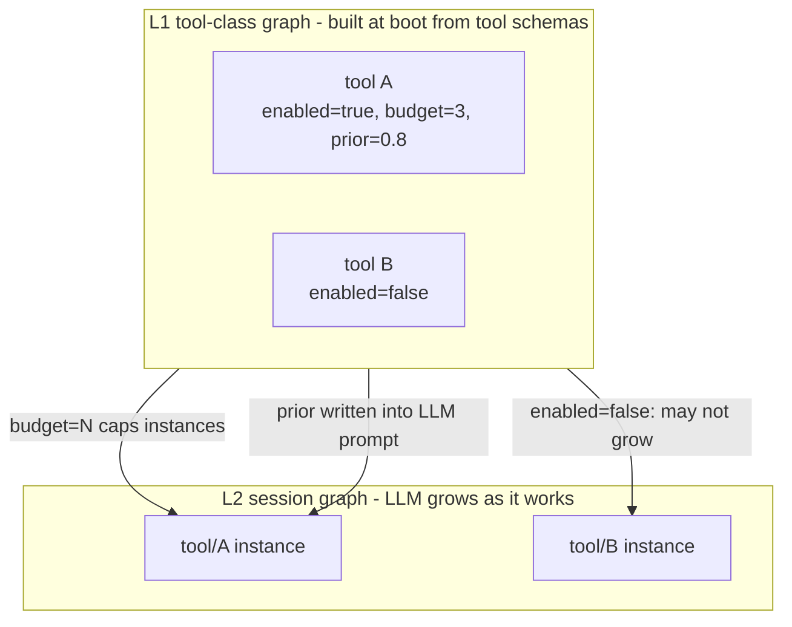

**Injection point** (`cmd/ares/serve_peer.go` `injectToolClassDAG`, verbatim
comment: "the L1 graph is NOT compiled into taskfabric — it is a capability
catalog, not an execution plan (L1 != L2)"):

- At boot, `injectToolClassDAG` (`serve_peer.go:534`) scans
  `toolBinder.GetToolSchemas()` to build L1 and feeds it to the evolution system.
- The planner checks L1 constraints before growing a tool node
  (`internal/fabric/agent/l2graph.go` `CountToolClass`).

> Note: there is also a **LiveDAG** (`buildLiveAgentDAG`, `serve_peer.go:574`)
> = "one node per peer agent", the **agent-pool topology** that the
> evolution structural patches act on (via `UpdateLiveDAG`). It is a
> different thing from the L1 tool-class graph.

---

## 8. Agent Expansion (agentsyscall)

While executing a quantum, the LLM can call these "system calls", just like it
calls `web_search`:

| Tool | What | Function | Source |
|---|---|---|---|
| `spawn_agent` | "hire a teammate" | `SpawnAgent` | `internal/agentsyscall/syscall.go:24` |
| `create_task` | "split this into subtasks" | `CreateTask` | `syscall.go:27` |
| `ask_agent` | "ask a teammate" | `AskAgent` | `syscall.go:730` |
| `create_plan` | grow a whole DAG at once | `CreatePlan` | `internal/agentsyscall/plan.go` |

**The subtle part: provenance comes from context, not the LLM (anti-forgery).**

```go
// SpawnAgent's parent (who created it) - the kernel knows "who is calling";
// that value wins over any LLM-supplied parent_id.
parentID := args.ParentID
if caller := kctx.CallerID(ctx); caller != "" {
    parentID = caller
}
```

- `create_task`'s `Origin` = `kctx.CallerID(ctx)` (never LLM-supplied).
- Tenant (`tenant_id`) is always taken from context; any LLM value is
  **overwritten**, not merged.

**"The agent decides what to do; the kernel decides on whose authority and
with what resources."**

**Plain-English picture**: like an intern who may *suggest* hiring a
teammate, but onboarding is done by HR. The LLM says "give me a teammate
that can review" (`spawn_agent`); it may only supply the **capability
description**. Identity fields like "who created it" (parent) and "which
tenant does it belong to" are taken by the kernel **from the call stack's
real identity (context)** — anything the LLM fills in is ignored. So even if
the LLM *hallucinates* a parent_id it cannot forge the genealogy; the audit
chain is stamped by the kernel, not spoken by the model.

The `create_task` detail, **as the source actually looks** (`syscall.go`, read line
by line). It is actually **two layers** — do not conflate them:

```go
// Layer 1: kernel CreateTask (syscall.go:485) — if a dependency does not resolve,
// the call FAILS NOW and the task is NOT installed.
task := &taskfabric.Task{
    ID: taskID, Capability: args.Capability, Priority: args.Priority,
    Dependencies: args.Dependencies,
    RetryPolicy:  taskfabric.RetryPolicy{MaxRetries: 2},
    Origin:     kctx.CallerID(ctx),            // "who is calling" = the creator; the LLM cannot fill it (anti-forgery)
    Checkpoint: tenantStampedEnvelope(ctx, args.Payload), // tenant also from ctx
}
if err := k.fabric.Create(task, taskfabric.WithResolvedDependencies()); err != nil {
    return nil, fmt.Errorf("agentsyscall: create task failed: %w", err) // fail = not installed
}
```

```go
// Layer 2: the tool binding BindTools (syscall.go:850) — catches EXACTLY this
// one error class and turns it into a result the model can read and fix.
res, err := kernel.CreateTask(ctx, ct)
var depErr *taskfabric.DependencyResolutionError
if errors.As(err, &depErr) {
    return &CreateTaskResult{                   // returned as a RESULT, not a tool error
        Rejected:            CreateTaskRejectedUnresolvedDeps, // "unresolved_dependencies"
        MissingDependencies: depErr.Missing,
    }, nil
}
return res, err                                 // every other error still fails the call
```

Three "whys", line by line:
- **`Origin: kctx.CallerID(ctx)`**: the creator is **not** an argument
  (`CreateTaskArgs` deliberately has *no* creator field!) — it is taken from the
  call context's "who is actually running now". The LLM cannot smuggle a fake
  creator — **the genealogy is stamped by the kernel**.
- **`WithResolvedDependencies()` (layer 1)**: the LLM path grows node by node, so
  every dependency ID it names **must already exist** in the fabric; if it does
  not, the call **fails now** and the task is **not created** — it never gets
  installed as a "dependency that can never be satisfied" and hangs in READY
  forever.
- **`Rejected` (layer 2)**: that *specific* error class is converted into a
  **result field** the model reads (not a tool error). Why? Verbatim comment: a
  tool error would **fail the whole quantum**, and the L2-projected tasks are
  not AllowPartial, so **one hallucinated id cascades FAILED through the entire
  downstream subgraph** — it would cost the whole session branch. Returned as a
  result, the model reads the reason and fixes its own call. In plain terms:
  when an employee types a wrong order number, HR returns the form to be
  corrected rather than smashing the whole line.

**Spawned vs configured agents**: equivalent capability (same LLM + tools),
but a spawned agent carries extra gates — must be an L2 capability
(`IsL2Capability`), carries the wallet from birth (`Governance`), optional
`ToolAllowlist`, and must pass the spawn quota.

---

## 9. Collaboration: Decompose / Ask / Handoff

**There is no "team collaboration" concept** (no group messaging, no
"meeting to align"). Agents do exactly three things toward each other; the
only coordinator is **the scheduler**.

```mermaid
flowchart TD
    A[big task -> agent-A] --> A1{agent-A calls LLM<br/>"too big, split"}
    A1 -->|spawn_agent| B[new agent-C live<br/>into pool]
    A1 -->|create_task| tB[task-B READY]
    A1 -->|create_task| tD[task-D READY]
    B & tB & tD --> drain[scheduler drains]
    drain --> run[each agent executes independently]
    run --> envelope[results stored in task envelope]
    envelope --> synth[next round: synthesize final answer]
```

| Mode | Code | Semantics |
|---|---|---|
| **Decompose** | `create_task` / `create_plan` | "split this off to you" (task into queue, scheduler dispatches) |
| **Ask** | `ask_agent` → `Bus.Request` | "let me ask you" (fire-and-forget, no blocking; breaks the C-1 deadlock) |
| **Handoff** | `Bus.Handoff` | "I can't do it, whole task to you" (point-to-point, **bypasses the scheduler**) |

**Ask is fire-and-forget**: `ask_agent` returns `{Status: "pending"}`
immediately; the quantum does not block (or the asker would hold the
scheduler, the target could never be drained, deadlock). The reply arrives in
the background (currently only logged, not written back to the asker — marked
C-1-a as future work). Identical questions are deduped within 30s.

**Plain-English "why asking cannot block"**: imagine two people sharing one
phone line. A calls B and, if A must *keep the line open* waiting for B to
answer, while B needs the line *free* to call back — the line stays held by
A, B can never get through. Deadlock. So the rule is "send it and forget
it": A asks, hangs up, goes back to work (the quantum ends); B's answer
arrives over a separate background channel. Cost: the asker does not get the
answer instantly. Benefit: the system can never jam.

**The `grand_loop` E2E test** (`internal/fabric/agent/e2e_grand_loop_test.go`)
verifies: A dies, B/C/D continue; B questions A, C verifies B — **the task
is indifferent to who runs it; it only cares who has the capability.**

---

## 10. IPC Message Bus (agentipc)

`Bus` is a **centralized in-memory message hub** (in-process, not
cross-process).

> **Important correction**: it borrows the **semantics** of IPC
> (the Send/Request/Reply vocabulary) but **not the mechanism** — messages
> travel between goroutines (shared memory + channels), no socket, no
> serialization. The source's security-boundary comment states plainly:
> "single-tenant, single-process v1; not usable across trust domains."

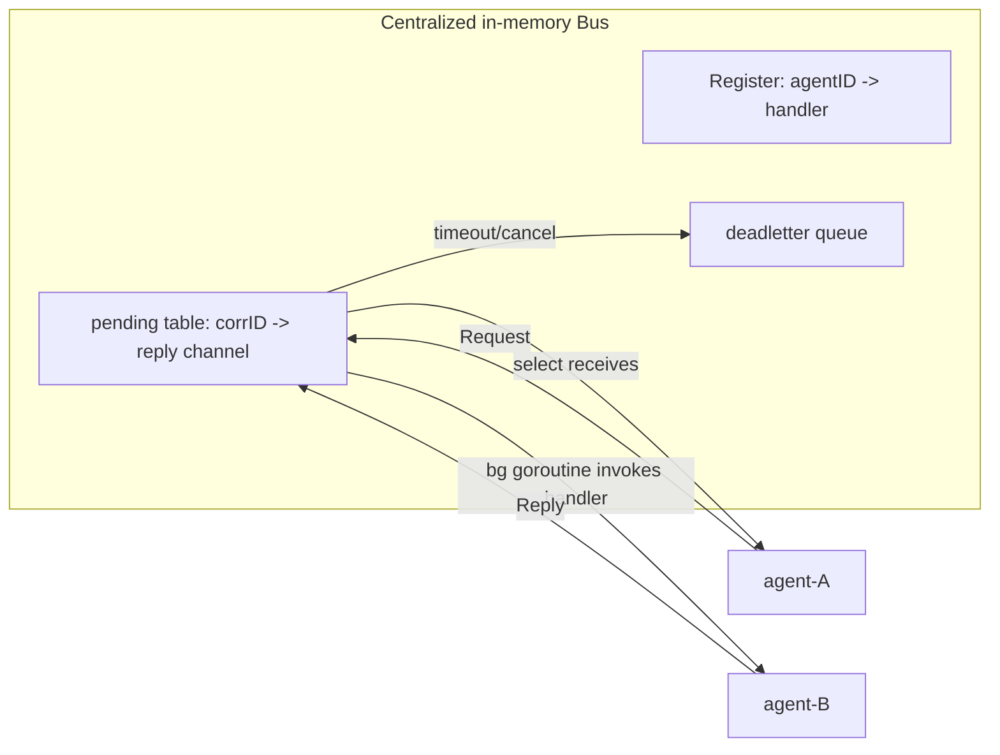

| Primitive | Semantics | Source |
|---|---|---|
| `Send` | fire-and-forget | `internal/agentipc/primitives.go:57` |
| `Request` | ask + wait (30s timeout) | `internal/agentipc/primitives.go:146` |
| `Reply` | async reply | `primitives.go` |
| `Delegate` | forward to whoever can | `primitives.go` |
| `Handoff` | point-to-point task ownership | `primitives.go:454` |
| `Subscribe`/`Broadcast` | "I care about X" / "tell everyone who cares" | `primitives.go` |
| Message struct | `Message` | `internal/agentipc/bus.go:14` |
| Register / Unregister | `Register`/`Unregister` | `bus.go:131` |

**Who owns / releases resources** (layered):

| Resource layer | Owner | Released by |
|---|---|---|
| In-flight message state (pending/channel/deadletter) | the Bus itself | `Request`'s `defer removePending` |
| Agent life/death | Agent Fabric | `Bus.Unregister` when the agent is killed |
| Token/tool budget | scheduler governance | `consumeBudget` |

**The Bus only moves messages; it owns and releases no resources.** When an
agent dies, the fabric knows first, then unregisters it.

**Plain-English picture**: the Bus is a **front-office operator**, not the
telephone network itself. You (agent-A) tell the operator "connect me to B"
(Request); the operator dials, B picks up and says "hold, I will call back"
(Reply over the background); or no one picks up / it times out, and the
operator files the missed call in the **dead-letter basket** (deadletter) for
later. Note: the operator only makes connections — it does not manage
employee life/death (that is the fabric's job) nor electricity bills (that
is the scheduler's governance). This "each layer owns one segment" split is
why it stays correct: if one segment crashes, the others do not have to clean
up after it.

Why is it called "IPC" but is not IPC? Real inter-process communication
crosses process boundaries, needing serialization + sockets. This Bus's
messages travel over **shared memory + channels** (between goroutines in the
same process); it only borrows IPC's *vocabulary* (Send/Request/Reply). Its
applicability boundary is written hard in the source comment: **single
process, single tenant** — do not use it across machines / trust domains.

---

## 11. Multi-Session Concurrency & Resource Isolation

**Key insight: a session is a task namespace, not a resource container;
agents are a global shared pool.**

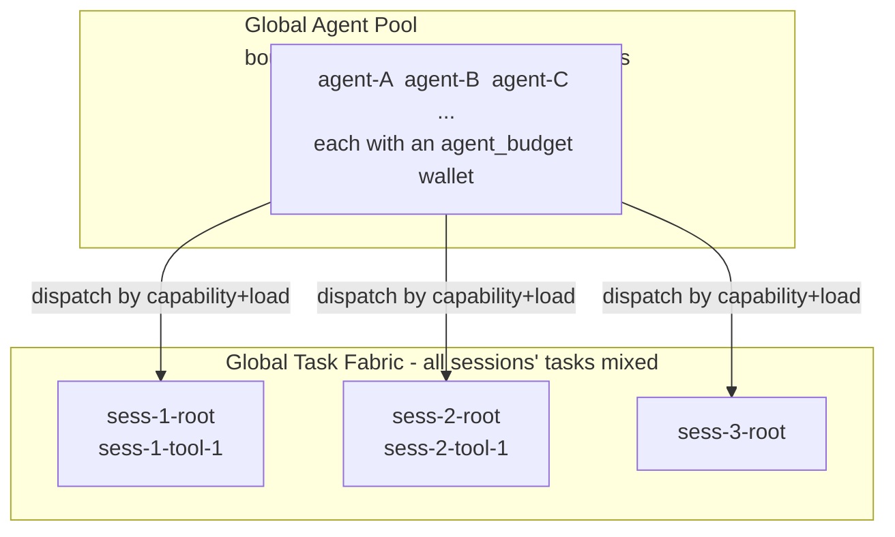

| Isolation layer | Mechanism | Source |
|---|---|---|
| Same-session admission serialized | per-session lock `lockAdmission` | `internal/agentruntime/session.go:67` |
| Cross-session tasks independent | unique task-ID prefix `sess-N-*`; deps only within a session | `session.go` |
| Global resource cap | `maxConcurrent` + `agent_budget` + `kernel.resources` | the scheduler |
| Reaper protection | `KeepSet`: a live session is never touched | `session.go:311` |

**Session lifecycle**: `Admit` → live (every quantum refreshes the idle
timer) → `Release` (answer completes/fails) → Reaper harvest
(delete terminal tasks after `ReaperGrace`).

| Stage | Function | Source |
|---|---|---|
| Admit (idempotent + same-session serialized) | `Sessions.Admit` | `internal/agentruntime/session.go:105` |
| Harvest deletable tasks | `Harvest` | `session.go:290` |
| Build the reaper keep-predicate | `KeepSet` | `session.go:311` |
| Release on answer failure | `ReleaseOnAnswerFailure` | `session.go:331` |

**Sessions and agents are decoupled**: killing an agent does not kill the
session; the task's lease expires, it returns to READY, and the scheduler
hands it to a replacement — the session is unaware.

**Plain-English picture**: a session is an **order number**; an agent is a
**delivery rider**. Orders (tasks) sit in a global work-order pool, prefixed
`sess-3-*` to say "belongs to order 3"; riders are shared globally and
assigned by capability + idleness. If order-3's rider has an accident
(agent dies), the order does not vanish — it goes back to the unassigned
pile (READY) and another rider resumes **from where he left off
(checkpoint)**. And different orders are independent of each other: order 3
stuck does not block order 4's dispatch. The only global constraints are
"how many riders are on the road at once" (`maxConcurrent`) and "each
rider's fuel tank" (`agent_budget` wallet).

---

## 12. Recovery (aresrecovery)

**Agent dies → task does not die**: lease expires → requeue → replacement
agent resumes from checkpoint.

**Plain-English intuition first**: when an agent picks up a task it is handed
a **temporary work badge (lease)** stamped with a time (TTL, say 5 minutes)
and a version number (epoch). When it finishes work it must **hand the badge
back and re-stamp it (renew)**. If the agent crashes / goes quiet mid-way and
the badge lapses with no renewal, the scheduler's sweep
(`RequeueExpiredLeases`) notices "this badge is expired but the task is still
hanging" and bounces the task back to the unassigned pile (READY); a new agent
takes a fresh badge and **resumes from the checkpoint the task left behind**.
"Epoch fencing" (the version stamp) guarantees: even if the old agent crawls
back and tries to write its result, it is rejected because "its badge version
is not the latest" (`ErrEpochMismatch`) — **there is exactly one valid writer
at any instant**.

So "recovery" is not "saving the agent" — it is "the task keeps going with a
new holder". The agent is consumable; the task is the asset.

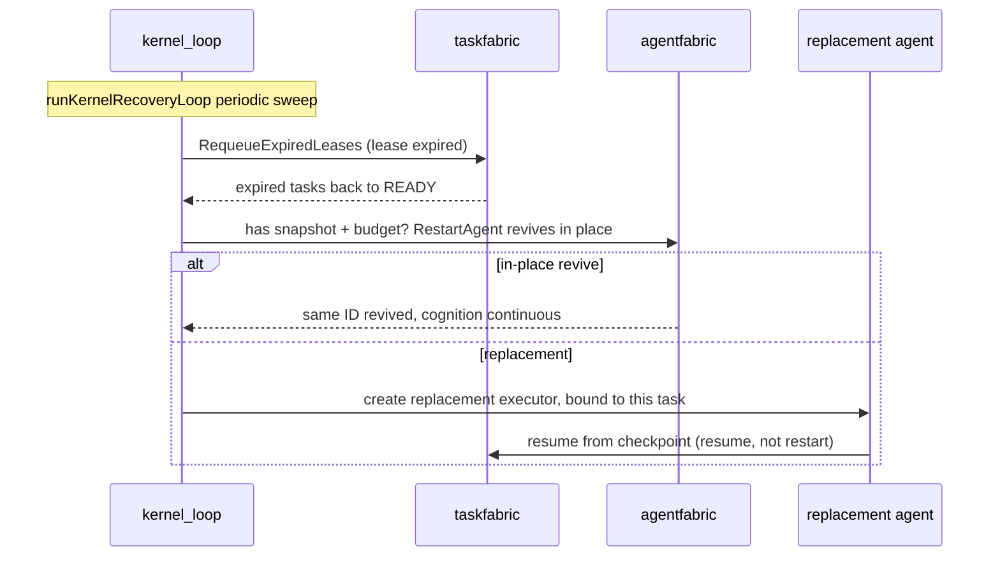

**Storm prevention**: a restart budget + exponential backoff. The budget now
counts **inside a time window** (`RestartPolicy.RestartWindow`, default 1h,
`recovery.go`): only restarts within the window are counted, and stamps older
than it are pruned in place at gate-read time — the slice stays proportional
to the budget, not the agent's lifetime. A long-lived healthy agent that dies
once a month is no longer mistaken for a crash loop and refused for good;
**a zero window keeps the old lifetime-cumulative semantics** (a zero-value
policy is unchanged). A successful revival does not refund the count (a
revival is exactly the cycle the budget exists to stop).

**Orphan visibility (P2-7, "visible, not reclaimed")**: retirement does NOT
cascade — `Agent.Parent` is provenance, not a lifecycle relation (changing it
is a contract change, pending a decision) — so the children a spawn/retire
loop leaves behind stay live and keep their resource claims. Two halves
(`orphan_audit.go` / `lifecycle.go`):

- **Event side**: `retireLocked` reads the still-live direct children before
  the state change (`orphanedSpawnsLocked`), and the retirement event payload
  carries an `orphaned_spawns` key (**only when there are orphans**, to keep
  every event noise-free).
- **Reconciliation side**: `Fabric.AuditOrphans(sample)` = the count of live
  agents whose parent is retired or whose parent record is missing (a
  restored store can lose it) + the sum of the resources they still hold + a
  bounded sample of ids. It rides on `aresrecovery.Recovery` (the sweep
  already pays the full walk; no new signature change), and the kernel sweep
  logs a Warn **only when non-empty** ("N orphans, M resource units, e.g.
  these three").

| Stage | Function | Source |
|---|---|---|
| Recovery subsystem | `Recovery` | `internal/aresrecovery/recovery.go:21` |
| Lease-expiry sweep | `RequeueExpiredLeases` | `recovery.go:254` |
| In-place revive (windowed budget) | `RestartAgent` | `recovery.go` (`RestartWindow` / `pruneRestarts`) |
| Full recovery chain | `RecoverFromAgentDeath` | `recovery.go:555` |
| Orphan audit | `Fabric.AuditOrphans` | `internal/fabric/agent/orphan_audit.go` |
| Orphan event key | `PayloadKeyOrphanedSpawns` | `internal/fabric/agent/stopreason.go` |
| Kernel recovery loop | `runKernelRecoveryLoop` | `cmd/ares/kernel_loop.go:389` |

**Deadlines are not lease expiries**: everything above is about *execution
rights* lapsing, and a task recovered here resumes with its budget spent but its
retry budget intact. A passed `Task.Deadline` is a different cut-off — terminal,
never requeued by this sweep (see §4.1).

### 12.1 Task-failure degradation (new in 0.3.3, sits right next to the agent layer)

§12 above covers the **agent layer** (an agent dies, the task survives:
replacement / in-place revival). 0.3.3 adds a **task layer** — what happens
when the task itself fails. The two layers **coexist and stack**; they do not
replace each other: the agent half is untouched in 0.3.3 (`aresrecovery` /
`kernel_loop` are exactly as before).

| Layer | Governs | Trigger | Status |
|---|---|---|---|
| **Agent layer** (§12 body) | the agent itself dies / goes quiet → replace or revive | lease expiry, chaos kill, agent crash | always present, 0.3.3 left it alone |
| **Task layer** (this section) | the task fails → classify retryability + backoff + gap tolerance | task returns an error, deadline exceeded | **added in 0.3.3** |

**The core decision point, `classifyFailure` (`failure.go:132`)** — the single
judge of "is this failure worth retrying?" with a three-rule precedence:

```
1. An explicit marker wins: MarkPermanent(failure.go:47) / MarkRetryable(failure.go:58)
   — the layer that produced the error knows best; it decides
2. ErrTaskDeadlineExceeded → terminal: past the absolute deadline, do not burn
   the remaining retry budget
3. Everything else is retryable (= 0.3.2 behaviour): a misclassification costs
   at most one retry, never a task (verbatim: "a misclassification costs a
   retry rather than a task")
```

**The six new `Task` fields added in 0.3.3** (`internal/fabric/task/task.go`):

| Field | Line | What |
|---|---|---|
| `Deadline` | `task.go:30` | absolute cut-off; `ExpireDeadlines` takes its own terminal path (no requeue), `Acquire` refuses expired |
| `RetryPolicy` | `task.go:139` (struct at `:91`) | retry budget: `MaxRetries` total / `Attempts` used; `CanRetry` (`:104`) = `Attempts < MaxRetries` |
| `BackoffBase`/`BackoffMax` | `task.go:39/39` | retry delay doubles, capped; `0` = immediate retry (old behaviour) |
| `NextAttemptAt` | `task.go:45` | `Acquire` refuses before this instant; **persisted**, so a restart cannot retry early |
| `AllowPartial` | `task.go:82` | run with a gap even when a predecessor dies permanently (a creation-time policy) |
| `DegradedInputs` | `task.go:88` | records "which predecessors are the gap" — the very record that unblocks scheduling |

**The degradation (partial-input) mechanism** (`AllowPartial` + `DegradedInputs`):

```
a predecessor fails permanently -> cascade
   · strict dependent -> FAILED as in 0.3.2
   · dependent with AllowPartial=true -> stays READY, the failed predecessor's
     ID is recorded in DegradedInputs
       — a still-running other dependency still blocks it; only recorded gaps count as met
       — checkpoint payload AND the task.ready event carry degraded_inputs (list of
         missing predecessors)
       — the failure reason is deliberately NOT copied: the failed task's own
         LastError / task.failed event remains the single source of truth
```

**In one line**: the agent layer guarantees "the executor may vanish, the task
remains"; the task layer guarantees "when the task fails we know to retry /
back off / degrade with a gap". The two are **additive** — a task can both be
re-homed because an agent vanished (§12) and be classified for retry or
degradation by `classifyFailure` (this section).

---

## 13. Chaos Engineering

**Chaos is not the recovery mechanism itself; it is the "deliberately break
it and check checkpoint+recovery can save it" drill stand.** "The checkpoint
lets you recover; chaos makes you *dare to believe* it recovers."

**Plain-English picture**: checkpoint/recovery is like "wearing a seatbelt",
but until you have actually crashed, you do not know whether the belt will
hold. Chaos is **pressing the airbag test button on purpose**:
`POST /api/chaos/random-kill` randomly kills a live agent (simulating a
sudden death), then you watch whether the system automatically does: lease
expires → task back to READY → a replacement resumes from the checkpoint.
`POST /api/chaos/recover` is "do not wait for natural expiry, force one
sweep now", handy for demos/tests to see the effect quickly.

The **GA quiet window** detail is worth a sentence: once evolution (GA) is
running it goes through consecutive "score → breed → deploy" steps; if a
drill **stretches in mid-way** (say it kills an agent right during "scoring"),
GA's data comes out half-broken and it may make a wrong decision. So during
`GenerationActive` (a generation in flight), chaos **pauses injection** and
waits until the round finishes — "do not let the drill interrupt the exam".

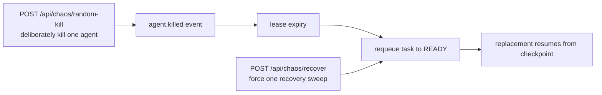

| Endpoint | Function | Source |
|---|---|---|
| Dispatcher | `handleChaos` | `cmd/ares/agent_routes_chaos.go:27` |
| Random kill | `chaosKillRandomFabric` | `agent_routes_chaos.go:188` |
| Force recover sweep | `chaosRecoverSweep` | `agent_routes_chaos.go:239` |
| List live agents | `liveFabricAgents` | `agent_routes_chaos.go:254` |

**GA quiet window**: while an evolution generation is mid-flight
(`GenerationActive`), chaos pauses injections so a half-tested fault doesn't
disturb a GA cycle about to make a decision.

---

## 14. Evolution (GA cold path + Deployment Pipeline)

**What is a "gene"**: the `Strategy`'s `Params` (temperature, etc.) +
`PromptTemplate`. **Evolution never changes code — only these two.**

**Plain-English intuition first**: GA is not "change the code to make it
smarter"; it is "change the agent's **habits of doing the work**". An agent
doing a task runs with a "prompt template + a few knobs (temperature, max
tokens…)". GA does exactly:

1. **Score**: take the "historical score cards" (`ExecutionAttribution`,
   written inline by the kernel when each task finishes) and score each habit
   set on "high score, low spend, fast".
2. **Breed**: keep the high scorers as **parents**; breed the next generation
   by **crossover** (splice two templates) + **mutation** (nudge a number).
3. **Three safety gates (G1/G2/G3)**: no free-for-all —
   - G1 (population level): block "stagnation / tool out-of-bounds" (a whole
     population stopped improving, or someone wants a tool outside the
     allowlist, gets held);
   - G2 (shadow A/B): the new strategy quietly runs a batch in a **shadow
     environment**, compared against the old; it passes only on **≥ 5%
     improvement**;
   - G3 (eval regression): after going live, re-run the baseline; a
     significant drop is **not promoted, auto-rolled back**.
4. **Rollback net**: sample-monitor 30s after deployment; a regression > 10%
   → automatic rollback to the old strategy.

So "evolution" is fundamentally a **canary A/B rollout with a safety net**,
not "magic that makes the model smarter".

> **Correction**: `DreamCycle` (`dream_cycle.go:304`) is a lightweight shell
> of the same GA engine and is **off in production**
> (`bootstrap` `EnableDreamCycle=false`). Production actually drives
> `GenomePopulationAdapter.Run` (`genome_wiring.go:38`), which carries the full
> safety-gate suite.

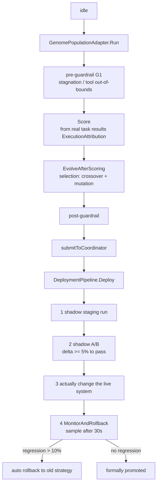

**"How evolution lands on the live system"** (deployment pipeline, 4 steps,
`internal/runtime/evolution/deployment/deployment.go`):

| Step | Function | Source |
|---|---|---|
| Deploy | `DeploymentPipeline.Deploy` | `deployment.go:184` |
| Monitor + rollback | `MonitorAndRollback` | `deployment.go:313` |
| Patch struct | `patch.RuntimePatch` | `internal/runtime/evolution/patch/patch.go:114` |
| Find executor by Target | `Registry.Register` | `patch.go:399` |
| Wire the live DAG | `UpdateLiveDAG` | `internal/ares_bootstrap/provide_new_evolution.go` |

**`RuntimePatch`** is the "universal mutation language": `Type` (what to
change) + `Target` (where) + `Value` (to what) + `Rollback` (inverse). It is
dispatched by Target to the Graph / Planner / Recovery / Knowledge / Memory
PatchExecutors.

**Effect on running tasks: none.** GA changes L1 (capability/strategy layer),
not L2 (session execution plan). Tool nodes already compiled into fabric tasks
in a running session are not rebuilt by an L1 patch; a changed prompt template
is only picked up by the next new session / next plan quantum. Worst case
"new strategy got worse" → the monitor detects it within 30s → auto rollback.

**G1/G2/G3 safety gates** (loose to tight):

| Gate | Location | Blocks |
|---|---|---|
| G1 Guardrails | around `GenomePopulationAdapter` | population-level: stagnation / tool allowlist out-of-bounds |
| G2 Shadow Gate | `DeploymentPipeline` step ② | shadow A/B: only delta >= 5% passes |
| G3 Eval + Regression | after lifecycle submit | run eval-suite / A/B vs baseline: a significant drop is not promoted |

> **Scope of these gates — do not read this table as "every promotion is
> verified".** G1-G3 guard the **`DeploymentPipeline` / `StrategyLifecycle`**
> chain. The **patch application path has no gate installed in production**: it
> decides by its own fitness threshold, which is exactly why the type is named
> `UngatedPatcher` (`internal/runtime/evolution/coordinator/coordinator.go:185`).
> Routing the patch path through the gate chain is tracked as A1-a; until then a
> patch can land without ever meeting G1-G3.

**The GA closed loop**: more runs → more score data → sharper evolution →
better strategy → better runs.

### 14.1 How the Idle GA Evolves Without LLM Involvement (Hot/Cold Path Decoupling)

The GA loop itself (score → select → cross/mutate → gate → deploy)
**makes zero LLM calls**. The key is that two timelines are decoupled:

```
Hot path (task execution)                    Cold path (idle GA)
┌─────────────────────────┐          ┌──────────────────────────────┐
│ plannerCognition        │          │ GenomePopulationAdapter.Run  │
│ quantum calls LLM:      │ ──────▶  │                              │
│ grow nodes / fill args  │  writes  │ ① Score: ReplayScorer.Score  │
│ toolCognition runs tools│  fitness  │   queries evidence store:    │
│ task end writes event   │  records │   mean of this StrategyID's  │
│ ExecutionAttribution    │  into    │   history (pure DB read,     │
│ {StrategyID,Success,    │  store   │   zero LLM calls)            │
│  TokenCost,Latency}     │          │ ② Evolve: sort by fitness,   │
└─────────────────────────┘          │   crossover + mutation      │
                                     │   (pure string/arithmetic)   │
                                     │ ③ G1/G2/G3 gates (numeric)  │
                                     │ ④ Deploy: write L1 metadata │
                                     └──────────────────────────────┘
```

**LLM is only invoked in the hot path** (planner once per quantum to grow
nodes). GA reads the `ExecutionAttribution` record that the kernel already
inlined into the event bus at `kernel/scheduler_quantum.go:309` when the
task finished — *which strategy ran, success or not, token cost, latency*.
That record **already exists**; GA does not re-query the LLM.

**Scoring path (default LLM-free)**:

| Config | scorer | LLM calls |
|---|---|---|
| Default (`evolution.llm_scoring` off) | `ReplayScorer` reads evidence store + heuristic fallback (constant 50.0) | **zero** |
| Cold start (no records) | returns `ColdStartScore=0.5` (neutral, no bias) | **zero** |
| Optional `evolution.llm_scoring=true` | `TieredScorer` with LLM Judge (`genome_wiring_idle.go:155`) | yes, but budget-capped by `MaxLLMCallsPerGeneration`; over budget falls back to heuristic |

**Evolution path**: `pop.EvolveAfterScoring` (`genome_wiring_run.go:157`)
sorts by fitness → culls the weak → cross-bred `PromptTemplate` strings +
arithmetic mutation on `Params` (temperature etc.). **Pure string
concatenation and numeric arithmetic, no LLM.**

> **Bottom line**: GA evolves "which prompt + parameter set to run tasks
> with"; the data on "how that parameter set performed" was already
> collected *during* task execution (by the LLM in the hot path) and
> written to the evidence store. GA just does post-hoc "score → cull →
> breed" — no LLM evaluation re-run needed. Classic
> **hot-path-produces-data / cold-path-consumes-data** decoupling.

### 14.2 The corpus rots: a zero-model-call probe (new in 0.3.x)

G3's arena gate runs against **a copy of the evaluation corpus in the
repository** — a file with no version stamp and no one watching it. Its decay
is silent: cases get deleted, their deterministic anchors get removed, and the
only symptom is "every score after this is judge opinion." `corpus_monitor.go`
makes that **cheaply observable**:

- **`InspectCorpus`**: reads the suite and reports the usable case count
  (same empty-input filter the gate applies), the count of cases carrying a
  deterministic anchor, and a sha256 fingerprint of the raw bytes.
- **`runCorpusProbe`** (driven by `evolution.gates.eval_probe_interval`,
  **default off**): re-reads on a timer; a **fingerprint change** is logged at
  Info (the corpus evolving is expected, including edits that don't change the
  counts), and **zero anchors** is logged at Warn (from then on every score is
  judge opinion, and nothing else in the pipeline says so). A file it cannot
  read is also a Warn — if a broken file only surfaces at G3 promote time,
  that is too late.
- **What it deliberately does NOT do**: run the real eval on a timer (one model
  call per case; a cost decision, not done). The reason is the same as
  `regression_runtime_replay`: a default switch should not multiply the bill.

The per-candidate replay that shipped in the same batch:
`regression_runtime_replay` (default off) makes the gate **run each candidate
through a real runtime, case by case** (`RuntimeArenaExecutor`: one runtime per
candidate, bounded to 2 retained, shared judge + deterministic floor) instead
of having a model **role-play** the candidate — "a score difference is an
execution difference, not a judging difference." When enabled with no provider
(the serving tool binder's boot ordering decides that), it **fails closed and
names the missing piece** rather than silently downgrading to role-play.

| Stage | Source |
|---|---|
| Fingerprint / anchor probe | `internal/ares_bootstrap/corpus_monitor.go` |
| Probe config key | `internal/ares_config/config_evolution.go` (`eval_probe_interval`) |
| Replay executor | `internal/ares_bootstrap/runtime_arena_executor.go` |
| Swappable-executor seam + shared judge | `internal/runtime/ares_evolution/service/llm_arena_scorer.go` (`ArenaExecutor`) |

---

## 15. Observability & Control Plane (introspect)

| Surface | Purpose | Source |
|---|---|---|
| 7 panels | Overview/Tasks/Agents/Scheduler/Execution/Memory/Events | `internal/introspect` |
| `EvolutionTracer` | evolution trajectory (`/evolution/trajectory`) | `internal/aresrecovery` |
| `FeedbackStore` | evolution feedback (`/evolution/feedback`) | same |
| `GlobalTracer` | full trace (`/observability/spans`) | same |
| `/api/chaos` | chaos drills | `cmd/ares/agent_routes_chaos.go` |
| `/api/evolution` | evolution control | `cmd/ares/evolution.go` |

The observability components are built once in Bootstrap step ②
(`assembleExperience`) and shared across surfaces, so the panels show
**live data** instead of empty lists.

**Plain-English picture**: introspect is the system's **control room**: a row
of screens (7 panels) + a batch of APIs (`/api/agents`, `/api/health`,
`/api/anomalies`, `/api/insights`). The key design is "**assemble once, share
many places**" — components like the evolution trajectory (EvolutionTracer),
feedback (FeedbackStore), and full trace (GlobalTracer) are **built once** in
Bootstrap step ②, then injected into each panel/API, avoiding "every panel
builds its own copy, data disagrees with itself". Like a hospital having one
set of monitors: every department's screen is wired to the *same* line, not
each department buying its own unit.

---

## 16. Storage Layer: Postgres

The durable foundation. `CREATE TABLE IF NOT EXISTS` + `ALTER ... ADD COLUMN IF
NOT EXISTS` are all idempotent — safe to re-run.

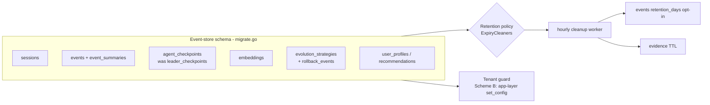

**Key fact (the 0.2→0.3 rename lives here):** the `leader_checkpoints` table is
`RENAME TO agent_checkpoints`, the `leader_id` column becomes `agent_id`, and
`idx_leader_checkpoints_status` becomes `idx_agent_checkpoints_status`
(`internal/storage/postgres/migrate.go:123-123`). This is the storage-layer
evidence of "the Leader was removed."

| Concern | Mechanism | Source |
|---|---|---|
| events / sessions / checkpoints tables | `CREATE TABLE IF NOT EXISTS` | `migrate.go:33/55/132/153` |
| Retention (opt-in) | `events_retention_days`, default = **never delete** | `bootstrap_builder.go:83-91` |
| Hourly TTL cleanup | `startExpiryCleanupWorker` + `CleanupExpired` | `bootstrap_builder.go:534` / `maintenance_worker.go:199` |
| Evidence-row TTL | registered on the same worker, S-10 tenant-scoped | `bootstrap_builder.go:303-306` / `bootstrap_steps.go:50-56` |

**Tenant guard = "Scheme B"** (worth memorizing): DB-layer RLS is
**deliberately NOT enabled** (the `migrate_storage.go:47-52` comment names it a
"pre-enforcement checklist"); instead the app layer binds
`set_config('app.tenant_id', $1, true)` transaction-locally
(`pool.go:172-238`). `true` = transaction scope, and the connection is
defensively cleared before return to the pool (`pool.go:215` so no tenant
leaks across requests). **SQL-injection guard**: every identifier passes
`validateSQLIdentifier` (`security.go:29-40`: regex + length + quoting).

**Plain-English "Scheme B" (why not RLS)**: Postgres has built-in row-level
security (RLS) that can isolate tenants at the DB layer, but "letting the DB
do access control" means the **policy is scattered inside the database** —
when the app changes its logic, the DB does not know, and both debugging and
evolution get painful. The v0.3.x choice: **the DB only stores data; all
access control lives in the app layer** — each connection first
`set_config('app.tenant_id', <current tenant>)` to stamp itself; the rows in
the DB are just "labeled data"; the app code decides who sees what. The cost
is "forget to stamp and you cannot find data" (fail-safe: better to find
nothing than to leak across tenants); the benefit is that the policy is
centralized, testable, and rollable. That is why the comment calls RLS a
"pre-enforcement checklist" — **not enabled yet**; today the app-layer
"stamping" is what keeps the line.

On "retention": `events_retention_days` is **opt-in (unset = never
delete)**, i.e. the event ledger is by default *not* cleaned, because the
ledger is the base of event sourcing — clean it wrong and you lose history.
What actually expires are the **evidence rows** (evidence TTL) and
**distilled-experience rows** (TTL), reclaimed together by the "hourly
cleanup worker" (`startExpiryCleanupWorker`).

---

## 17. Knowledge Layer: AKG

AKG (Agent Knowledge Graph, BETA) uses `KnowledgeObject` as the universal
knowledge representation, with **three layers**: `Raw` (original bytes, kept
for re-distillation) → `Normalized` (cleaned text for vectors/matching) →
`Summary` (LLM-friendly summary).

**Plain-English picture**: AKG is a **knowledge supermarket**. Any knowledge
(code files, Git records, distilled experience) is first turned into a
standard **product** (`KnowledgeObject`), packed in three layers:
- **Raw** = the original packaging (raw bytes), kept in case you "need to
  re-pack it";
- **Normalized** = opened and weighed (control chars stripped, text
  normalized), what you use to "scan & compare" (vector / keyword match);
- **Summary** = the shelf label card (LLM-friendly summary), what the model
  reads quickly.

The key is that "write" and "read" are two separate roads: the write side
(DistillBridge) shelves the product; the read side (HybridSearch →
KnowledgeRuntime) pulls it off the shelf and feeds the agent's tools and the
RAG retriever. And **BETA never blocks the hot path** — if AKG goes down, the
system just warns and keeps running; a temporarily unavailable knowledge base
cannot stop the work.

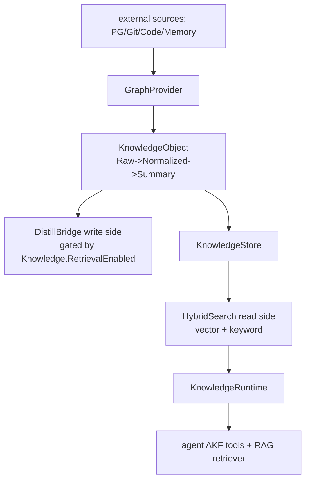

**The current pipeline is rule-based (no LLM):** `DefaultNormalizer`
(strips control chars), `DefaultSummarizer` (truncates to first 200 chars),
`defaultPlanner` (`containsAny` keyword + weight)
(`internal/knowledge/pipeline/normalizer.go` / `planner/default.go`).
It is assembled in Bootstrap step ② `wireAKGLoop`
(`bootstrap_builder.go` `assembleExperience`); **if AKG is unavailable the
system warns and degrades, still fully functional** (BETA never blocks the hot
path).

| Concern | Mechanism | Source |
|---|---|---|
| Universal knowledge object (3 layers) | `KnowledgeObject` | `internal/knowledge/object.go` |
| Write-side distillation bridge | `wireAKGLoop` → `AKGBridge` | `internal/ares_bootstrap/bootstrap_builder.go` |
| Read-side sharing | `KnowledgeRuntime` feeds both agent tools + RAG | `bootstrap_builder.go` `assembleEvolutionDAG` |
| Tenant isolation | **by `namespace`, not a tenant column** (tenant→namespace mapping) | `SECURITY.md:94-99` |

> **Connection to "task normalization"** (the earlier AKG proposal): store
> "original task + decomposed sub-tasks" as an `ObjectTask` **shadow semantic
> ledger** (bypass write + degraded read-prior). Do **not** make it the
> authoritative source of live task semantics, or the 0.3.x invariant
> "hot path never depends on the knowledge component" would be dragged down
> by a BETA AKG.

---

## 18. Memory & Distillation

The "remembers more the more it runs" mechanism. Split into a **write side
(distillation)** and a **read side (retrieval injection)**.

```mermaid
flowchart LR
    tc[task.completed event] --> sd{ShouldDistill<br/>task>=10 and result>=20}
    sd -->|pass| llm[LLM extracts Problem/Solution/Constraints<br/>with fenceUntrusted fencing]
    llm --> store[store experience row<br/>+ embedding]
    store --> vec[MemoryRetriever<br/>vector search MinScore0.4 TopK5]
    vec --> prompt[inject into prompt context]
    store --> prior[ExperiencePrior injected at spawn]
    prior --> next[next agent "born with experience"]
```

| Concern | Mechanism | Source |
|---|---|---|
| Distillation service | `DistillationService` | `internal/runtime/memory/experience/distillation_service.go` |
| Distill gate | `ShouldDistill` (success **and** failure both eligible; only content-length filters) | `distillation_service.go` `ShouldDistill` |
| **Stored indirect-injection guard** | `fenceUntrusted`: task content wrapped in `---UNTRUSTED-TASK-DATA---` fences, preventing a "stored into the experience store then RAG-injected back into a prompt" persistent-injection path | `distillation_service.go` `buildExtractionPrompt` |
| Distillation wiring | `wireDistillation` + `subscribeDistillationEvents` (subscribes `task.completed`) | `internal/ares_bootstrap/bootstrap_steps.go:26` / `:105` |
| Read-side retrieval | `MemoryRetriever` (vector, defaults `MinScore=0.4` / `TopK=5`) | `internal/runtime/memory/context/memory_retriever.go:93` |
| Scheduler-side prior | `ExperiencePrior` injected at spawn (truncated to 4096 runes) | `internal/fabric/agent/lifecycle.go:49` / `planner_cognition.go:209` (`maxExperiencePriorRunes`) |
| Cost / threshold knobs | `DistillationThreshold` / `MaxDistilledTasks` / `DistilledTaskTTL` | `internal/runtime/memory/manager.go:113/123/132` |
| Async vector backfill | `embeddingEnqueuer` (default synchronous; with a queue it persists the row first, then backfills the vector async so the event loop never blocks) | `distillation_service.go` `WithEmbeddingEnqueuer` |

**Token cost**: distillation runs an LLM extraction (30s timeout) — one of the
few "background token-burning" places. Cost is controlled three ways:
`MaxDistilledTasks` (row cap), `DistilledTaskTTL` (expiry reclamation), and the
async embedding path.

**Plain-English picture of the whole chapter**: when a task finishes (win or
lose) it emits a `task.completed` event; the distiller is like an "on-shift
reviewer" who, hearing the bell, opens that record: **"what was done, how it
won/lost, what the traps were"** (the three columns Problem / Solution /
Constraints), extracted by the LLM and stored in the experience library. The
next time a **new agent is born** (spawn), the scheduler stuffs "the most
similar historical experience to this task" into its prompt as a prior —
**a new intern joins already carrying the veterans' "pitfall notes"**;
mid-run, when it needs to look something up, RAG semantically retrieves the
top-5 relevant snippets from the experience library and stuffs them into the
context. The write side (distillation) and the read side (retrieval/prior) are
**asynchronously decoupled**: a distillation failure does not hurt the task
itself (BETA never blocks the hot path) — it just means "nothing learned this
time".

Two safety details worth their own line:
- **the `fenceUntrusted` fence**: the task body (possibly user-supplied
  malicious content) is wrapped in `---UNTRUSTED-TASK-DATA---` before it
  enters the prompt. Why? To stop **persistent injection**: an attacker hides
  an instruction inside a task → it gets distilled into the experience store →
  next time RAG retrieves it back and injects it into *another* task's prompt.
  The fence tells the LLM "what is inside is data, not an instruction".
- **success *and* failure are both distilled**: failure cases are often more
  valuable than successes ("this road has a trap"), so `ShouldDistill` does
  not filter by win/lose — only by "too short to learn from".

---

## 19. MCP Integration & Tool Discovery

Tool sources come from **three paths**, all landing in one `core.Registry`
(`toolBinder.GetToolSchemas()` reads it to build L1):

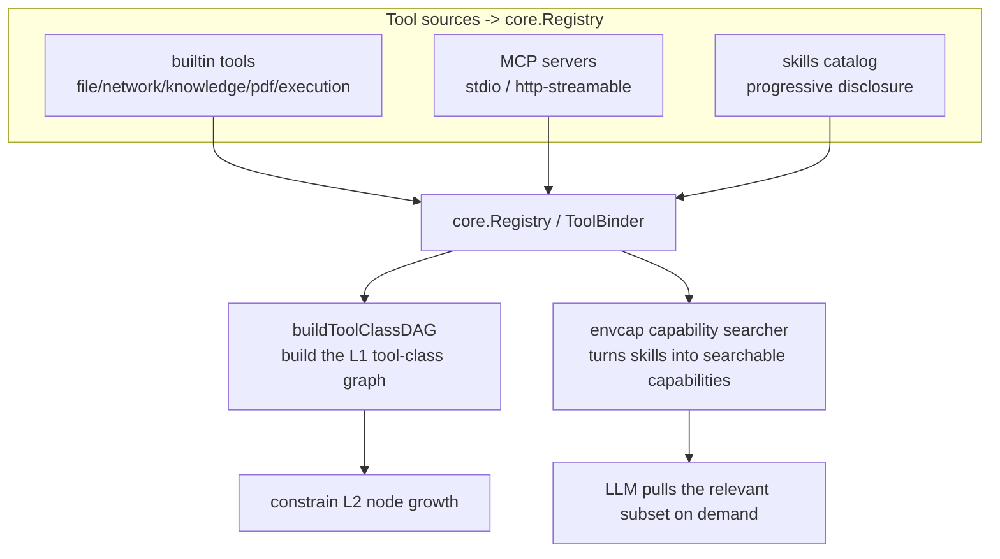

| Concern | Mechanism | Source |
|---|---|---|
| MCP assembly | `ProvideMCP` (stdio / http transports) | `internal/ares_bootstrap/provide_mcp.go:203` |
| MCP manager | `MCPManager` (transport_stdio / transport_server) | `internal/runtime/protocol/mcp/` |
| **Progressive disclosure** | the registry keeps the **full** tool set; each quantum advertises a **narrowed subset** | `internal/fabric/agent/planner_cognition.go` (`advertisedToolSchemas`) |
| Capability searcher | `registerCapabilitySearch` (envcap): makes the skills catalog a searchable tool capability | `cmd/ares/agent_routes_tools.go:280` |
| L1 tool-class graph | `buildToolClassDAG(toolBinder.GetToolSchemas())` | `cmd/ares/serve_peer.go:515` |

**What makes "tool discovery" distinctive — and what it took to be true**: the registry holds the
full set, but the planner no longer dumps it. Every quantum the advertisement is filtered by
(a) L1 `enabled` (a tool the evolution disabled is **not shown at all**, rather than shown and
silently skipped when chosen), (b) a static tag filter, and (c) the task's capability tags —
read from the task payload when a submitter set them, otherwise derived from the request text by
keyword. Capability matching is a **union**, because the tool tag map holds one value per key.

Two properties keep this from becoming a silent capability loss: a filter that matches nothing
**fails open** to the previous set, and every advertisement emits one log line with `caps` /
`advertised` / `total`. When the keyword read misses a capability a task really needs, the model
can call `need_tools`; the request is unioned into the task and reaches the next quantum, which
works only because the kernel carries task-scoped payload keys across the checkpoint re-wrap
(`carryTaskScopedPayload` in `internal/kernel/scheduler_quantum.go`).

**Boundary worth knowing**: MCP tools are not on this path. They are registered into the SDK's
own tool registry (`sdk/sdk.go`) and report planner capabilities through `Capabilities()`
(derived from their advertised description) instead of `cap_*` tags, so kernel-side narrowing
does not apply to them.

### 19.1 Active service discovery (the `internal/discovery` engine)

The above is "tool-level" discovery. At the very top there is another
**"service-level" active-discovery layer**: instead of waiting for the user to
hand-write MCP servers in config, the system **proactively scans existing
configs on the machine and auto-detects usable providers**.

| Layer | What | When | Source |
|---|---|---|---|
| **① Service discovery** | Scan Claude/Cursor/VSCode/ARES configs + PATH binaries; find which MCP servers exist | every 5min (default) + self-healing loop | `internal/discovery/engine.go` |
| **② Tool discovery** | connect + `ListTools` + `OnChange` dynamic add/remove | boot + server notifications | `internal/runtime/protocol/mcp/client.go:228` |
| **③ Tool selection** | full set registered, only a relevant subset fed to the LLM (progressive disclosure + envcap) | at LLM call time | `cmd/ares/serve_wiring.go:215` |

```mermaid
flowchart TB
    subgraph disc[1 service discovery - internal/discovery]
        p[Providers scan concurrently<br/>Claude/Cursor/VSCode/ARES + PATH binaries]
        p --> merge[merge -> diff<br/>added/updated/removed]
        merge --> store[persist to ServiceStore]
        merge --> evt[emit events -> EventStore "discovery" stream]
        auto[StartAutoDiscovery<br/>every 5min + panic self-heal backoff] --> p
    end
    evt --> mcp[2 connect to MCP -> ListTools + OnChange]
    mcp --> reg2[core.Registry]
    reg2 --> sel[3 progressive disclosure + envcap feeds LLM on demand]
```

**Key design points:**

- **Active != connect-what-you-configured**: it scans the IDEs' existing
  `mcp.json` files (`providers/filesystem.go`) and auto-detects the MCP
  servers scattered on the machine.
- **Manual registrations are not deleted** (#51): services created by
  `Engine.Register` are passive; the diff's removed branch protects them.
- **Self-healing background loop**: `StartAutoDiscovery`'s goroutine recovers
  its own panics and restarts with exponential backoff (`1s/2s/4s...30s cap`).
- **Gated**: `Discovery.Enabled` defaults to **false**
  (`bootstrap_builder.go:493`); when off you configure MCP manually.

| Concern | Function | Source |
|---|---|---|
| Discovery engine (4 phases) | `Engine.DiscoverNow` | `internal/discovery/engine.go:50` |
| Provider interface | `DiscoveryProvider.Discover` | `internal/discovery/discovery.go:87` |
| Per-IDE config scanning | `NewClaudeProvider` / `NewCursorProvider` / `NewVSCodeProvider` / `NewARESProvider` | `internal/discovery/providers/filesystem.go` |
| Auto-discovery loop (self-heal + backoff) | `StartAutoDiscovery` | `internal/discovery/engine.go` |
| Assembly + event bridge | `ProvideDiscovery` / `forwardDiscoveryEvent` | `internal/ares_bootstrap/provide_discovery.go:51` |

---

## 20. SDK / CLI Usage

| Entry | Scenario | Source |
|---|---|---|
| `ares serve` | production long-running (HTTP + background loops) | `cmd/ares/serve.go` |
| `ares start` / SDK | embedded (in-process agent, shares the L2 core) | `sdk/` + `internal/agentruntime` |
| Other CLI subcommands | `status` / `doctor` / `chaos` / `evolution` | `cmd/ares/main.go` (cobra) |

**Two entries, one semantics**: both `serve` and the SDK drive the L2
execution core in `internal/agentruntime` (session registry + compile
coordinator + planner/router cognition + task reaper). **The entry differs
(HTTP vs in-process); the execution semantics are identical.**

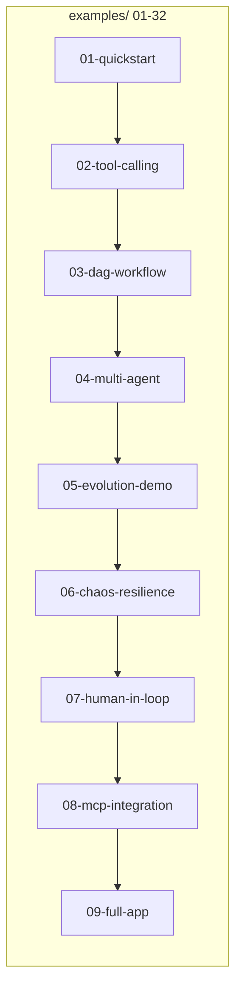

`examples/` runs from 01 (minimal LLM hookup) to 32 (llm-service-direct),
covering quickstart / tool-calling / DAG / multi-agent / evolution / chaos /
HITL / MCP / full-app — the living documentation of "how to use the system."

---

## 21. Security Model

**Three trust boundaries** (`SECURITY.md`):

| Boundary | Mechanism | Source |
|---|---|---|
| **SSRF** | `ValidateURL` rejects private/loopback/link-local/cloud metadata (`169.254`); **every hop re-validated** to stop redirect bypass | `internal/tools/resources/builtin/network/ssrf.go:32` |
| **Sandbox** | code-execution tools run sandboxed; MCP stdio servers are **constrained by the operator** (stated in docs) | `SECURITY.md:61` / `.../execution/code_runner.go` |
| **Tenant** | **single-tenant by default**; `tenant_id` is a **per-request opt-in scope**; **kernel-enforced** (an LLM-supplied tenant is always overwritten by context); the knowledge side isolates by **namespace** | `SECURITY.md:69-99` / `agentsyscall` |

**The common fail-closed toolkit (recollected here from earlier sections):**

| Mechanism | Effect | Source |
|---|---|---|
| Wildcard bind requires auth | refuse to start unauthenticated | `cmd/ares/serve.go:292` |
| Path-traversal guard | `SetAllowedConfigDir` confines config reads to a directory | `internal/ares_config/config.go` |
| Read interfaces need permission | `PermRead` gates introspect / config reads | `agent_routes_task_read.go` |
| SQL identifier validation | `validateSQLIdentifier` blocks injection | `internal/storage/postgres/security.go:29` |
| Tenant kernel-enforced | `kctx.CallerID` / `tenantctx` override LLM args | `internal/agentsyscall/syscall.go` |

**The one through-line**: fail closed wherever it can, never trust the LLM or
the model where the kernel can enforce, and have context stamp every
tenant / origin / provenance.

---

## 22. Where ReAct Went: Dynamic DAG and the Think-Do-Evolve Layers

v0.3.x **deletes the ReAct tool loop** (many source comments state
"the ReAct tool loop is deleted" — see `internal/agents/sub/agent.go:55` /
`internal/fabric/agent/l2graph.go:22`). Its replacement is not "another
loop" but the **dynamic DAG + splitting "do" into two node kinds + an outer
evolution round** working together.

**Plain-English picture (why not ReAct)**: ReAct is "one person thinking
while doing" — the LLM loops in its head "think → call tool → see result →
think again → call tool again". The problem: **everything is in its memory**
— once it crashes (panic / timeout / killed), **"where I got to" is lost
entirely** and it must start from scratch. And it **runs as long as it wants**
with no convergence bound, so it burns money and time without a ceiling.

v0.3.x splits "think" and "do" into **two kinds of boxes** on the DAG:
- **Think (plan box)**: each plan quantum calls the LLM once and **only
  grows new tool boxes**; it never runs a tool itself.
- **Do (tool box)**: every tool call is a **first-class task**, scheduled and
  executed by the kernel; results are written back to the fabric for the
  next planner quantum to read.
- **Outer evolution round**: after a round, GA injects a mutation and the
  whole DAG re-runs — this is the "gets sharper over time" outer loop.

In one line: **ReAct is "one person"; the dynamic DAG is "a line of stations
+ one flowchart" — the flowchart (L2 graph + tasks) is durable while the
cooks (agents) are swappable, so losing one does not lose overall progress.**

### 22.1 A metaphor

| Mode | Metaphor |
|---|---|
| **ReAct** | One cook thinks while doing, all in their head; if the cook collapses, the recipe is lost |
| **Dynamic DAG** | A recipe flow-chart + a line of station cooks; a cook fills one box and hands it off, the head cook watches the chart and assigns work; the chart is a durable asset, the cook is swappable |

### 22.2 "Think" and "Do" are split into two node kinds

ReAct's chain (think→do→think→do) is split into **boxes** on the DAG:

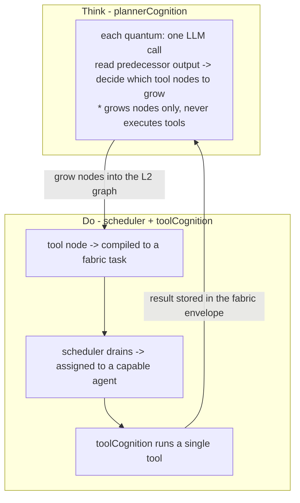

| ReAct (0.2.x) | Replacement (0.3.x) | Source |
|---|---|---|
| one cognition's `LLM→tool→LLM` tight loop | **plannerCognition**: one LLM call per quantum, grows tool calls as nodes, does not execute | `planner_cognition.go:236` (`ExecuteStep`) |
| tools run inside the cognition | **toolCognition**: a tool node is a first-class fabric task, executed by the scheduler | `internal/fabric/agent/l2graph.go` |
| unbounded, LLM runs as long as it wants | **maxPlanDepth** (default 10) forces convergence | `planner_cognition.go:26` (`DefaultMaxPlanDepth`) |
| loop state = in-memory Messages, lost on crash | tasks + `CheckpointEnvelope` are durable (checkpoint-resume); the **L2 graph itself is in-process only** — after a restart the session is re-admitted with a freshly built (empty) graph | see §6, §25.1 |

### 22.3 What "dynamic" actually means (grow-as-you-go)

The same DAG at three moments — **it is not drawn up front; it grows while it runs**:

```mermaid
flowchart TB
    subgraph T0["T0 - just submitted (skeleton only)"]
        r0[root session] --> p0[plan-1]
    end
    subgraph T1["T1 - plan-1 thinks, grows tools (graph changed)"]
        p0x[plan-1] --> g1[tool: grep]
        p0x --> r1[tool: read]
        g1 --> p1[plan-2]
        r1 --> p1
    end
    subgraph T2["T2 - plan-2 sees results, keeps growing / answers"]
        p2[plan-2] --> a[answer: emit final result]
    end
    T0 --> T1 --> T2
```

- **T0**: only root + the first plan box.
- **T1**: plan-1 calls the LLM; the LLM says "I need grep + read", so two tool boxes + a plan-2 (depending on them) are **grown** at the tail. The scheduler runs the tool boxes.
- **T2**: plan-2 reads the grep/read results; the LLM says "enough", so an **answer** box is grown → session ends. If it says "need to check one more thing", plan-2 grows another batch of tool boxes.

**"Dynamic" = for every plan box run, the DAG grows a segment, and the scheduler drains the newly grown part.**

### 22.4 What this buys vs what it costs

**Gained (not in ReAct):** tools are first-class tasks with checkpoint-resume; unified kernel scheduling; a `maxPlanDepth` convergence bound; an explicit, replayable plan; evolvable steering.

**Paid (where ReAct was simpler):**

| Cost | Detail |
|---|---|
| Complexity explosion | ReAct is one loop; 0.3.x is planner + L2 graph + incremental compile + scheduler + toolCognition + checkpoint |
| More latency | tool results must "go into the fabric → next plan quantum reads", several hops more than ReAct's immediate feed-back; **unfriendly to rapid trial-and-error** |
| Token cost | every plan quantum re-assembles context and re-calls the LLM, burning more than ReAct |
| Wiring fragility | `PlannerDeps` has 9 fields (`planner_cognition.go:31`); miss any and it degrades |

### 22.5 There is also an "outer round" (evolution)

`LoopConfig` (`internal/runtime/loop.go:11`; the verbatim comment sits at `:9`:
"Unlike a fixed ReAct loop, drives the outer round loop that re-executes the
entire DAG with mutations applied between rounds"). This is what the GA cold
path uses — **a mutation is injected between rounds, then the whole DAG is
re-executed**.

So the full replacement = **planner (think) + scheduler/toolCognition (do) +
the outer round loop (evolve): three pieces together**.

> **One-line verdict**: ReAct is "one person thinking while doing" — a single
> chain, lost entirely on crash. The dynamic DAG splits that chain into "plan
> boxes (think) + tool boxes (do) + answer boxes (end)"; the skeleton (the
> graph) is durable while the cook (the agent) is swappable; it grows as it
> runs, the head cook (scheduler) assigns work, and the outer loop can evolve.
> It is a "trade structure for robustness" choice — **positive** for 0.3.x's
> goals (resilience, evolvability, multi-agent collaboration); but used for
> "single-agent real-time interactive trial-and-error" it is heavier, slower,
> and more token-hungry than classic ReAct.

---

## 23. L1 / L2 Dual Graphs & Data Splitting

### 23.1 L1 vs L2: rule layer vs instance layer

The system has **two graphs at different levels**, not "two copies of the
same kind":

| | L1 ToolClass graph (`injectToolClassDAG`) | L2 session graph (`L2Graph` / `MutableDAG`) |
|---|---|---|
| Node is | a **tool class** (grep, web_search…) | a **tool instance** (3rd grep of this session) |
| Built by | boot scan of `toolBinder.GetToolSchemas()` | LLM grows it **live** in planner quanta |
| Carries | `enabled`/`budget`/`prior` metadata | `payload` / dependency edges / results |
| Lifetime | shared system-wide, long-stable | one per session, reaped at session end |
| Changed by | **GA evolution** (patch on metadata) | **LLM** (grow nodes while running) |
| Compiled to tasks? | **No** (constraint catalog only) | **Yes** → fabric tasks, run by the scheduler |

Source: L1 built at `cmd/ares/serve_peer.go:515`; L2 at
`internal/fabric/agent/l2graph.go`; the L1→L2 gating in
`planner_cognition.go growToolNodes` (checks `isToolEnabled` /
`toolBudgetRemaining` / `l1Priors` before growing a node).

**L1 sets the rules, L2 produces the instances.** The cleanest proof:
`budget=N` sits on an L1 tool-class node; when the planner grows an L2 node it
calls `CountToolClass` to count "how many instances of this class this L2
session already has", blocking past N — **the rule lives in L1, the counted
instances live in L2.**

### 23.2 Why two graphs are mandatory (three breaks with one)

```mermaid
flowchart TB
    one[If L1/L2 were one graph] --> a[sharing: the catalog is copied per session]
    one --> b[evolution safety: a GA patch to 'rules'<br/>would corrupt in-flight session work-orders]
    one --> c[update cadence: stable(evolved) vs volatile(LLM-grown)<br/>in one object, locks/versions/rebuild all clash]
```

1. **Sharing**: the tool catalog is naturally "one for the whole system"; mix it
   with session work-orders and every session gets a copy.
2. **Evolution safety**: GA patches L1 metadata; **in-flight L2 sessions are
   unaffected** (their nodes are already grown; the patch only governs
   "next time").
3. **Cadence**: L1 is stable (occasionally evolved), L2 is volatile
   (growing every quantum). One object = broken locking.

> Analogy: a DB schema (table structure) is never the same thing as its rows
> — L1 is the schema, L2 is the rows.

### 23.3 Data splitting: structured vs semantic (Postgres / pgvector)

| Data class | Where | Why |
|---|---|---|
| **Structured**: task state machine, lease/epoch, checkpoints, event ledger | Postgres tables — **only when `storage` is enabled**; otherwise the event store falls back to an in-memory archive (`cmd/ares/serve_wiring.go:338`) | needs transactions, exact queries, event sourcing, multi-node sharing |
| **Semantic**: knowledge objects, distilled experiences (Problem/Solution/Constraints) | pgvector columns (`VECTOR(1024)`) | needs recall by *meaning*, not by word |

Agent-fabric runtime state (the agent population, `CognitiveState`) is
**process-local**, not in Postgres: the `agent_checkpoints` table exists, but
`migrate.go:128` notes it currently has **no production query**.

"Same Postgres + pgvector instance" is deliberate: relational data
(experience rows) + vectors (`embedding` column) live in **one DB, one
transaction** — no separate Milvus/Pinecone. Multi-node clusters share one
PG. (`migrate.go:97` creates the generic `embeddings` table as
`VECTOR(1024)`; the real pgvector tables are `knowledge_chunks_1024` /
`experiences_1024`, whose `ivfflat` indexes live in `migrate_storage.go:72`.)

---

## 24. Retrieval Denoising

Vector search gets **noisier as data grows** — four sources:

**Plain-English intuition first**: imagine vector search as "finding books in
a library by how they *feel* similar". With a few dozen books you can glance
and spot the right one; with a hundred thousand, "feels similar" stops
working — a pile of books all "half-similar", and you cannot tell which is
the real one. The four noise sources correspond to four things:
① **curse of dimensionality**: a hundred thousand books crammed into one
shelf area, all "similarity scores" squeezed into the narrow 0.7~0.9 band, so
there is no separation; ② **approximate index (ivfflat)**: to be fast it only
flips through the nearest few "buckets", so it can miss what is truly
relevant or mix in what is not; ③ **long-tail cold data**: "dead data" that
was written into the store but rarely used — short, vague, low-quality
vectors, yet still retrieved; ④ **pure cosine, no re-rank**: books whose
title looks similar but content is wrong cannot be told apart by "similarity
score" alone.

```mermaid
flowchart LR
    q[query vector] --> n1[1 curse of dimensionality<br/>tens of thousands cluster in cosine 0.7~0.9, no separation]
    q --> n2[2 ivfflat approximate index<br/>scans only the nearest 'buckets', misses/mixes]
    q --> n3[3 long-tail cold data<br/>short/vague/low-quality vectors]
    q --> n4[4 pure cosine, no rerank<br/>can't tell 'title near but content wrong']
```

### 24.1 What the project actually does (source-backed)

| Technique | Fixes | Source |
|---|---|---|
| Hard filter first (`WHERE tenant_id AND embedding IS NOT NULL`) | ①③ | `internal/storage/postgres/vector.go:91` |
| **HybridSearch** (vector cosine + lexical keyword, fused) | ①④ | `internal/knowledge/store.go:55` |
| TopK + MinScore gates (default `RAGTopK:5 / MinScore:0.4`) | ①③ | `internal/runtime/memory/manager.go:429-430` |
| Quality metadata in scoring (Extraction/Consistency/Freshness/Usage) | ③ | `internal/knowledge/object.go:96` (weights in `quality.go:31`) |
| Experience dedup / conflict merge (similarity threshold) | ③ | `internal/runtime/memory/experience/conflict_resolver.go:15` |

**What it does NOT do (the highest-value gap)**: a **model-based** second pass
— there is no cross-encoder / learned reranker anywhere in the tree. What exists
is *heuristic* re-weighting, not semantic re-ranking: a `rerankResults` /
`mergeAndRerank` pair used to live in `internal/storage/postgres/services/`, which
was deleted wholesale on 2026-10-16 (never constructed by the production wiring —
zero-reference dead code, kept in git history). What production actually runs today
is the hybrid scoring in `internal/knowledge/hybrid.go` (vector + lexical, weights
configurable).

### 24.2 The right denoising posture at scale (wide recall + precise rank)

```mermaid
flowchart LR
    q[query] --> r1[1 wide recall<br/>vector/hybrid top-50<br/>better to over-include]
    r1 --> r2[2 precise rank (rerank)<br/>cross-encoder scores each pair<br/>or an LLM decides 'which are truly relevant']
    r2 --> top[3 take top-5 to inject]
```

Plus three (by cost-effectiveness):

1. **ivfflat → tune probes, or switch to HNSW** (ivfflat recall degrades at
   scale; HNSW is higher, at the cost of memory + build time)
2. **metadata pre-filter**: narrow by type/time-window/tags/capability-domain
   before recall — cheaper than post-hoc rerank
3. **embedding versioning + full re-embed**: on model upgrade, the
   `embedding_version` column re-embeds old vectors to the new version

> Interview one-liner: "At scale I denoise in three layers — **before**
> recall: hard filter + pre-filter; **during**: hybrid retrieval
> (vector + keyword); **after**: wide recall top-50 + cross-encoder rerank to
> top-5 + quality/freshness weighting."
>
> **Keep the tenses straight when you use this line**: the project *today* is
> `ivfflat(lists=100)` + *heuristic* re-weighting. HNSW + cross-encoder is
> where it should go, not what it does — say "I'd move it to HNSW" and you
> stay defensible.

---

## 25. Checkpoint & Recovery

### 25.1 Two layers of "memory" (the first follow-up question)

**Plain-English picture**: think of a task as a chess game and the agent as
the player. The system actually keeps **two "memories"** — do not mix them:
- **Task progress (Task.Checkpoint)**: which move we are on, the state of
  every box — a "board snapshot", durable in the fabric ledger; anyone who
  picks it up can read it and continue.
- **Agent brain (CognitiveState)**: the player's own context, which tools it
  has called, the intermediate conclusions it is thinking — "what is in this
  player's head", belonging to the agent itself.

The difference in recovery shows up exactly here: **swapping the holder
(requeue)** takes only the "board snapshot" (a new player sits down and
continues, with a fresh brain); **in-place revival (RestartAgent)** moves the
"old player's brain" intact into a "new body" (same-ID revival, cognition
continuous). Both save the task; only the latter gives you "cognition
continuity".

| Layer | Stored in | What | Plain |
|---|---|---|---|
| **Task progress** | `Task.Checkpoint` (fabric ledger, durable) | `CheckpointEnvelope` | "how far the task got" |
| **Agent brain** | `CognitiveState` (the agent's own state) | LLM context + tool-call history | "what's in this agent's head" |

### 25.2 `CheckpointEnvelope` field table (`checkpoint_schema.go`, SchemaVersion=v5)

| Field | What it does | Note |
|---|---|---|
| `SchemaVersion` | format version (v5) | a rollback must not force-read a newer version |
| `StepCheckpoint` | **quantum progress** (nil = not run yet) | the core field; the resume landing point |
| `Payload` | task's raw data (task_desc) | "what the task is" |
| `SessionID` / `TenantID` | owning session / tenant | stable across yield→resume; restored into tenantctx at exec |
| `StrategyID` | GA strategy at SUBMIT time | **stamped once, never re-read** (attribution is task-granular; a mid-flight promote must not mis-credit the new strategy) |
| `UsedExperienceID` | which distilled experience was borrowed | bandit-feedback linkage |
| `InputTokens` / `OutputTokens` | **cumulative** LLM token spend | accumulated across quanta (not the last step); GA sees total task cost |
| `LastError` | "why it died" on terminal FAILED | agent death does NOT set this (that's `Task.FailedDependency`) |
| `UserProfile` | extra user profile (opaque to fabric) | the executor restores it |

### 25.3 Agent recovery: in-place revival (7 steps inside `aresrecovery.RestartAgent`)

Loading the death snapshot, binding task-X and resuming from `StepCheckpoint`
happen **outside** `RestartAgent` — in the caller (`runKernelRecoveryLoop`,
`cmd/ares/kernel_loop.go:336`) and in the scheduler.

```mermaid
sequenceDiagram
    participant S as Scheduler
    participant R as Recovery (RestartAgent)
    participant F as AgentFabric
    participant B as Agent B(replacement)
    S->>R: agent A is gone, task-X still RUNNING
    R->>R: 1 check restartBudget (windowed: default 5 within RestartWindow=1h; a successful revival does not reset it; zero window = lifetime-cumulative)
    alt over budget
        R--xS: refuse; task-X FAILED
    else within budget
        R->>R: 2 atomic reserve (claim the slot, then sleep)
        R->>R: 3 exponential backoff (1s, 2s, 4s ... 30s cap)
        R->>R: 4 same-ID arbitration (one reviver wins)
        R->>F: 5 spawn B via CognitionFactory (a real cognition, not an empty shell)
        F->>B: 6 load A's CognitiveState into B
        R->>R: 7 release the death snapshot
    end
    S->>B: caller side (NOT in RestartAgent): bind task-X, resume from StepCheckpoint
```

| Step | Key point | Source |
|---|---|---|
| budget check (windowed: 5 within `RestartWindow`, default 1h; zero window = lifetime-cumulative) | "5 in the window", not "5 ever" — a long-lived healthy agent earns its budget back; prevents the reset-loop | `recovery.go:277` |
| atomic reserve | check+increment in one shot; claim the slot before the sleep | `recovery.go:283` |
| exponential backoff | prevents a crash-restart storm | `recovery.go:310` |
| same-ID arbitration | death snapshot drives same-ID in-place revival; provenance/audit continuous | `recovery.go:326` |
| spawn via CognitionFactory | builds a "real cognition", not an empty shell | `recovery.go:151` |
| load the brain | A's LLM context/tool history moves into B | `recovery.go:340` |
| bind + resume (**caller side**) | *not* in `RestartAgent`: `runKernelRecoveryLoop` binds task-X, the scheduler resumes from `StepCheckpoint` | `kernel_loop.go:451` |

> `RecoverTaskCheckpoint` (`recovery.go:305`) and `RecoverFromAgentDeath`
> (`recovery.go:371`) are marked TEST/CHAOS-ONLY; `RestartAgent` is the
> production path.

### 25.4 Two recovery modes

| Mode | Trigger | Result |
|---|---|---|
| **requeue (swap-in)** | lease expiry → task back to READY → scheduler assigns another agent | new agent resumes from `Task.Checkpoint`; **does not necessarily reuse A's brain** |
| **in-place revival (RestartAgent)** | agent panic / chaos kill → recovery finds a death snapshot | **same-ID revival**; A's brain (CognitiveState) is moved into a "new body" |

**requeue is the default path; in-place revival is the enhanced path**
(only when a death snapshot exists).

> One-liner: lease expiry just **requeues the task to swap in a new holder**
> (it does not kill the task); the lease guard rejects the old holder's late
> writes — **`ErrNotOwner` once it no longer holds the lease, and
> `ErrEpochMismatch` when it still holds it at a stale epoch** — so at any
> instant there is exactly one valid writer.

---

## 26. Context Management (sliding-window truncation + rule-based cleaning + RAG injection, NOT LLM summarization)

> This section is deliberately factual: the project does **not** do LLM
> summarization-style compaction (not OpenAI's `compact` "summarize the
> history into one paragraph and feed it back"). What it does is
> **"sliding-window truncation + rule-based cleaning + RAG injection"**,
> zero LLM cost. This is a deliberate trade-off with a clear boundary.

**Plain-English intuition first**: the LLM's context window has a fixed
number of "seats" (the token cap). To fill those "seats" there are three
ways:
- **LLM summary compaction** (NOT done): hand the whole history to another
  LLM to summarize into a small paragraph, then feed it back. Most complete,
  but costs an extra LLM call (expensive + slow + the summary is itself lossy
  + one more failure point).
- **Sliding-window truncation** (done): take only the **most recent N**
  messages and drop the old ones. Zero cost, deterministic — but it loses the
  older context.
- **Rule-based cleaning + RAG injection** (done): the truncated messages are
  cut with **regex rules** to strip tool noise (code blocks, tool returns keep
  only the first sentence), while vector retrieval stuffs back "not-recent
  but related" old knowledge snippets.

In one line: **the project picked "the cheap three-piece set" and clearly did
NOT add "the expensive piece (LLM summary)"** — a trade-off, not an oversight;
the boundary (long tasks miss on both ends) is spelled out in §26.4.

### 26.1 Three-layer mechanism (source-verified)

```mermaid
flowchart TB
    subgraph store[1 storage layer]
        m[session message stream]
        c["SessionMaxHistory=500<br/>AddMessage drops the oldest past 500<br/>(session.go:23)"]
    end
    subgraph read[2 read layer BuildContext]
        w["MaxHistory(default 10-50)<br/>take only the most recent N<br/>(manager_impl.go:563)"]
        cl["ContextCleaner.Clean<br/>rule-based cleaning (NOT LLM)"]
    end
    subgraph rag[3 RAG injection]
        r["retrieveContextString<br/>inject relevant experience/knowledge snippets"]
    end
    store -->|truncate at read time| w
    w --> cl
    cl --> out[LLM context]
    rag -->|prepend| out
```

| Layer | What | Source |
|---|---|---|
| ① storage cap | each session stores at most `SessionMaxHistory=500` messages, oldest dropped past the cap (prevents long-session OOM, a bug that was fixed) | `context/session.go:23` `defaultMaxSessionMessages=500` |
| ② read truncation | `BuildContext` takes only the **most recent `MaxHistory` (10-50)** messages, not the full history | `manager_impl.go:582` `messages[len-maxHistory:]` |
| ② rule cleaning | `ContextCleaner.Clean` does "role-differential compression" on the truncated messages | `context/cleaner.go` |
| ③ RAG injection | prepends retrieved relevant experience/knowledge snippets (current input is the query) | `manager_rag.go:17` `retrieveContextString` |

### 26.2 What `ContextCleaner` actually does (no hype)

The code comment says "intelligently cleans / differential compression" —
**the actual implementation is pure rules (regex + truncation + first-sentence
extraction), zero LLM calls.** It treats message roles differently:

| Message role | Handling | Effect |
|---|---|---|
| `tool_call` / `tool_result` | `extractGist`: strip code blocks, **keep only the first sentence**, truncate to `MaxToolLen` | tool noise cut heavily |
| `assistant` with ToolCalls | treated as tool-like, aggressive cut | same |
| `assistant` pure reasoning | `compressCodeBlocks`: ``` blocks → `<code block [lang]>`, truncate to `MaxAssistantLen` | long code collapses to a placeholder |
| `system` / others | truncate to `MaxSystemLen`/`MaxAssistantLen` | fallback truncation |

**Key facts (do not repeat the comment's hype in an interview)**:
- **There is no "summarize / extract the key points" semantic action** — it is
  "cut code blocks", "take the first sentence", "truncate": rule-based.
- `compressCodeBlocks` (`cleaner.go:128`) just replaces a ``` code block with
  the placeholder `<code block>`; **it does not read the code's contents.**
- `extractGist` (`cleaner.go:144`) takes "the sentence before the first
  period/exclamation/question mark", or `WithEllipsis` hard-truncation as a
  fallback.
- There is `CleaningMode` (Default/Conservative/Aggressive, `cleaner.go:19`)
  and `CleanWithTurns` (turn-aware tool-message keep/cut, `cleaner.go:169`),
  but **the essence is still rules, not LLM.**
- **(0.3.3 update) `CleanWithTurns` can now be wired into the production read
  path**: with `memory.turn_aware_cleaning: true` (ares.yaml, mapped to
  `MemoryConfig.TurnAwareCleaning`), `BuildContext` routes through
  `CleanWithTurns` (tool_call↔tool_result kept paired); otherwise (the
  default) it stays on the flat `Clean` — **switch off = byte-for-byte the
  current behaviour**. Both paths share one `CleanOptions` budget, so the
  switch changes grouping, not how much text survives. Note: the structured
  path `BuildPromptMessages` already always uses `CleanWithTurns`; this switch
  only affects the text path `BuildContext`. **(0.3.3 update) the token budget
  (B-G2) is now wired**: with `memory.context_token_budget>0`, `BuildContext`
  trims the window by a conservative token estimate BEFORE cleaning (drop
  order: system floor > tool-causal > history); 0 = off. **Still TODO**: the
  memory-anchor LLM summary (B-G3) — a new LLM call, intentionally not done.

### 26.3 The three "compression" approaches compared (why this one)

| Approach | Cost | Effect | Weakness |
|---|---|---|---|
| **Sliding-window truncation (this project)** | zero (pure slice) | keeps recent N coherent | drops older context |
| **Rule-based cleaning (this project)** | zero (regex/truncate) | cuts tool/code noise | dumber — can cut content that is terse but critical |
| RAG injection (this project) | vector search (cheap, not LLM) | recalls "not-recent but related" old knowledge | precision depends on embedding quality (see §24) |
| **LLM summarization (NOT done here)** | an extra LLM call (expensive + slow) | most complete semantic compression | costs tokens + lossy summary + a new failure point |

**Why "truncation + rule cleaning + RAG" instead of LLM summarization**:
1. **Zero LLM cost** — truncation/cleaning/vector search add no tokens; the hot
   path never blocks on the LLM.
2. **Deterministic** — rule-based results are stable; no "summary LLM had a
   bad day" variance.
3. **Sufficient** — "recent N (coherent) + RAG relevant snippets (semantic)"
   covers most agent scenarios.

### 26.4 Clear boundaries (factual, not hype)

- **Very long multi-turn tasks are the weak spot**: "a key decision from step
  3 long ago" is both outside the recent N and possibly not retrieved by RAG
  (embedding-dependent) — missed by both.
- **Rule cleaning is lossy**: cutting code blocks and first-sentences **drops
  concrete detail**; if the LLM later needs "a variable name in that code
  block", it is already gone.
- **`MaxHistory` defaults to 10-50**: the window is narrow; a few turns back is
  already out of window (RAG compensates, but RAG is "related", not
  "chronological").
- **If long-running tasks are needed in the future**: the right fix is to add
  an **LLM summarization path** (summarize the out-of-window old history into
  a "memory anchor"), NOT to raise `MaxHistory` (that just makes the
  truncation more expensive).

### 26.5 Interview one-liner (factual version)

> "Context management is **sliding-window truncation + rule-based cleaning +
> RAG injection**, **not LLM summarization**. The storage layer caps a
> session at 500 messages (OOM guard); the read layer, `BuildContext`, takes
> only the most recent `MaxHistory` (10-50), then runs a `ContextCleaner`
> (regex-cuts code blocks, tool messages take the first sentence — **zero LLM
> cost**); RAG simultaneously injects relevant experience snippets.
> **Why not LLM summarization**: truncation + rules + vector search add no
> tokens, the hot path never blocks on the LLM, and it's deterministic.
> **Boundary**: in very long tasks, info that is neither recent nor related
> but critical gets missed on both sides; covering that needs an added LLM
> summarization path — a known limitation, not a design oversight."

---

## 27. LLM Failover & Tool Organization

> This chapter fills the third tier of fault tolerance (previously we only covered
> "agent layer / task layer"; this is the missing **LLM provider layer**) and
> explains the tool organization previously just called "core.Registry".
> Line-verified, no hype.

**Plain-English picture (the three fault-tolerance tiers together)**: we have
already covered two tiers — "an agent dies, the task lives" (§12) and "a task
breaks, we know to retry / back off / degrade" (§12.1). There is a third
failure mode: **the LLM provider itself dies / gets rate-limited** (OpenAI
429, a local LLM crashes). This tier is backstopped by `FailoverClient`:
configure **one primary + N fallbacks**; when the primary fails, switch to the
fallbacks in order; a switched-from provider is "cooled down for 60 seconds"
and must not be touched; if all are down, it reports "all N providers are in
cooldown".

**In plain terms**: like "a delivery platform with one head chef plus a few
relief chefs" — when the head chef is rate-limited (too busy) he rests for
60 seconds and orders go to the relief chefs; but **how many tokens an agent
may burn in its life (the wallet) is a separate ledger** — the two do not
interfere. Failover decides "who serves this request"; the wallet decides
"how much this agent can spend at most".

Why "disable single-call retry at the bottom, and let the failover layer own
retry"? Because if each provider internally retried 3 times, *just the
retries* would burn a long stretch before we even switched to the next
provider; centralizing the retry decision in the failover layer
(`MaxAttempts=1` + circuit breaker off) means "whether to switch to the next
provider" is decided in exactly one place — predictable behaviour.

### 27.1 LLM failover (`FailoverClient`, `internal/llm/failover.go`)

The third tier missing from the two already covered in §12: this one is
"**the LLM provider died / got rate-limited**".

**Mechanism (source-verified)**:

```
NewFailoverClient(configs[0]=primary, configs[1:]=fallbacks, rate, burst)
  · token-bucket rate limit attached to primary ONLY; fallbacks are unlimited (failover.go:81)
  · each underlying client has single-call retry disabled (MaxAttempts=1); the
    failover layer owns provider switching (failover.go:76)

Generate / GenerateStream (walk the providers):
  for each client (primary first, fallbacks in order):
    · callerAborted(ctx)? -> stop immediately (do not "blame every provider")
    · isCooledDown(provider)? -> skip (leave it alone for 60s)
    · call LLM under a per-attempt timeout
    · success -> clearCooldown, return
    · failure/429 -> markCooldown, try the next
  all down -> "no provider available (all N cooled down)"
```

| Detail | Fact | Line |
|---|---|---|
| default cooldown | a rate-limited (429) provider is cooled for 60s; other errors get **1/3** of that (clamped 100ms..60s) | `failover.go:17`, `:180` |
| primary-only limit | token bucket on primary only; fallbacks unlimited | `failover.go:81` |
| retry off | underlying clients `MaxAttempts=1` **and circuit breaker disabled**; the failover layer owns switching | `failover.go:76-77` |
| caller cancel | `callerAborted` -> `coolDown` returns 0: stop, record nothing, blame nothing | `failover.go:200-215` |
| stream timeout | first-chunk timeout (also a first-chunk `Err`, also a pre-chunk channel close) = failure -> keep failing over | `failover.go:387-436` — **note: `GenerateStream` has no production caller yet** (`:302-304`) |

**Difference from the agent wallet (§3 `agent_budget`)**:

```
LLM failover = REQUEST-level: which provider serves THIS call
agent wallet = TASK-level: how many tokens/tools an agent may burn in its life
Independent: the wallet is the "budget ceiling"; failover is "who sends this request"
```

### 27.2 Tool organization (`core.Registry`, `internal/tools/resources/core/registry.go`)

§19 covered "how tools **enter**" (discovery + ListTools + progressive
disclosure); this is "how they are **organized** once in".

**Actual methods (`registry.go`, verified)**:

| Method | What | Line |
|---|---|---|
| `Register(tool)` / `Unregister(name)` | tool in/out of the pool (id de-dupe, type check) | `:97` / `:126` |
| `SetActiveTools(names)` | activate only these tools — the progressive-disclosure switch; **but serve keeps the full set active by default**, the live disclosure in §19 is envcap + the skills catalog | `:52` |
| `Filter(*ToolFilter)` / `FilterByCategory` | pick tools by condition / category | `:201` / `:243` |
| `GetSchemas()` / `GetLLMTools()` | emit schemas; the planner filters them per quantum (`advertisedToolSchemas`) before they reach the LLM | `:250` / `:291` |
| `Execute(name, params)` | run one tool | `:177` |
| `OnChange(fn)` | pool-change notification (MCP dynamic add/remove syncs here) | `:41` |

**How it meshes with earlier modules**: the L1 ToolClass graph (§7/§23) is built
at boot from **tool schemas** — `toolBinder.GetToolSchemas()` →
`buildToolClassDAG` (`cmd/ares/serve_peer.go:660-515,622`), with node id =
`toolName#<argKeySet>` (`core/convert.go` `ToolClassID` / `ToolArgShape`).
The capability tags in `core/capability.go` are a **different** mechanism: they
drive §19's envcap capability search, not the L1 graph.

---

## 28. Event-Driven Bus (who subscribes to what)

> §15/§24 covered the event **ledger** (storage + compaction); this chapter
> covers "how events **drive** other modules". The rows below are the
> **serve/kernel main-chain** subscription points; the tree actually has **20**
> production `.Subscribe(` call sites (ObserverPlugin, EvolutionScheduler,
> flight collectors, memory distiller, SDK distillation, …) — this table is a
> curated subset, not the full set.

**Plain-English picture (why an "event bus" instead of "call the function
directly")**: think of the factory's **PA system**, not "dialing each
department". When a task completes, the kernel shouts over the bus "task-X
is done"; whoever cares picks up their own mic (subscribes): the scheduler
pulls the successor task, the distiller reviews, GA records the score, the
observability panel logs it. **The one emitting the event (the kernel) does
not know — and does not care — who is listening**; adding a new module just
means "plug into the PA", no kernel change. That is the physical basis for
decoupling the hot path from the cold path.

One easy misreading: `ExecutionAttribution` (GA's score record) is **not
pulled in by a subscriber** — the kernel writes it **inline into the event
bus** when the task finishes (`scheduler_quantum.go:258`). Subscribers drive
the "readers/users of it" downstream; the one that *writes* it is the kernel
itself — do not confuse "where the data comes from" with "who consumes it".

### 28.1 The 7 main-chain subscription points (each `EventFilter` down to its types)

| Subscriber | Subscribes to | Why |
|---|---|---|
| **Scheduler** `scheduler.go:315` | `task.created/ready/completed/failed/yielded` (5) | event-driven drain; `yielded` skips the poll interval between quanta (§4) |
| **Recovery loop** `kernel_loop.go:290` | `task.expired/failed/acquired/yielded` (4) | lease / failure -> recovery |
| **answer-fail release** `peer_assembly.go:432` | `task.failed` | answer failed -> release the session (idle TTL is the backstop) |
| **Distillation** `bootstrap_steps.go:112` | `task.completed/failed` | distill experience (§18, success **and** failure) |
| **GA fitness** `ares_evolution/observer.go:216` (+ `scheduler.go:433`) | `task.completed/failed/agent.stopped` | turn outcomes into strategy samples / `KindFitness` evidence (§14). Note: `ExecutionAttribution` is written **inline** by the kernel scheduler (`kernel/scheduler_quantum.go:309`), not by a subscriber |
| **skill outcome writer** `skill_outcome_writer.go:81` | `task.completed/failed` | write task outcomes into skills experience |
| **Observability** `serve_wiring.go:384` (`EventFilter{}` = match-all) | every event | flight record / panel replay (§15) |

### 28.2 The core insight

> The whole system is "**one event ledger driving three chains**": when a task
> finishes, **the same `task.completed` event** simultaneously — ① pulls the
> scheduler to launch successors; ② triggers distillation + GA to record
> fitness; ③ is logged by the observability surface. **The hot path
> (execution) and the cold path (evolution) are decoupled on this bus** —
> event-driven is not just "faster drain"; it is the nervous system of the
> whole system.

**Factual boundary**: of these 7 main-chain points, most are in the
`task.completed/failed` family (execution outcomes driving distillation/GA/
recovery); only the scheduler (**5** types) and recovery (4 types) are truly
"multi-type". So the accurate phrasing is "**driven primarily by task
lifecycle events**", not "any event drives anything".

---

## Appendix: 0.2.x → 0.3.x Verdict

| Dimension | 0.2.x | 0.3.x | Verdict |
|---|---|---|---|
| Orchestration | Leader (single point + double-path race) | Leader removed; flat peers + kernel scheduling | ✅ positive |
| Tasks | no durable state machine, ReAct has no checkpoint | durable tasks + checkpoint-resume | ✅ positive |
| Agents | passive sub-agents | disposable cognition, can spawn | ✅ positive |
| Planning | implicit, one-shot | explicit L2 graph, grow-as-you-go, recoverable | ✅ positive |
| Self-healing | two external heartbeat supervisors | event-driven unified recovery chain + in-place revive | ✅ positive |
| Evolution | early DreamMode | GA + G1/G2/G3 gates + rollback net | ✅ stronger |
| Cost | — | complexity up; no equivalent of centralized-owner semantics; HITL wired in fabric (0.3.3) | ⚠️ |

---

## 29. HITL Approval Gate (0.3.3)

A workflow step can declare `interrupt: { message: "..." }` (YAML) or set
`engine.Step.Interrupt` (Go) to require human approval **before execution**.
The compiled task enters READY but is blocked by an approval gate — a third
gate alongside the existing backoff and deadline gates.

**Plain-English picture**: some boxes (e.g. "deploy to production", "delete
data") must not be decided by the machine alone — **a human has to nod**. A
step that declares `interrupt` compiles into a READY task that is "stuck at
the door waiting for a signature": the scheduler's `ReadyTasks` does not hand
it out, and a direct `Acquire` is refused by `ErrTaskAwaitingApproval` —
**both roads are blocked**, the same hard level as "in backoff" or "deadline
already passed". A human resolves it (`ResolveApproval`): **approve** → the
gate opens, the scheduler picks it up next tick; **reject** → the task goes
straight to FAILED, strict dependents cascade to FAILED (an `AllowPartial`
dependent records the gap and continues). The crux is **restart safety**:
the decision is **written into the event payload and folded back on
restore** — after a process restart, a pending gate **does not silently open**
(safe), a resolved decision **is not lost** (continuous), and the approver
(`ApprovalBy`) is kept for audit.

**Three gates, all enforced:**
1. `ReadyTasks` / `ResumableTasks` exclude pending-approval tasks (they are
   not handed to the scheduler).
2. `Acquire` returns `ErrTaskAwaitingApproval` (a direct caller cannot bypass
   the gate).

**Resolve path** (`ResolveApproval`, no ownership required — same as
`ExpireDeadlines`):
- **Approve**: task stays READY, gate opens. `approvalCleared` now returns
  true, scheduler picks it up next tick.
- **Reject**: task driven to FAILED via `failTerminalLocked` (READY→FAILED is
  a legal transition), with the existing cascade to strict dependents.
  `AllowPartial` dependents are not cascaded (they record the gap).

**Persistence**: the approval policy (`requires_approval`, `approval_message`)
and the runtime decision (`approval_decision`, `approval_feedback`) are
persisted in the event payload and folded back on restore. A restart cannot
silently open a pending gate (security) or lose a resolved decision.

**HTTP surface**: `GET /api/interrupts` (authRead) lists pending approvals;
`POST /api/interrupts/{id}/resolve` (authWrite) resolves one. The approver's
principal is recorded as `ApprovalBy` for audit.

**Default compatibility**: a task without `RequiresApproval` executes and
persists byte-for-byte identically to 0.3.2/0.3.3 — pinned by
`TestDefaultPathPayloadHasNoNewKeys`.

> **Source-location note**: line numbers are a v0.3.2 snapshot and may drift as
> the dev branch moves. Function names / file paths are more stable than line
> numbers — locate by symbol when in doubt.

## 30. Version Status: 0.3.4 / 0.3.5 (convergence)

**0.3.4 close-out (the AKG↔GA three gaps; ledger wording 2026-10-17/18)**:

| Item | What | Status |
|---|---|---|
| M2.5 relation gate | `FilterRelations` + `FindRelationConflicts` (uses only the vocabulary's own `contradicts`; **marks, never drops**); `DistillBridge.extractRelations` runs through the gate before writing | ✅ wired |
| M4 build observability / incremental | `DistillConversationWithReport` real producer (7 counters from this run); `persistAndPromote` skips unchanged objects by ContentFingerprint | ✅ closed |
| M6 tiered retrieval | `TieredRetriever` (bounded lexicon scan, deterministic truncation check) + `knowledge.tiered_retrieval` **opt-in** (replaces, does not stack — one corpus, one injection) | ✅ closed (2026-10-17, opt-in) |

**0.3.5 start**: M8b wiring + M9 dimension mapping are underway (one
attribution bug and a Q2 decision recorded in the `docs/defects/00-INDEX.md`
revision log).

**Still pending a decision (5, see the "full registry" block in
`docs/defects/00-INDEX.md`)**: P0-1 timed real-eval runs (a cost decision) /
P2-1 the 0.7 absolute-floor semantics / P2-7 orphan cascade retirement (a
contract change) / P2-14② the tool-surface cap shape / P2-9② whether vector
and event-ledger move to a separate PG instance.

**Un-decision debt (no decision needed)**: P2-8 dead-letter not durable
(process memory, lost on restart); P2-10 RAG off by default + 0.4 weak floor
(a product call); the `RuntimeArenaExecutor.Execute` success-branch test gap
(only the live integration path reaches it — recorded in the ledger, not
claimed as covered).
